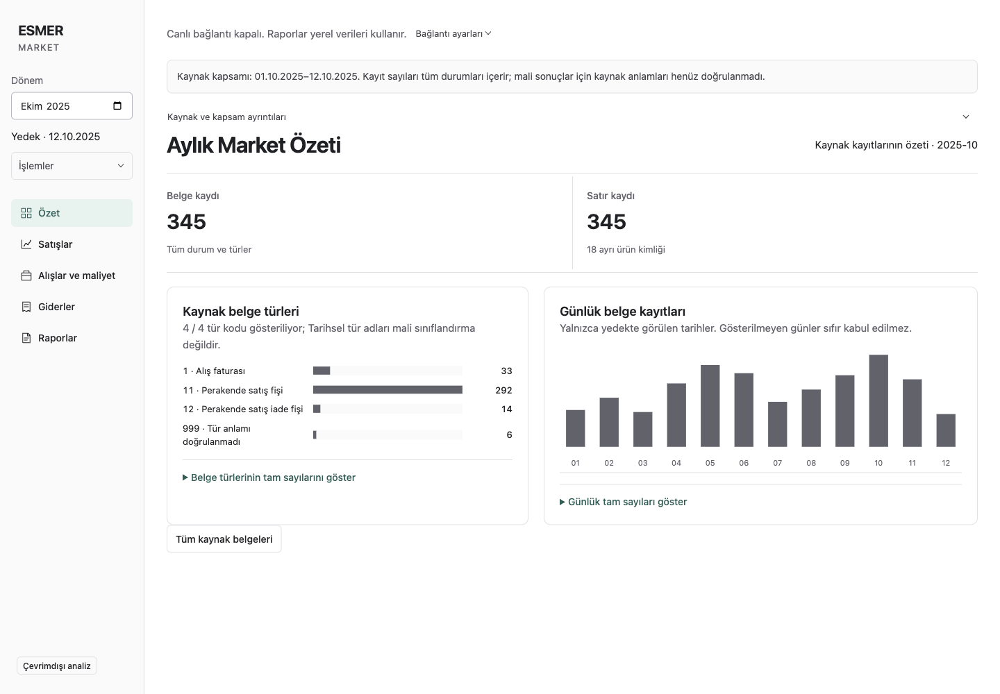

# Owner workspace and financial reporting follow-up

This follows [PR 30](https://github.com/AlesSystems/esmer-market-analytics/pull/30), [issue 26](https://github.com/AlesSystems/esmer-market-analytics/issues/26) R1/R4, and the [page audit](2026-09-26-page-audit.md) at `72996bc`. Target user: Eralp Esmer. Target acceptance areas: DATA-01, REPORT-01, UI-01–04 and UI-06–08; foundation A02/A03/A07 remain evidence gates.

## Work boundary

The user authorized implementation and updating this PR, then separately authorized read-only inspection of the existing isolated restored backup. Production access, owner contact, deployment and merging remain outside this work. Source inspection uses a disposable cold copy; the original remains stopped. Private records and credentials stay outside Git.

The approved visual identity stays intact. The overview uses local source record counts and the existing SVG chart pattern. It does not present raw recorded amounts as net sales or profit. This distinction is part of the product contract, not a presentation preference.

## Observed baseline

Environment: macOS arm64, Node 24.15.0, packaged Electron application already retained from the audit. These failures were observed before the changed runtime was built.

| Contract | Procedure | Expected | Actual baseline |
| --- | --- | --- | --- |
| UI-01 | Playwright `source-workspace.test.ts`, raw-backup case | Accessible daily record chart | Missing image, test failed after 5 seconds |
| UI-07 | Playwright `report-expense-states.test.ts`, history case | Failure/retry instead of definitive empty history | Retry button absent |
| UI-08 | Same test file, embedded expense case | One main landmark | Two main landmarks |

The failures were application behavior, not missing executable or toolchain failures. Test commits are `2143c80` and `a8a5a29`. The financial investigation separately ran four existing integration files (`sales-package`, `sales-reconciliation`, `report-revisions`, `excel-report`); all 24 tests passed against synthetic contracts. That does not verify a real-source financial mapping.

## Routing and proof

The [user-supplied routing diagram](images/owner-workspace-2026-09-26/requested-routing.png) assigns complex source work to Astra Low, ordinary UI implementation to Sol Medium, and independent review separately. Disjoint files permit concurrent investigation and UI work. The coordinator serializes Git mutations, packaging and Electron execution.

The [decision trail](owner-workspace-decisions.tsv) records the choices and proof. Model the Domain kept raw records separate from financial facts; Prove It Works required exercising the packaged application and independently checking the source extraction. The implementation reuses existing source aggregates, report versions and decimal formatting. No chart library or new application dependency is required. Public application screenshots use generated records only; the diagram is the original user attachment.

## Implemented behavior

- UI-01: daily and document-type count charts reuse SVG and local query results. Neutral bars do not imply a financial result. Expandable exact tables retain keyboard access, unknown codes and the 50-type truncation disclosure. Uncovered periods have explicit unavailable copy.
- UI-02/03/06: Turkish dates and decimal separators, readable historical type descriptions, advanced product-ID filter, pagination above and below long tables, and clearing both applied and unapplied filters. Exact raw fields remain in document details. Connection setup is collapsed; offline/stale status and errors remain visible.
- UI-04/07/08: empty expenses lead with Excel import and template access. Failed report history offers retry without claiming the archive is empty. Saved-report open failure remains visible. Embedded expense/report views have one main landmark, and report return restores keyboard focus.
- REPORT-01, partial: raw-only monthly/sales requests report unsupported financial mapping instead of claiming no data was imported. Existing saved reports retain their original dataset, provenance and export path. Real candidate creation remains blocked on DATA-01.

Implementation commits: `34f9614` for shared report readiness; `7d705ec` for expense/report states; `242cf89` for source charts/navigation. Regression contracts: `2143c80`, `a8a5a29`, `984137c`, `2a7eea0`.

## Final verification

Application source/build: `242cf89`. macOS arm64, Node 24.15.0, Electron 44.3.0. Packaged `app.asar` SHA-256: `07a0661e5ae46a92c97ee3f93c6c798de363fc21b9da04a5ae415a98f0c072fc`.

| Procedure | Actual result | Limits |
| --- | --- | --- |
| `npm run test:unit` | 29 passed | Synthetic deterministic contracts |
| `npm run test:integration` | 279 passed, four optional SQL cases skipped | Does not certify financial mapping |
| Full packaged Playwright suite | Initially 30 passed, seven skipped, three failed assertions | Copy/duplicated-element locators needed alignment with the changed UI |
| Focused packaged `source-workspace`, `report-expense-states`, `source-preview` | Five passed, one private case initially skipped | Confirms all three initial failures are resolved and the two review fixes work |
| Packaged actual-backup preview case | One passed | Native import, exact persisted counts, offline restart and disabled live state; no financial activation |
| `npm run typecheck`, `npm run lint`, build, local packaging | Passed | macOS only |
| `node scripts/verify-package.mjs <app.asar>` | Passed, 80 dependency notices | Existing dependency set unchanged |
| Final capture on generated 345-header/345-line fixture | All five pages have one main and no document-level horizontal overflow at 1440×1000; overview inspected at width 800 | Not Windows scaling or full-history performance acceptance |
| Offline private financial oracle | 30 checks passed; receipt hash verified independently by coordinator | Extraction accuracy, not completed-sale semantics |

Across the full run and focused confirmations, **34 distinct packaged checks passed; six conditional checks remain unperformed**. This is not a claim that a second full suite was run. The final post-check runtime change only replaced a chart color literal with the existing `--muted` token; the rebuilt package was recaptured and the actual-backup case passed on it.

The single Impeccable detector pass flagged one advisory for the new color literal. Reusing `--muted` resolved that drift. One batched desktop/compact visual pass and one final confirmation inspected the actual package. No further visual redesign was performed.

Independent cross-review by the two Sol Medium workers covered each other's files, with separate Standards and Spec findings. It found return-focus and uncovered-period copy defects; both were reproduced before fixing, then passed packaged checks. Astra Low independently reviewed application financial boundaries and found no activation/confidence regression. A fresh Sol High/Astra High reviewer could not be spawned because the host's agent-thread limit was reached. These are cross-reviews within the available team, not the exact independent high-reasoning review tier requested in the routing diagram. No new comments or suppressions required cleanup.

## Screenshots and reproduction

All application images below are generated examples, not Eralp's market records. Fixture identity: `synthetic-owner-experience-2026-09-26`. The [capture record](images/owner-workspace-2026-09-26/capture.json) records counts and page checks.



[Sales](images/owner-workspace-2026-09-26/sales-1440.png) · [Purchasing](images/owner-workspace-2026-09-26/purchasing-1440.png) · [Expenses](images/owner-workspace-2026-09-26/expenses-1440.png) · [Reports](images/owner-workspace-2026-09-26/reports-1440.png) · [Compact overview](images/owner-workspace-2026-09-26/overview-800.png)

Reproduce this macOS capture after `npm run package:local`:

```sh
mkdir -p work/poteto/pr30-owner-experience
node_modules/.bin/esbuild docs/evidence/owner-workspace-tools/capture.ts --bundle --platform=node --format=esm --packages=external --outfile=work/poteto/pr30-owner-experience/capture.mjs
node work/poteto/pr30-owner-experience/capture.mjs
```

The capture creates and deletes its own synthetic profile. Private profiles are not inputs. The [routing screenshot](images/owner-workspace-2026-09-26/requested-routing.png) is the original user attachment, included in the PR as requested.

## Remaining acceptance and Windows continuation

**DATA-01 and completed real financial reporting are not delivered.** The [fresh financial investigation](2026-09-26-financial-readiness.md) records the actual blockers and exact next evidence. No real data was relabelled synthetic, no tolerance was invented, and no financial gate was bypassed. Costs and operating profit remain unavailable where evidence is missing.

Continue on `codex/issue-14-live-sync` at or after `242cf89`. On the documented Windows host, pull this branch and run `npm run typecheck`, `npm run lint`, `npm run test:unit`, `npm run test:integration`, `npm run package:win`, and `npm run test:desktop`. Exercise installer and portable builds with generated fixtures, the approved private package, offline restart, error/retry, report return focus, advanced filters, narrow windows and Windows display scaling. Record exact build and machine identity, then update A07 only for checks actually performed. Both distributions remain unsigned.

Full-history capacity, validated financial rules, actual expense completeness, independent recovery acceptance and production approval remain open. Neither the current bounded backup nor these Mac checks close A01–A07 or L01.
