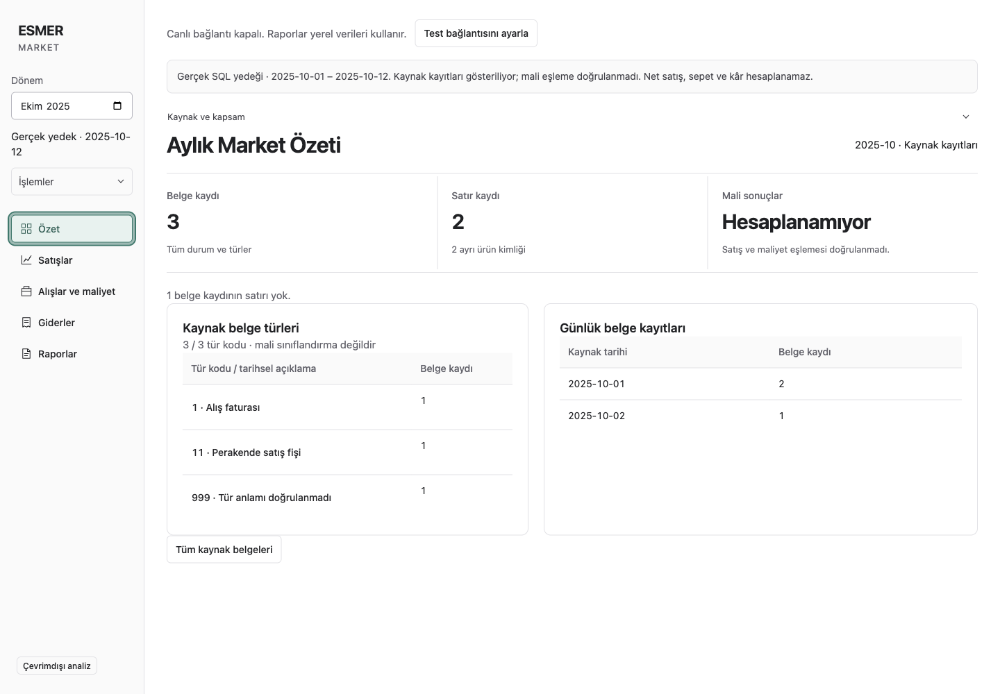
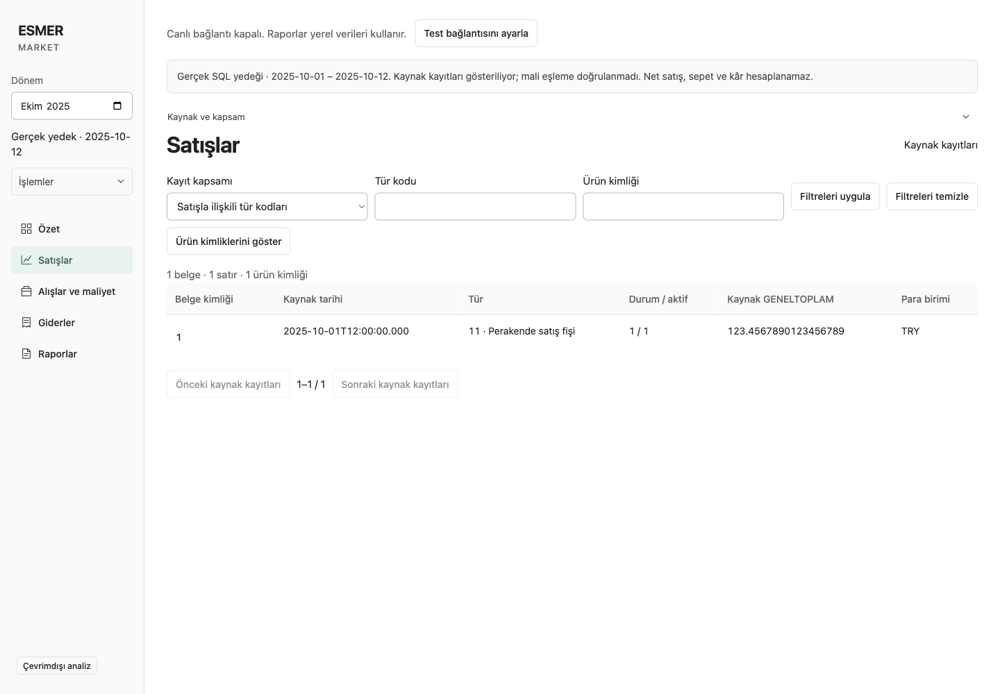
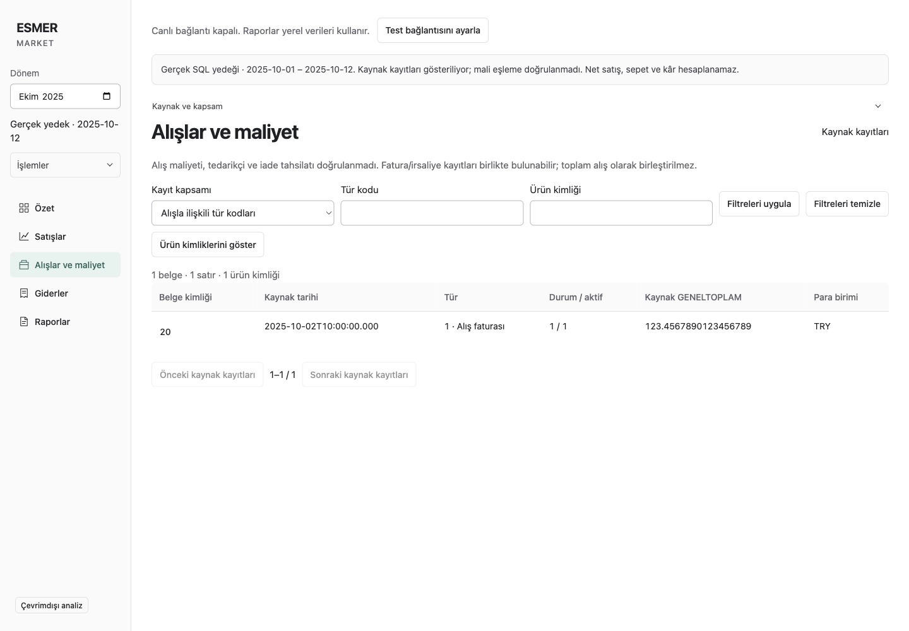
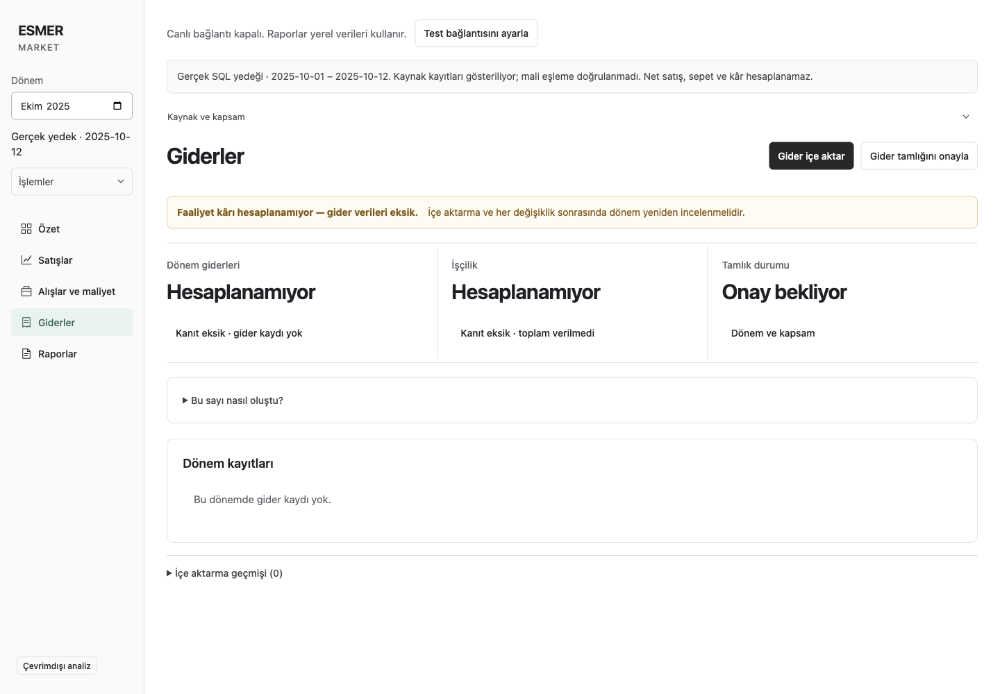
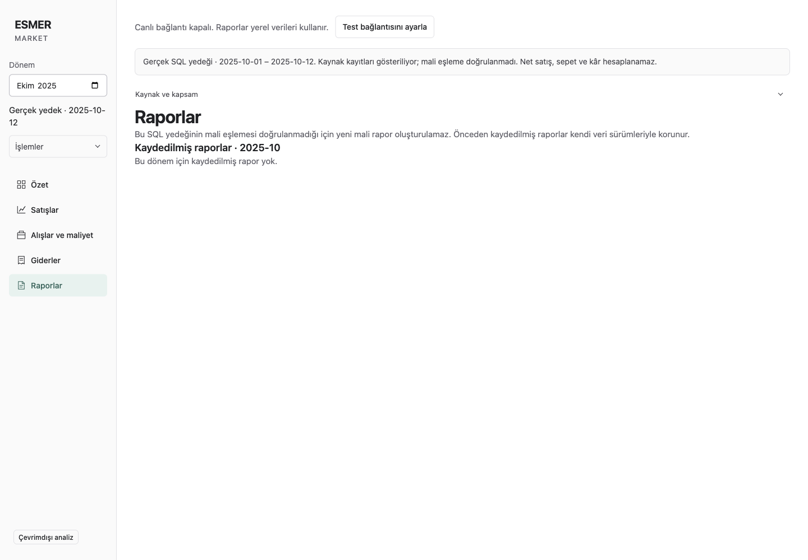

# Page usability audit and real-backup reporting diagnosis

Date: 2026-09-26. Status: analysis and future-update backlog; no application behavior changed.

Method: two independent reviewers — design assessment `/root/page_design_audit`, detector/source assessment `/root/page_evidence_audit` — plus a packaged-app walkthrough and report reproduction by the orchestrator. Assessment A completed before Assessment B findings entered the synthesis.

## Conclusion

The current real-backup experience is a source-record browser inside a business-analysis shell. Navigation is restored, but this does **not** yet deliver the requested working market tracking and reporting experience. Page names imply more financial capability than the imported data path supplies. The largest gap is real-source normalization and reporting; charts and clearer presentation are also needed.

The calm typography, selected navigation, stable period control, and preservation of unknown values are useful foundations. Repeated technical warnings, long raw tables and inactive financial summaries prevent the owner from quickly understanding the business. The report page currently ends in an empty archive, without a useful next step.

## Inspection and evidence

- Branch: `codex/issue-14-live-sync`; inspected HEAD: `447e3c1f615dcc73076f46ed9d10fe41aead672c`; application code/build: `777d744`.
- Packaged Electron 44.3.0, macOS arm64, Node 24.15.0, 1440 × 1000 content viewport. Archive SHA-256: `b71d00c040e34870e4786eadbfa9cfba2a7d197617a90f6a84691593551a5627`.
- Actual batch: `e2731e28-d5b8-418f-b1fe-b955b1c9de5b`, source window 1–12 October 2025. Used a private copy of the retained profile; no renewed SQL access or modification of the original profile/backup.
- All five settled pages captured at viewport and full-page sizes. Real screenshots and raw reproduction output remain outside Git in the existing private evidence directory, under `page-audit-2026-09-26/`.
- Published screenshots below use generated source records, fixture `synthetic-ui-audit`: three headers, two lines. The application's existing “Gerçek SQL yedeği” label describes its raw-package mode; **these published images are synthetic illustrations, not actual market data**. Real screenshots were inspected separately to assess full table density.
- No SVG/canvas charts occur in the active source workspace on any of the five inspected pages. Financial-path charts already exist in `MonthlyOverview` and `SalesWorkspace`; they are not connected to this real-source package.
- Scope: A03/A07 usability observations and issue #14 / [PR #30](https://github.com/AlesSystems/esmer-market-analytics/pull/30) continuation. No foundation acceptance gate is closed by this audit. Windows, screen-reader, keyboard-only, zoom and full-history performance acceptance remain unverified.

## Page-by-page findings

### 1. Özet

**Observed:** “Aylık Market Özeti” shows document/line counts, a large “Hesaplanamıyor” metric, and two tables. Daily patterns and type distributions require reading row by row. Connection status, backup warning and source disclosure precede the title. The actual sample's long tables extend below the first viewport.

**Future update:** Add daily document-count columns and horizontal bars for document types, with the exact tables available underneath. Use the subtitle “Kaynak kayıtlarının özeti” until financial reporting is available. Keep a short cutoff/status line visible; put technical provenance and test-connection setup in details/maintenance.

**Boundary:** Count source records across all included statuses; do not call this sales volume, completed transactions or revenue. Disclose the partial date window, unknown codes and displayed/total type count. The query caps types at 50. Do not fill uncovered days with assumed zeroes.

### 2. Satışlar

**Observed:** The primary view asks for “Tür kodu” and “Ürün kimliği,” then shows internal identifiers, `Durum / aktif`, ISO timestamps and `Kaynak GENELTOPLAM` with long decimal strings. The real sample shows 50 rows before pagination. There are no product names, category breakdowns or business trend views on this path.

**Future update:** Say “Satışla ilişkili kaynak kayıtları” in the current view. Offer observed type codes with historical descriptions in a select; put internal product-ID lookup under advanced filters. Localize dates and decimal separators, right-align numeric columns, and retain exact source precision in details. Put pagination above long tables as well. Product-name/category analysis depends on an expanded, validated projection.

**Boundary:** An internal record ID is not necessarily a receipt/invoice number. Do not turn unknown status codes into approved/paid/completed labels. A raw recorded total is not validated revenue.

### 3. Alışlar ve maliyet

**Observed:** The page title promises costs, but the content is another raw document table. A paragraph explains that cost, supplier and return recovery are not verified. The distinction between purchases, dispatch documents and returns is carried mainly by historical type-code labels.

**Future update:** Use “Alışla ilişkili kaynak kayıtları” for this mode and a compact “Maliyet analizi henüz hazır değil” status. Make the historical document-type filters readable. After real mapping is validated, provide purchase-price history, supplier returns and cost coverage with drilldown.

**Boundary:** Do not combine invoice and dispatch totals, infer supplier credit settlement, or draw cost/spend charts from unvalidated fields. A document-type count chart is possible now; supplier rankings and historical cost curves are not.

### 4. Giderler

**Observed:** The working import action competes with a warning, two large “Hesaplanamıyor” values and “Onay bekliyor.” “Bu sayı nasıl oluştu?” appears when no number exists. No expense rows have been supplied in the retained real profile.

**Future update:** Lead with “Bu dönem için gider kaydı eklenmedi,” “Excel’den gider ekle” and access to the template. Rename the completeness action to “Giderlerin eksiksizliğini incele.” Keep the required operating-profit warning, but condense repeated unavailable states. Show expense-category bars and period trends only when actual classified expense records exist.

**Boundary:** Expense data and completeness confirmation are separate. Importing the SQL backup does not provide either automatically; missing expenses must not become zero.

### 5. Raporlar

**Observed:** One paragraph says this backup cannot create financial reports; “Kaydedilmiş raporlar · 2025-10” then says no saved reports exist. Most of the page is empty. There is no create action, readiness checklist, alternative-period suggestion or contextual route back to useful data.

**Future update:** Distinguish three states: no saved report, financial data not ready, and service/read failure. Explain the missing prerequisite in plain Turkish and provide an appropriate action. Present saved versions with period, source cutoff, status and export action. Keep graphs inside the selected report, not in an empty archive.

## Why reports are unavailable

### Reproduced result

| Operation on copied real profile, October 2025 | Actual result |
| --- | --- |
| Open all five destinations | Successful |
| `listReportVersions({period:"2025-10"})` | `status:"history"`, zero saved reports |
| `openMonthly({period:"2025-10"})` | `status:"unavailable"`, `code:"EMPTY_STORE"`, “Henüz veri içe aktarılmadı.” |
| `openSales({period:"2025-10"})` | Same `EMPTY_STORE` result |

The rendered Reports page in this build says that new financial reports cannot be created and that there are no saved reports. It does not literally display the English word “unavailable”; that is the service result reproduced separately. No service crash was observed in this successful-history scenario.

### Root cause, traced through the code

1. [Raw package contract](../../src/source/raw-package.ts) is `sql-backup-preview-v1`, with `sourceReconciled:false`.
2. [Store import](../../src/store/store.ts) writes `source_preview` and returns `preview-imported`. It does not activate a normalized financial dataset.
3. [App selection](../../src/ui/App.tsx) opens `SourceWorkspace` when a raw source package exists. Its report destination renders [SavedReports](../../src/ui/reports/SavedReports.tsx), which lists/reads/exports existing accepted reports and contains no new-report creation workflow.
4. [Report versions](../../src/reports/versions.ts) routes monthly creation through `SalesReports.open`. [Sales query](../../src/reports/query.ts) returns `EMPTY_STORE` when the active financial snapshot has no metadata/dataset ID. The raw records are stored elsewhere, so this condition is true despite their successful import.
5. [Financial package contract](../../src/source/package.ts) currently requires synthetic provenance and supported synthetic mappings. There is no production real-backup financial mapping to switch on in this build.

**Diagnosis:** An incomplete real-data integration, plus misleading capability/error presentation. Restarting, importing the same raw package again or enabling live connectivity will not complete the missing normalization contract. It is not safe to label real rows synthetic to bypass it.

The report engine does have implemented version review, preservation and export paths. Focused tests below pass with supported fixtures. They do not prove real-market financial correctness. Real reporting requires validated sale identity/status, returns and document-conversion treatment, dates, units, discounts/KDV, and independent reconciliation. Cost/profit additionally require historical cost and expense evidence. Validated sales can become useful before profit is available; avoid making every feature wait for complete profitability.

## Label proposals

These are proposals, not implemented or newly validated business definitions.

| Current wording | Proposed wording / behavior |
| --- | --- |
| Mali eşleme doğrulanmadı | Satış ve maliyet hesapları için kayıtların anlamı henüz doğrulanmadı. Put the detailed explanation behind “Ayrıntılar.” |
| Kaynak GENELTOPLAM | Kaynak belge tutarı · doğrulanmadı. Keep `GENELTOPLAM` and exact value in detail. |
| Tür kodu | Belge türü (kaynak kodu), with observed options and historical-description caveat |
| Ürün kimliği | Ürün kayıt ID’si; explain that this package has no product names |
| Durum / aktif | Durum kodları; explain that their business meaning is unverified |
| Gider tamlığını onayla | Giderlerin eksiksizliğini incele |
| Bu sayı nasıl oluştu? (empty expenses) | Gider hesabı ve kapsamı |
| Henüz veri içe aktarılmadı (raw records exist) | Yedek kayıtları yüklendi; mali rapor için doğrulanmış satış verisi henüz hazır değil. |
| Raporlar (archive-only content) | Kaydedilmiş raporlar, with readiness state and next action |

## Additional defects found

| ID | Severity | Evidence | Future regression contract |
| --- | --- | --- | --- |
| UI-06 | P2 | Packaged reproduction: starting with no applied product filter, type a draft ID, click “Filtreleri temizle”; draft text remains. `SourceWorkspace` only resets drafts when applied query values change. | Clear removes both applied filters and unapplied draft text. Cover both cases. |
| UI-07 | P2 | Source inspection: `SavedReports` initializes history to `[]`; history failure sets a message, then renders “Bu dönem için kaydedilmiş rapor yok.” as well. This failure branch was not injected in the packaged app. | A failed history request shows failure/retry, never a definitive empty-history claim. Successful empty and populated lists remain distinct. |
| UI-08 | P2 | Rendered expense page has two nested `main` landmarks; screenshot locator exposed both. Opening `MonthlyOverview` within the source report wrapper has the same nesting in source. | One main landmark per page; verify expenses and an opened saved report, then test navigation focus. |

## Priority and acceptance backlog

| Order / ID | Priority | Future slice | Done when |
| --- | --- | --- | --- |
| 1 / DATA-01 | P1 | Validate and implement real-source financial normalization | Authorized isolated source evidence supports a versioned real mapping; independent oracles reconcile sales/returns/conversions; real provenance passes through import, offline UI and export. Unknown cost/profit remains explicit. |
| 2 / REPORT-01 | P1 | Make report readiness and creation understandable | Empty, blocked, failed and ready are separate states with correct next actions; a real candidate can be reviewed, saved, reopened offline and exported with matching figures once DATA-01 is ready. |
| 3 / UI-01 | P1 | Give Özet useful visual comparison | Daily/type record charts reconcile exactly to tables, preserve partial coverage, handle empty/unknown/truncated types, and have accessible labels/table alternatives. Reuse existing SVG patterns. |
| 4 / UI-02 | P1 | Clarify source view names, filters and table labels | An owner can identify the period, current scope, record type and amount limitations without schema knowledge. Dates/numbers are readable; exact detail remains available. |
| 5 / UI-03 | P2 | Reduce repeated status text | One concise status/cutoff area; details remain reachable; primary content is visible early. Isolated test setup moves into maintenance. |
| 6 / UI-04 | P2 | Make expense/report empty states actionable | Relevant import/template, period or source-summary action exists; no unsupported zero/absence claims. |
| 7 / UI-06–08 | P2 | Fix the identified interaction/accessibility defects | Focused contracts in the defect table pass against the packaged application. |
| 8 / DATA-02 | P1 | Expand useful product/purchasing analysis and history | Approved name/category/supplier/unit/cost projection and full-history capacity have independent evidence; charts use appropriate populations and units; Windows latency is measured. |

P1 = major obstruction to the intended owner task; P2 = material usability or recovery defect. This backlog is documentation, not authorization to copy excluded legacy features or claim completed acceptance.

## Comparison with the reference project

Inspected [EsmerMarketAccounting](https://github.com/AltanEsmer/EsmerMarketAccounting) at `dd01c27b8ff08b714014e5e02213e36de9a7a8a0` through GitHub read-only APIs. Its [dashboard source](https://github.com/AltanEsmer/EsmerMarketAccounting/blob/dd01c27b8ff08b714014e5e02213e36de9a7a8a0/frontend/src/pages/Dashboard.js) contains revenue-trend, category-distribution and top-product charts, plus low-stock/recent-invoice sections. The tree includes Products, ProductDetail, StockHistory, Invoices, Iade and NetKar pages. This supports the user's expectation of visible business analysis; it does not establish that the old calculations work correctly. The legacy app was not run.

| Desired quality | Current rebuild gap | Direction within the approved product |
| --- | --- | --- |
| Understand performance at a glance | Raw counts and tables dominate | Validated financial KPIs/trends with period and coverage; useful count charts now |
| Find products and investigate changes | IDs only in current projection | Named products/categories, unit-aware drilldown and price/cost history after validation |
| Track purchases and supplier returns | Raw type groups, no verified settlement/cost | Validated purchasing links and distinct physical return/credit evidence |
| Save/export usable reports | No real financial dataset | Complete DATA-01 → REPORT-01 with reproducible saved versions |
| Better UI | Technical vocabulary and repeated caveats | Task-oriented Turkish, compact status, charts plus precise drilldown |

The foundation intentionally excludes POS write-back, login/roles, customer analytics, employee payroll, multi-currency and statutory accounting. The reference README advertises a broader system; those claims do not silently expand this rebuild's contract. No legacy code, migrations or Git history were copied.

## Heuristic assessment

Scores are qualitative design judgments, 0 poor to 4 excellent, not accessibility certification.

| Nielsen heuristic | Score / 4 | Main issue |
| --- | --- | --- |
| Visibility of system status | 3 | Visible, but competes with the task |
| Match with real world | 1 | Database vocabulary and overpromising page names |
| User control | 3 | Navigation/back/reset exist; reset edge case found |
| Consistency | 2 | Shared shell, inconsistent raw date/number presentation |
| Error prevention | 3 | Unknowns preserved, invalid filters insufficiently explained |
| Recognition over recall | 2 | Codes and IDs require prior knowledge |
| Efficiency | 2 | Long tables and bottom-only pagination |
| Minimalist design | 2 | Repeated warnings and oversized unavailable values |
| Error recovery | 2 | Weak next actions and conflated failure/empty state |
| Help and documentation | 2 | Explanations are technical rather than task-oriented |
| **Total** | **22/40** | Significant usability work remains |

Cognitive load: the filter strip presents six controls at once; technical IDs require memory. Stable five-item navigation is not itself a reason to redesign the shell. The first-time owner experiences a promise of insight followed by warnings and raw records; Reports ends without a next action. A returning reviewer must traverse long tables and remember codes. A screen-reader user faces nested landmarks; focus behavior still needs a dedicated pass.

## Verification results and limits

- Five settled real-profile pages plus five synthetic equivalents were captured and visually inspected. Earlier captures caught transient loading and were replaced. A temporary screenshot script first hit a strict locator error because Expenses has two main landmarks; the capture locator was narrowed. A later synthetic screenshot timed out during overlapping Electron activity; sequential foreground recapture completed. These are capture-process observations, not report-calculation failures.
- Report API reproduction: exact statuses shown above, in both real-copy and raw synthetic profiles.
- `npm run test:integration -- tests/integration/report-revisions.test.ts tests/integration/excel-report.test.ts tests/integration/report-display.test.ts`: **17 passed**.
- `ESMER_EXECUTABLE=<packaged Mac executable> node_modules/.bin/playwright test tests/desktop/source-workspace.test.ts --workers=1`: **2 passed**. Covers preserved report opening and source failure maintenance access with generated fixtures.
- Separate packaged draft-clear probe: expected empty input; actual draft retained. Documented UI-06, not fixed in this analysis.
- Impeccable detector over `SourceWorkspace.tsx`, `SavedReports.tsx`, `ExpensesWorkspace.tsx`: **exit 0, zero findings**. Manual inspection found issues beyond the detector's rules.
- No new package, source access, migration, financial calculation or runtime UI change. No build/typecheck/lint rerun is needed for this documentation-only change. Diff and local-link checks are required before commit.
- Windows acceptance, full-history import, real financial reconciliation, actual expense completeness and future UI changes remain open.

Related requirements: [foundation specification](../superpowers/specs/2026-09-04-esmer-market-rebuild-design.md), [source audit](../superpowers/specs/2026-09-04-esmer-market-rebuild-audit.md), [acceptance checklist](../superpowers/specs/2026-09-04-esmer-market-rebuild-acceptance.md), [implementation plan](../superpowers/plans/esmer-market-implementation-plan.md), and [previous all-page evidence](source-workspace.md).
