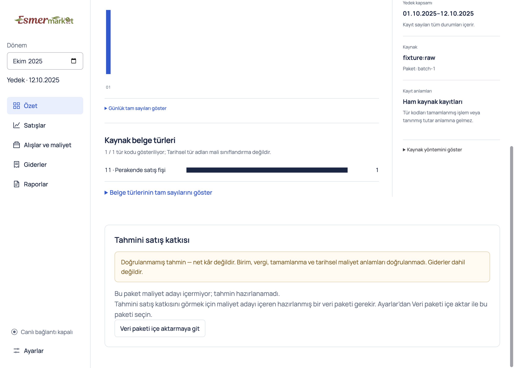
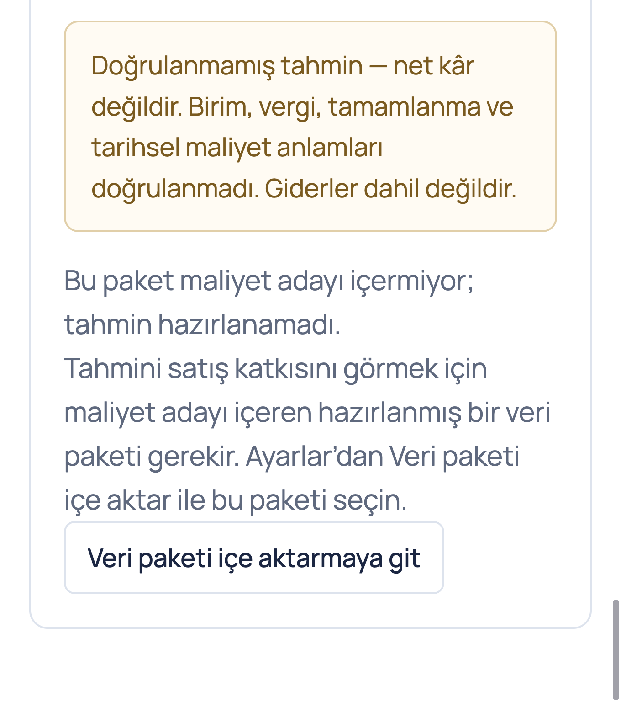

# Recover an unavailable sales estimate

Gate `ESTIMATE-RECOVERY-20261004`. The unavailable **Tahmini satış katkısı** state now explains the required prepared cost-candidate package and offers **Veri paketi içe aktarmaya git**. The action opens the existing Settings importer. The owner still needs that package to see a contribution.

This implements the recovery improvement from the [screenshot investigation](https://github.com/AlesSystems/AlesSystems-Workstreams/blob/main/Esmer%20Market%20Analytics/findings/2026-10-04-estimated-sales-contribution.md). The [recorded estimate contract](../contracts/recorded-estimates.md) remains authoritative. Related historical issues are [#39](https://github.com/AlesSystems/esmer-market-analytics/issues/39) and [#40](https://github.com/AlesSystems/esmer-market-analytics/issues/40), whose closed original objectives were superseded by estimate-first V1.

## Recovery procedure

1. In the unavailable estimate section, activate **Veri paketi içe aktarmaya git**.
2. In **Ayarlar**, activate **Veri paketi içe aktar** and select the prepared package containing cost candidates.
3. After a valid import, inspect the selected month, covered contribution, coverage, exclusions, returns, and source method.
4. Restart the same profile and verify the imported package remains available. Reselect the month if needed.

Cancellation and rejected input retain the active package. A later valid preview import replaces the current source package and removes estimate capability, as the existing contract prescribes. A preview alone cannot reconstruct missing cost candidates.

## Implementation boundary

`SourceEstimate` now retains the typed query response separately from export feedback. Only `source-unavailable` with `ESTIMATE_UNAVAILABLE` offers the recovery action. The existing `AppFrame.show("settings")` owns navigation and focus. Missing-frame mounts do not display an inert action. New requests clear the response; the existing sequence guard rejects late replies.

A supported estimate with null costs remains a report with **Bilinmiyor** and its exclusions. Stale-source responses and service failures retain their own messages. The renderer neither checks package schemas nor calculates money. Formula, package schema, IPC, source preparation, atomic import, and financial-report rules have no changes.

Two independent design candidates and an independent judge selected this narrow UI recovery path. A new retained-data converter would still need cost operands and an import. Renewed SQL reads cannot recover costs from the active preview without a separate source task. Both alternatives were excluded from this fix. Design and review used one model family.

## Red and green evidence

Application base `47677c682222da6d88e22b8c99180a1833d615b9`. Branch `codex/fix-estimate-package-recovery`. Regression commit `ae5f350` precedes implementation commit `361ff85`. Environment Darwin 27.0.0 arm64, Node 24.15.0, npm 11.12.1, Electron 44.3.0. Packaged archive SHA-256 `74d4f4c3a2bb2247ada8e22b8b5b442f2b6479320e5ae515640183e6b7996ec8`.

The new packaged regression first ran against the old packaged base with `ESMER_EXECUTABLE` and `npm exec -- playwright test tests/desktop/source-estimate.test.ts -g 'preview estimate recovery'`. It failed for the missing action.

```text
Error: expect(locator).toBeVisible() failed
Expected: visible
Error: element(s) not found
1 failed
```

After implementation, `npm run test:desktop -- tests/desktop/source-estimate.test.ts` rebuilt the package and reported `2 passed`, with one private-data opt-in skipped. The regression uses synthetic matching source identity across preview, supported estimate, and null-cost estimate. It proves keyboard recovery, Settings heading focus, return focus, cancellation, corrupt-package preservation, September selection through valid import, contribution `-20,00 ₺`, restart, preview replacement, and null-cost exclusions without recovery.

| Check | Result |
| --- | --- |
| `npm run typecheck` | Passed |
| `npm run lint` | Passed |
| `npm test` once at final implementation | 50 unit, 325 integration, and 86 packaged desktop passes |
| Unperformed opt-in/platform checks in full suite | 14 integration and 11 desktop skips |
| Build and local package through desktop script | Passed, unsigned Mac executable |
| Impeccable detector over `src/ui/SourceEstimate.tsx` | No findings |
| Normal and compact 200% visual inspection | Recovery text and full action visible; no horizontal overflow |
| Independent task-local packaged negative-state probe | Six checks passed, including compact 125% keyboard/focus, structured stale/read failures, and late prior-month replies |

Full-suite source/private opt-ins were removed from that command's environment. No SQL source, retained private operands, owner profile, credentials, or real package was opened. Existing locked dependencies were reused through a task-local symlink. Packaging reported dependency-path warnings and skipped signing. These results establish synthetic Mac behavior, not Windows or real-source acceptance.

The first compact Playwright screenshot was blank despite DOM visibility assertions. One final batched capture waited for the zoom state and paint, then used `webContents.capturePage` with its own window focused. The resulting images show the rendered recovery. That capture briefly overlapped the desktop suite before serialization guidance arrived; both completed successfully. No additional visual iteration was run. The blank capture is not retained as product evidence.

## Independent review

Standards and Spec reviewers each reported zero actionable findings against base `47677c6` and implementation/evidence head `0221df1`. Standards checked repository rules, all twelve code-review smell heuristics, screenshots, links, and hashes. Spec checked the selected recovery contract and independently drove six packaged checks. A stale-source response with the same message as the preview, a generic unavailable response, and a rejected read all omit recovery and guidance. A late unavailable reply for the previous month cannot restore obsolete recovery. Compact 125% keyboard activation, Settings focus, return focus, and overflow checks passed. No code repair was needed.

No-comments found zero comments or suppressions to remove. Deslop found no casts, redundant guards, or new abstractions in the diff. The task-local review reports and negative-state probe are retained with the other rerun aids. Reviews used one model family.

## Screenshot provenance

Both images are synthetic captures of the packaged implementation `361ff85`, with the restricted `rawSnapshot()` fixture, lineage `fixture:raw`, extraction `batch-1`, and an isolated disposable profile. The capture date is 2026-10-04. Requested normal window size is 1180×1000 at 100% zoom, with captured content 1180×845. Requested compact window size is 680×800 at 200% zoom, with captured content 680×768, or 340×384 CSS pixels. Window chrome and available screen space limit the captured content height. These are the two final visual captures, with no image edits.





The screenshot hashes are recorded in [SHA256SUMS](estimate-package-recovery/SHA256SUMS). Temporary rerun aids and logs remain under `/tmp/esmer-estimate-fix-20261004`, including `red.log`, `focused-green.log`, `full-suite.log`, `capture-recovery.mjs`, `capture-confirm.log`, `spec-negative-probe.mjs`, and `spec-negative-probe.log`.

Windows packaged recovery, native manual file dialogs, real package availability, the screenshot's actual profile/build, and deployment remain unperformed. The implementation PR is the requested handoff boundary.
