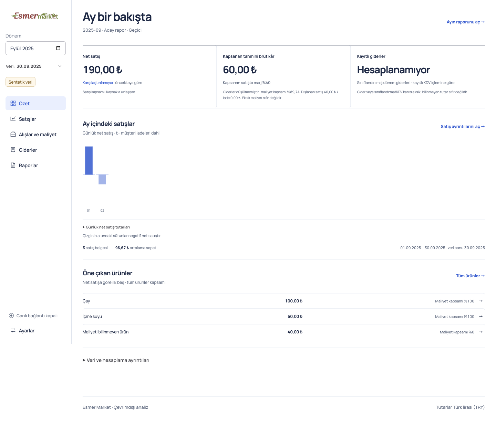
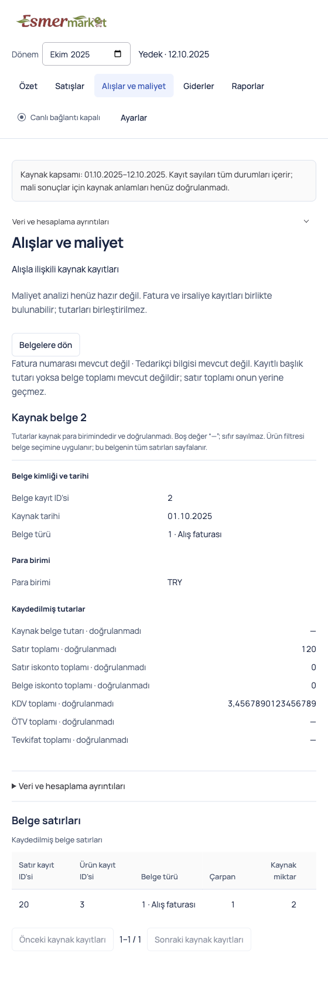

# Issue 72: business navigation simplification

The user approved the representative UI and [implementation plan](../superpowers/plans/2026-10-06-issue-72-simplification.md) on 2026-10-06, then authorized implementation and PR creation for [#72](https://github.com/AlesSystems/esmer-market-analytics/issues/72). Five business pages now share one remembered month. Substantial details have their own content view and restore the originating list. The current white, cobalt and Manrope system and the existing Settings layout remain.

## Build and boundaries

Application/test commit: `7ba289141899fda18306e2a7f4daa0aba335d42d`. Branch: `codex/issue-72-simplification`. Base: main `afe93cdd1abe5f127240d761a6174aaa1c172e8f`. Verified origin: `https://github.com/AlesSystems/esmer-market-analytics.git`. A native attached worktree isolates this change; unrelated primary-checkout output and other worktrees were preserved. Documentation and evidence are a subsequent separate commit (`407abae`), followed by this delivery receipt. [PR #73](https://github.com/AlesSystems/esmer-market-analytics/pull/73) targets main and is open for review.

Environment: macOS 27.0 arm64, Node 24.15.0, npm 11.12.1, Electron 44.3.0. Fixtures are synthetic: `productProfitRecords`, legacy sales mapping, purchasing snapshots, `rawSnapshot`, prepared estimate packages, app-owned expense profiles and saved v1/v2 reports. Visual fixtures add fabricated P1/EMPTY purchase documents and `purchase2`. No identifying records or credentials appear in captures.

No renewed source inspection, opt-in SQL execution, production access, owner contact/installation or merge occurred. No dependencies, SQLite migration, calculation version, report format or source allowlist changed. This receipt does not pass real-source financial, full-volume, Windows A07 or owner acceptance gates.

## Implemented contracts

- Özet shows sales/comparable change, covered gross before operating expenses, classified recorded expenses, daily sales and product highlights. The full monthly report opens in Raporlar. Recorded expenses use the existing classified summary; owner contributions, loans and transfers do not become operating expenses.
- Satışlar starts with its summary and searchable products. Categories, year comparisons, transactions, returns and exclusions remain accessible. Product and transaction detail replace the primary content instead of appearing beneath the entire list.
- Alışlar ve maliyet retains purchasing, supplier returns, replacement costs, stock/waste and exclusions. Faturalar browses retained supported invoices, including empty and unsupported documents. Missing serial, supplier and header totals remain explicit. Available lines cannot substitute for a recorded header total. Linked dispatches retain their dates and unchanged deduplication.
- Giderler has one manual-entry and one Excel-import action. Drafts, preview, validation, duplicates, corrections, completeness, history and locked-operation protection remain. Unavailable source periods do not disable local expense records.
- Raporlar starts with the selected month and retains review, immutable versions, comparisons and complete Excel export. Archived detail shows its saved month and provenance. Unknown or failed history reads do not claim a known empty archive.
- Ayarlar explains actual provenance and verification for the two data views. Synthetic financial data is labelled accurately. Imports, connections, recovery and display controls keep their approved layout.
- Technical identifiers and calculation evidence start collapsed under `Veri ve hesaplama ayrıntıları`. Material costs, exclusions, incomplete expenses, unknowns, actual currency and unverified estimates remain beside their results. Exact recorded strings remain available.

The root owns a validated `YYYY-MM`. First use selects the latest actual dated record month, separately from the extraction cutoff; empty datasets require a choice. A saved unavailable month stays selected. Legacy text-size-only preferences remain valid. Field patches merge inside the existing serialized write queue, so concurrent month and text-size changes cannot erase each other. Failed persistence explains restart behavior and permits retry.

All protected departures precede page/month/mode changes and preference writes. Hidden pages retain state and expense guards but do not query, take focus or handle Escape. Matching completed reads and details survive Settings. Cancelled invoice reads settle busy state; linked detail stacks advance only after owned successful responses. Return receipts restore filters, sort/page, both table axes, window position and visible opener focus, with a heading fallback. Nested evidence returns to its immediate parent.

Financial context and recorded hashes remain authoritative. Delayed, failed or replaced-source responses cannot put old totals under a new title. Replaced recorded captures close old detail; an explicit selection is required. Same-source refresh preserves appropriate list context; different lineage/database cannot reuse unrelated identifiers. The readonly `queryPurchaseDocuments` and `inspectPurchaseDocument` IPC operations validate sender, payload and pinned context, use retained local snapshots and bound pages to 50 rows. The renderer gains no Node, database or arbitrary SQL access.

## Verification

Final results at `7ba2891` are recorded with build and log SHA-256 identities in [verification.json](issue-72/verification.json).

| Procedure | Expected | Actual |
| --- | --- | --- |
| `npm test` | Unit, integration and actual packaged desktop regressions pass | Exit 0: 53 unit, 346 integration, 102 packaged macOS desktop passed |
| Gated cases | Remain distinct from passing evidence | 14 integration and 11 desktop skipped; private/opt-in/platform/lifecycle gates stay open |
| `npm run typecheck` and `npm run lint` | No static failures | Both exit 0 |
| Build and `package:local` within desktop runner | Launch the actual packaged app | Passed; macOS arm64 ASAR tested |
| `npm run package:win` | Build installer and portable distributions | Exit 1: bundled Intel `makensis` cannot spawn on this ARM host, system error -86 |
| Independent `verify-package.mjs` on final Windows unpacked ASAR | Notices present | `PACKAGE_NOTICES_OK 80 dependencies` |
| Independent release inventory on final Windows unpacked payload | No prohibited payload entries | 87 files, 3079 archive files, zero violations |

The final macOS and partial Windows ASAR both have SHA-256 `62489d4d20da68a61f3cfdbf4d4f8d0a2f97b1e3999b0139989fc44e8469d81b`. The Windows unpacked payload is not installer, portable-distribution or runtime acceptance.

Tests first exposed missing preference/month/invoice/navigation contracts. Subsequent full runs exposed stale raw detail expectations, source result loss through Settings, failed-month recovery ownership and a delayed report-response journey. These were diagnosed and repaired; named stages preserve the response journey's assertions and timeout. Independent review then exposed lifecycle gaps, followed by regressions and repairs. A final failure distinguished unknown history from successful empty history; the archive now mounts after its first successful history read and remains retained. Earlier failed logs are preserved locally rather than represented as passing runs. Final receipts identify the successful logs under ignored `work/issue-72/`; these synthetic logs remain in the attached worktree.

## Nine task walkthroughs

These are automated working-application journeys with synthetic fixtures, not evidence that Eralp performed the tasks without coaching. Actual owner usability and acceptance remain open.

| Issue task | Packaged evidence | Result |
| --- | --- | --- |
| Understand monthly performance and qualifications | `business-navigation`, `ozet-control-desk`, `source-estimate`, `product-profit` | Passed |
| Find a product and inspect its sales | `product-detail`, `sales-drilldown`, `business-navigation` | Passed |
| Find an invoice and available lines | `purchase-documents`, `purchasing`, `source-workspace`, `navigation-lifecycle` | Passed |
| Add/import expenses | `manual-expenses`, `expenses-control-desk`, `expenses`, `workspace-subviews` | Passed |
| Open/export monthly report | `product-profit`, `reports-control-desk`, `report-version-comparison`, `product-detail` | Passed |
| Identify page/subpage and month | `business-navigation`, `workspace-subviews`, detail journeys | Passed |
| Return with list context | `product-detail`, `sales-drilldown`, `purchase-documents`, `source-workspace`, `navigation-lifecycle` | Passed |
| Share month across pages and restart | `business-navigation`, `settings` | Passed |
| Reach secondary tools without crowding first view | `workspace-subviews`, `purchasing`, `reports-control-desk`, `settings` | Passed |

## UI and independent review

Two production visual rounds covered 20 safe captures: initial inspection and one confirmation at `f4c66e7`. Later changes through `7ba2891` repair request/return lifecycles, the old purchasing technical disclosure and unknown-history handling; these screenshots are not recaptured final-head proof. All 20 confirmed captures had no page errors or document overflow. Dense tables scroll within their own regions. Packaged tests cover keyboard focus, hidden-page behavior, Turkish text, text-size persistence, narrow windows, empty/unavailable/loading/failed periods, source replacement, archived identities and exports.

The [capture receipt](issue-72/working-visual-receipt.json) identifies fixtures and widths. The final [native zoom receipt](issue-72/native-zoom-receipt.json) verifies BrowserWindow zoom factor 2, inner/client/scroll width 720, and navigation/metric bounds at or below 700. The canonical 200% image is that native viewport capture. Emulated viewport and queued preference-write setup failures were corrected before accepting it. The mechanical UI detector ran once: 12 advisories all concern unchanged incumbent CSS; no new token/palette cleanup was added.

| Review axis | Original finding | Resolution / final limit |
| --- | --- | --- |
| [Standards](issue-72/standards-review.md) | One P2: hidden invoice requests left permanent busy state | Resolved at `bc3d426`, bounded recheck through `de4a5e5`; final two commits change archive empty-state ownership only. No unresolved finding in reviewed scope |
| [Spec](issue-72/spec-review.md) | Three P2: saved-detail loss, linked purchasing parent loss, expanded technical metadata | All resolved; bounded follow-up includes `7ba2891` |
| [Comments/suppressions](issue-72/comment-review.md) | Zero added/changed comments or suppressions | Final gate at `7ba2891`: zero deletion targets and MUST KILL flags |
| [Capture UX](issue-72/ux-review.md) | No additional material visual defect | Bounded safe capture review; no Windows or owner claim |

Standards and Spec were independent from the application writer and from each other's original review. They used the same GPT-6.1 model family; this is not a cross-family review. Original findings are retained separately rather than reranked. All repaired behavior has final full-suite coverage.

Representative captures:

The remaining captures under `issue-72/` cover sales, products, transactions, purchasing, financial invoices, expenses, reports, Settings, unavailable months, source overview/invoices and native 200% zoom. No shipping raster asset was added.

## Execution state and Windows continuation

N01 design/user review, N02 behavioral contracts, N03 implementation, N04 local integrated verification and N05 independent review are completed. N06 documentation/integration is completed with this receipt and [PR #73](https://github.com/AlesSystems/esmer-market-analytics/pull/73). Local N04 completion records the attempted Windows packaging and open gates; it does not certify Windows acceptance. Small Conventional Commits retain the test/implementation/regression sequence; no unrelated cleanup is included.

Use branch `codex/issue-72-simplification`, application build `7ba2891` or the later documentation-only PR head, on a supported Windows x64 environment:

1. Run `npm ci`, `npm run typecheck`, `npm run lint`, `npm test` and `npm run package:win`. Confirm installer and portable distribution checks, notices and inventory succeed; record actual artifact hashes.
2. Launch both distributions with isolated synthetic profiles. Verify offline operation, restart and remembered month, both data views, protected expense cancel/locked operations, source replacement, coherent delayed/failed reads and unavailable periods.
3. Repeat the nine task walkthroughs, nested returns, search/filter/sort/page and both-axis position/focus restoration. Check saved v1/v2 identity, review, complete exports, imports, duplicates, recovery and text-size settings.
4. Check actual Windows keyboard behavior, narrow windows and 100/125/150/200% scaling. Record environment, commands, expected/actual results and safe screenshots against the exact build.

Full-volume/source-semantic proof and Eralp's own acceptance remain separate. Owner installation and production source access require their own direction. This PR does not merge or authorize those actions.
