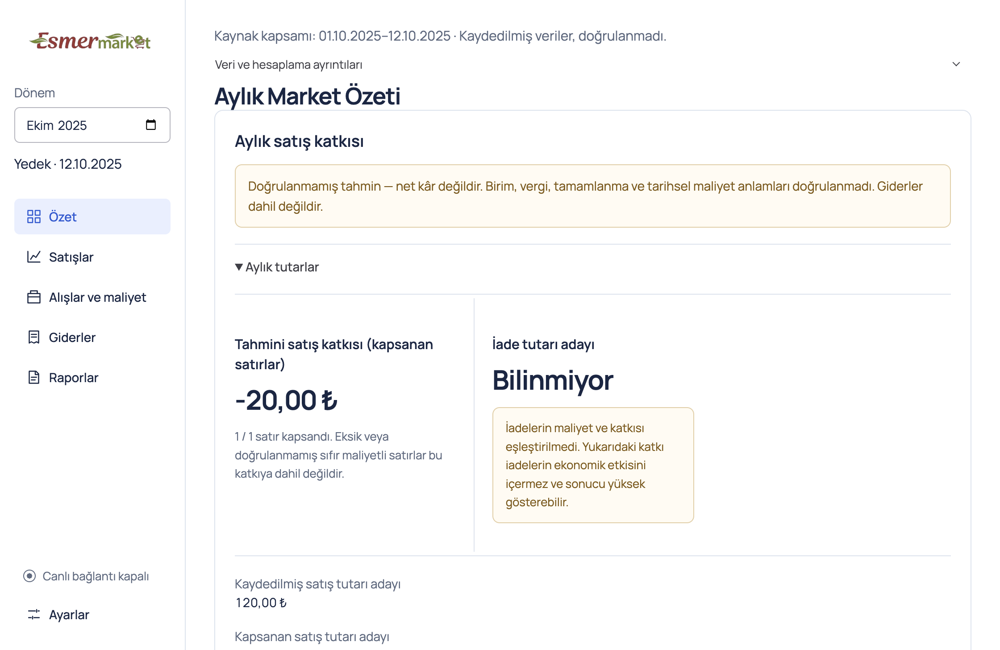
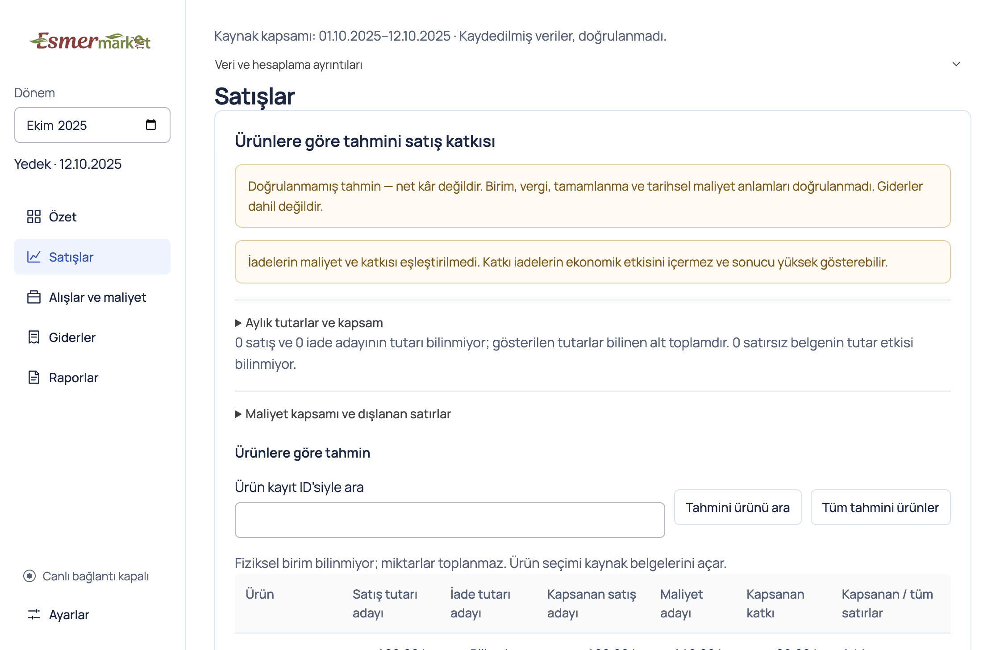
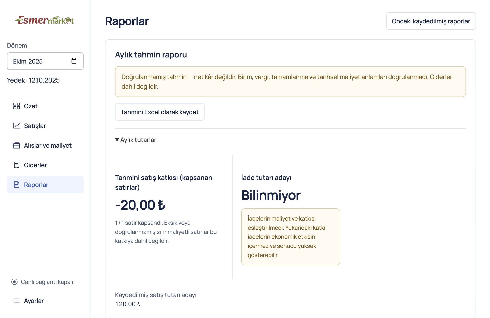

# v0.5 Mac demo evidence

[Issue #75](https://github.com/AlesSystems/esmer-market-analytics/issues/75), [approved scope and work contracts](../superpowers/plans/2026-10-09-v0.5-demo.md), [Turkish presentation guide](../operations/demo-v0.5-tr.md).

## Build and scope

User direction on 2026-10-09 selected the existing imported Esmer records, one consistent UI, and this Mac for the presentation. The existing `analytics.sqlite` remains the sole local database. Imported source records automatically govern the business pages, including empty imported packages. Financial-only compatibility and accepted report history remain available without a dataset selector. No schema, financial formula, source field, source permission or dependency version changed.

Branch: `codex/v0.5-demo`, based on `46f654b`. Contract test `7790f00`; UI implementation `ef78944`; boundary coverage `2561069`; platform test resolver `f716e28`. Packaging contract `6d15004`, implementation `89b72a3`, framework link boundary `bdcbbc9`.

Environment: macOS 27.0 (26A428), Mac16,8, Apple Silicon arm64, 24 GiB memory; Node 24.15.0, npm 11.12.1, Electron 44.3.0. These results are local Mac evidence.

## Verification

Final acceptance continues on 2026-10-10 after the interrupted review repair. The initial contract tests failed because the view selector remained and an empty imported source could expose synthetic financial data. The implementation passed the focused source, archive, import, export, expense and recovery contracts. The first complete suite found archive lifecycle and transient financial workspace unmounting regressions. Existing tests retained their filter, page, pinned detail, readiness and focus assertions; repair verification is recorded below.

| Check | Actual result |
| --- | --- |
| `npm test` at application commit `ed5768a` | 53 unit, 353 integration and 113 packaged desktop tests passed; 14 integration and 11 desktop environment/opt-in skips. |
| Typecheck, lint, build | Passed after the lifecycle repairs; build passed in packaged acceptance. |
| `npm run package:mac` | Passed; v0.5.0 arm64 ZIP produced. |
| Extracted ZIP envelope, ASAR and inventory | 596 ZIP entries under the app only; extracted ASAR identical to built ASAR; 285 bundle files and 3,079 ASAR files, zero inventory violations; 80 dependency notices verified. |
| Extracted-app lifecycle, demo and startup checks | 17 packaged tests passed using `ESMER_EXECUTABLE`, without rebuilding or evidence capture. |
| Existing local profile, opaque receipt `demo-local-01` | Imported source present, recorded-only format, contribution unavailable as expected, overview and Sales records visible, no selector, live SQL disabled. Only status booleans/codes were logged. |
| Windows package command on this Mac | NSIS tool cannot execute (`spawn Unknown system error -86`). Windows distribution verification/runtime acceptance remains open; no Windows artifact is published. |

The existing Mac profile held a recorded-only import, not prepared cost candidates. Tests first exposed the hidden raw dashboard and missing format metadata; `2b691f5`, `faf0ac6` and `766bccc` added automatic recorded-primary presentation and validated format coverage. Financial formulas and source columns remain unchanged. The initial saved SQL connection was enabled; it was disabled before opening the real profile, preserving all connection settings encrypted and retaining the prior encrypted configuration outside Git. No refresh or external source connection occurred.

`8d10bf9` repaired pinned financial workspace and archive lifetimes. `50796c3` synchronized a keyboard test with its intended deferred focus restoration; five repetitions and the full suite passed. The earlier failed runs are diagnostics, not acceptance evidence.

Synthetic packaged fixtures cover source/financial coexistence, an empty source, source failure, later financial import, source replacement while Reports is open, all destinations, remembered month/restart, source-document return, protected expense drafts, archive persistence, preview-only recovery and Excel export. Source/financial calculation and import/recovery tests remain in the full suite. Real operands are excluded from screenshots, fixtures, logs and artifacts.

## UI evidence

Two visual rounds were completed with synthetic fixtures: a batched review, one batch of hierarchy fixes, and final confirmation. The screenshots below show the prepared synthetic estimate path in the normal 1120 × 760 window. The recorded-only path reuses the existing record widgets and was verified functionally; no additional visual round was performed. A compact 680 × 800 window at 200% zoom was also inspected for horizontal overflow. Later lifecycle repairs do not alter these photographed page layouts. No private screenshots were captured.

## Release and remaining gates

Artifact: `Esmer Market Analytics-0.5.0-arm64-mac.zip` (137,292,649 bytes), unsigned Apple Silicon Mac demo prerelease. Application code commit: `ed5768a`; release integration adds documentation only.

- ZIP SHA-256: `5923269045eab927f6775e9e3e75a1cf905e8e9a08aa83e98b582174172cc80e`
- ASAR SHA-256: `bf7407bf27efca22066c7ab92aa3816ad55f43c24619b5f76a51d91e9de9b6c2`
- Release assets: ZIP, `SHA256SUMS.txt`, `mac-release-inventory.json`.

The inventory admits only the exact reviewed Electron 44.3.0 arm64 framework path/hash (`8c8ba438c3b55fab5a1f5d0d43a9d149a504936eccc1cadb17b90b534faff74f`). It matches the locked vendor download byte for byte; AWS-pattern instruction bytes triggered the marker check. A modified framework with an injected private-key sentinel is rejected. Exact public updater metadata is admitted and still scanned; unexpected metadata names and secrets are rejected. Boundary tests and fixes: `5d1e84f`, `9c8ccde`, `700674f`, `c0b8cfe`.

Independent review of immutable `46f654b...d27cc0c` found three P2 lifecycle gaps. Standards identified indefinite loading after availability failure. Specification identified initial financial metadata exposure before source resolution and prepared product lookup state/focus loss after drilldown.

Contract commit `6b9fac0` exposes these cases with synthetic packaged tests. Repairs `a081a03` and `9f60463` add terminal availability/retry, gate initial content and retain lookup state with source/month receipt invalidation. Boundary commit `c1be3a3` covers rejection, page/search/scroll/focus restoration and source replacement. Focused confirmation passed 21 packaged tests with two opt-in skips; typecheck and lint passed. A source-recovery guard and a locator for the newly retained hidden panel were diagnosed and corrected without weakening behavioral assertions. The complete suite and extracted ZIP passed.

Follow-up at `fe16401` found no Standards blocker and two Specification gaps in Settings active-data claims during pending/error source resolution and Report product-origin return. Contract `62887f5` exposed those paths. `42bbb32` gates Settings on source resolution, and `567f309` captures the Report origin as well as Sales. `ed5768a` adds settled failure, exact report filter and month invalidation checks. Focused confirmation passed 24 tests with one private-fixture skip; enriched lifecycle checks passed all six, and typecheck/lint passed. No private data or new source access was involved. Final acceptance and independent follow-up below supersede the earlier artifact.

Final independent review on immutable `46f654b...9ffb4e2` completed on 2026-10-10. Reviewers traced implementation and inspected verification receipts; they did not independently rerun builds or access private data.

| Axis | Final result |
| --- | --- |
| Standards | Zero actionable/documented-standard blockers. Availability failure/retry and inactive retained financial state satisfy the contract. One optional duplicate test executable resolver remains; it does not affect release behavior. |
| Specification | Zero unmet requirements or scope creep. Initial content and Settings use authoritative source resolution; Sales and Report lookups return to their respective origin with state/focus/scroll, and source/month changes invalidate stale origins. |

The review axes remain separate; optional duplicated product callbacks were consolidated naturally by the scoped opener repair. Comment review found one documented vendor-byte exception, zero proposed deletions and zero MUST KILL flags. The review skill's `docs/agents/issue-tracker.md` is absent; repository instructions supplied the `gh` issue workflow. `/setup-matt-pocock-skills` can add that optional configuration.

The demo preserves unverified contribution, excluded returns, missing costs, unknown amounts and expense completeness. It does not validate source meanings, create accepted real financial reports or prove whole-market net profit. No SQL refresh, restored-backup inspection, production connection, owner contact or Eralp installation is included. Current-build Windows execution/distribution acceptance, independent machine-loss recovery, admitted-volume performance and verified real-source financial mapping retain their separate acceptance gates.

## Windows continuation

Use the final PR branch or release tag on a Windows x64 host with Node 24/npm 11. Run `npm ci`, `npm run typecheck`, `npm run lint`, `npm test` and `npm run package:win`; verify installer and portable inventories, clean install, restart/persistence, keyboard/text-size behavior, exports and recovery under the retained [acceptance checklist](../superpowers/specs/2026-09-04-esmer-market-rebuild-acceptance.md). Keep private fixtures opt-in and live access disabled. This Mac demo does not pass those checks.
