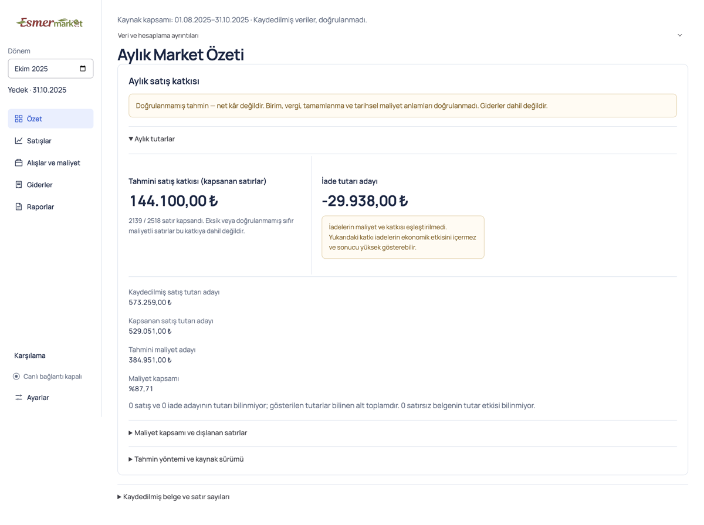
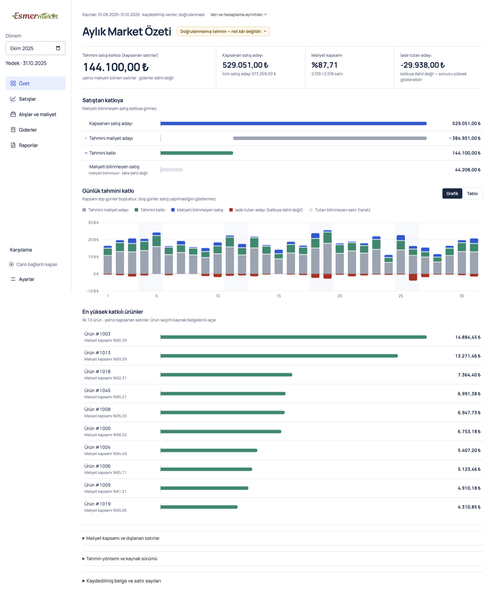
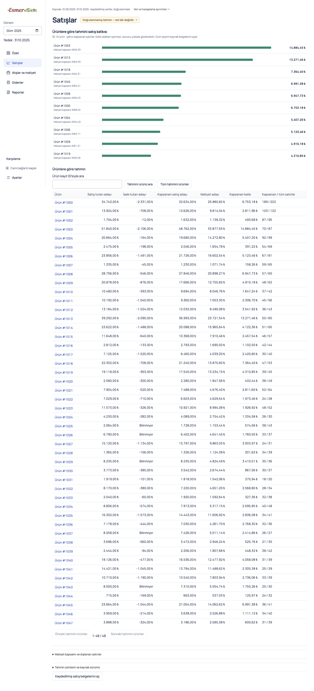
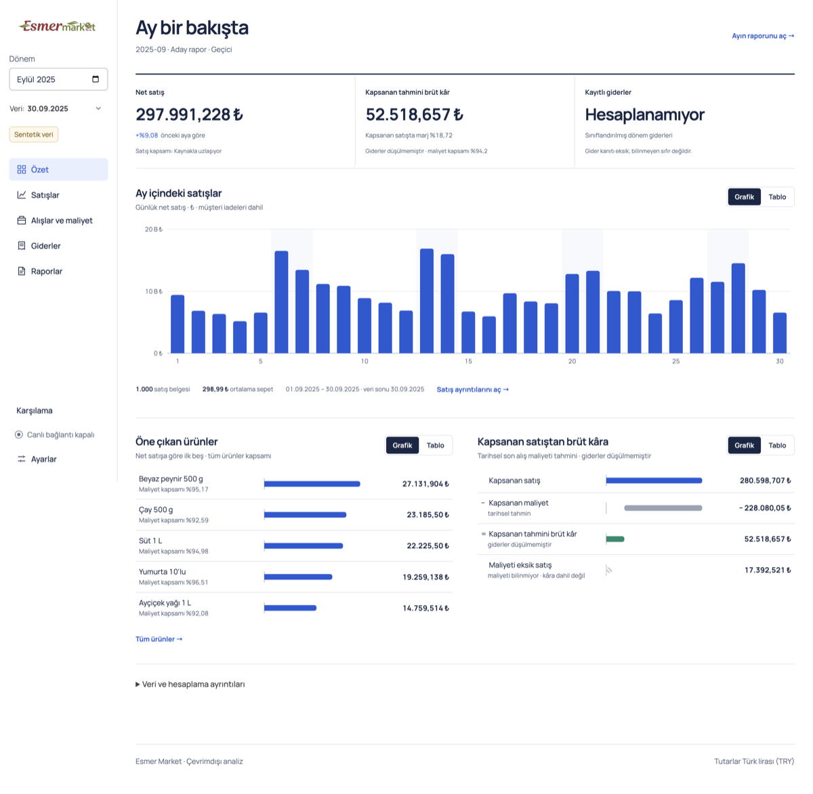
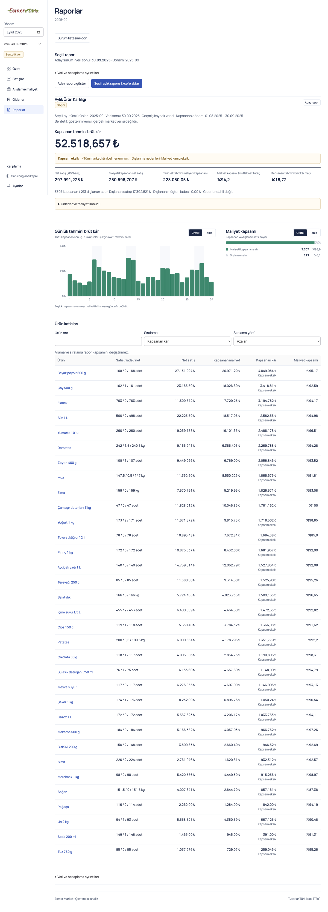
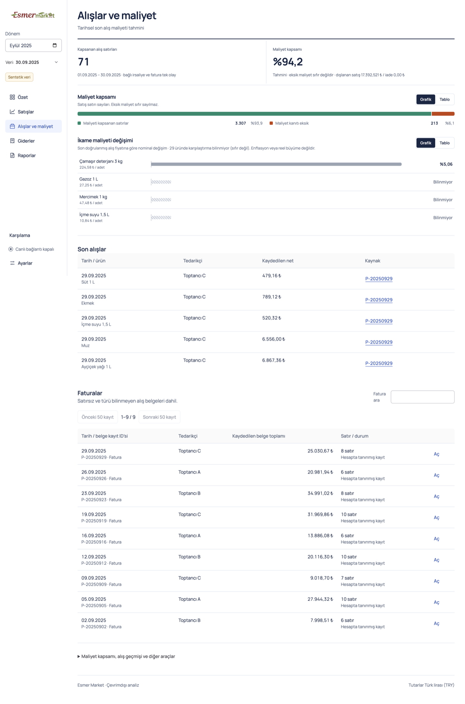
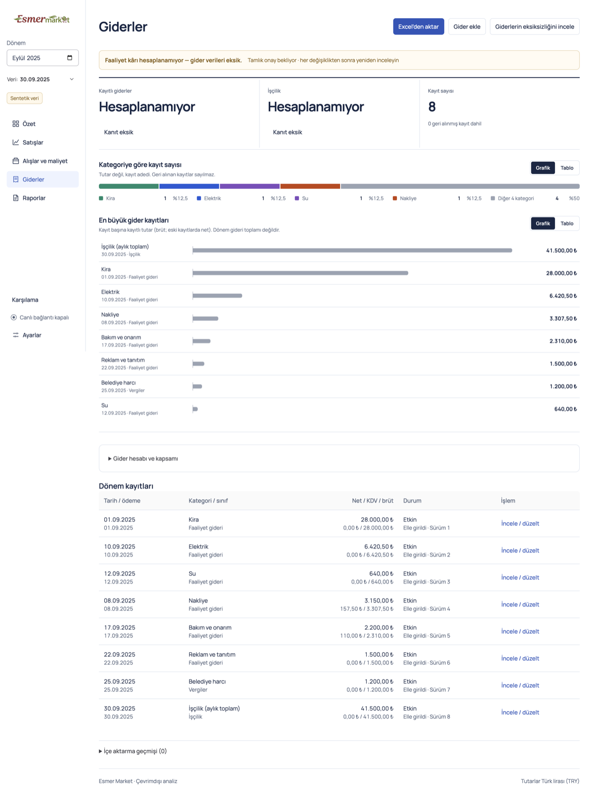

# Chart-led v1 visual edition

Date: 2026-10-13. Branch `claude/v1-visual-dashboards`, from main `34f95da`. Contract: [chart-led pages](../contracts/page-control-desks.md#chart-led-pages-2026-10-13). Environment: macOS arm64, packaged local Electron build. Fixtures are synthetic only.

## Request and boundary

The user reported that the graphs were basic and poorly viewed, and asked for a more visual UI with fewer confusing text sections, toward v1.

Seven source-evidence items remain unobtainable:
- ERP rules;
- amount and unit definitions;
- historical-cost evidence;
- return links;
- backup coverage proof;
- control reports;
- classified expenses with owner confirmation.

Validated real profit (#39–#41) and operating profit after expenses therefore stay gated. This work changes presentation and adds two service fields. It changes no calculation contract, schema, dependency, source access or deployment.

On 2026-09-29 the user had set a limit of three graphs. Today's request relaxes it to three graphs per page, under the same gap, unknown and table-alternative rules. [Monthly product profit](../contracts/monthly-product-profit.md) links that change.

## What changed

- **Shared chart primitives** in `src/ui/charts`:
  - daily stacked bars;
  - ranked bars;
  - a sales-to-contribution bridge;
  - a composition bar;
  - a chart frame with an exact-value table twin;
  - one `Doğrulanmamış tahmin — net kâr değildir.` badge per estimate page.
  Unknown, out-of-coverage and unknown-amount values are drawn as hatched gaps or stubs, never as zero. A known zero day gets a baseline marker. The palette was validated for colour-vision separation and contrast with the dataviz validator. There is no canvas, WebGL or new dependency. Styles load through `style.css`.
- **The recorded-source estimate** returns:
  - a top-ten contribution `ranking`, where unknown contribution is excluded rather than ranked as zero;
  - `uncoveredSaleAmount`, computed in the service. When some amounts are unknown it is a known subtotal.
  The Excel export is unchanged.
- **Pages**, each with at most three graphs:
  - Source Özet: bridge, daily estimate and top products.
  - Source Satışlar: ranking, then the product table.
  - Source Raporlar: the daily chart replaces the long daily table.
  - Financial Özet: daily net sales, top products and gross bridge.
  - Financial Satışlar: profit ranking and daily covered gross profit.
  - Financial Raporlar: daily covered gross profit and cost coverage.
  - Alışlar ve maliyet: cost coverage and replacement-cost change.
  - Giderler: record counts by category and the largest records.
  Contract caveats that must sit beside the number stay there as short phrases. Method, IDs and per-reason lists stay in the existing disclosures, except the Partial reasons, which stay beside the value.

## Verification

| Check | Command | Result |
| --- | --- | --- |
| Types and lint | `npm run typecheck`, `npm run lint` | Clean |
| Unit | `npm run test:unit` | 94 passed |
| Integration | `npm run test:integration` | 356 passed, 14 skipped (pre-existing skips) |
| Packaged desktop | `npm run test:desktop` | 130 passed, 14 skipped (Windows-only, private-data and live tests) |
| Screenshots | `ESMER_CAPTURE_VISUAL=<dir> npx playwright test tests/desktop/visual-capture.test.ts` | Source, tiny financial and rich financial profiles at 1440 and 1120 |

New synthetic fixtures:
- `tests/helpers/rich-estimate-fixture.ts`: 48 products, August–October 2025.
- `tests/helpers/rich-business-fixture.ts`: September 2025, 33 generic products, three generic wholesalers, 8 expense rows, completeness unconfirmed.

An independent review found no blocking issues. It raised five should-fix findings:
- unknown-amount days drawn as complete;
- Partial reasons moved away from the value;
- a zero missing-cost bridge step;
- ranking focus and return origin;
- colour by rank.
These were repaired test-first. A second review confirmed them and raised three follow-ups, which were also fixed: a zero known subtotal that hid unknown amounts on the source bridge, a stale Özet focus restore, and hue collisions. The final full suite passed after those fixes.

## Screenshots (synthetic data)

## Limits and open gates

- Windows packaging and runtime acceptance (`npm run package:win`, A07) were not run. macOS results do not satisfy them.
- Real-source financial validation, operating profit and owner acceptance remain gated on the seven missing evidence items.
- In `shadcn-ui.test.ts` (Windows-only), the daily-trend bound went from 900 to 901 px with a comment. It has not been checked on Windows.
- The legacy daily chart inside Satışlar' collapsed "İşlemler ve satış dağılımı" keeps its old markup, which is pinned by the linear-height drilldown test.
- Expense category colours come from a stable hash, so two categories can share a hue. Direct labels and the table twin carry identity.
