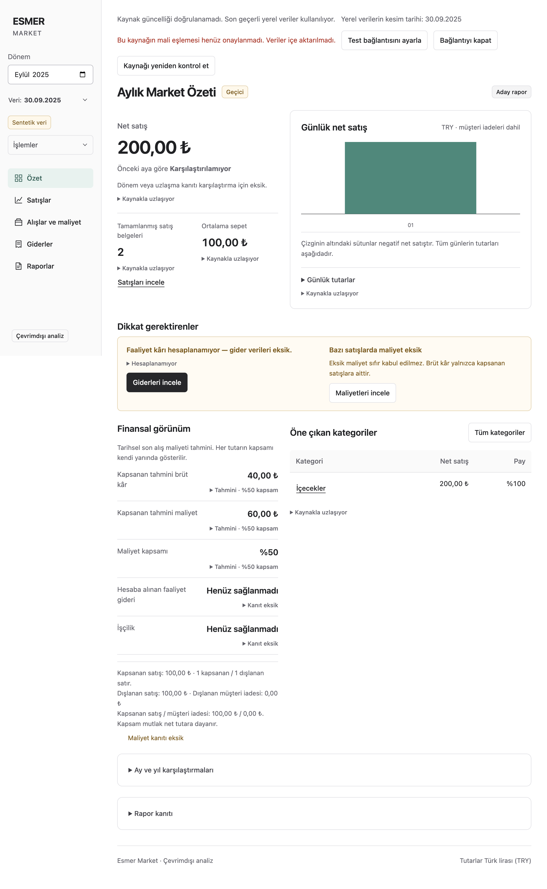

# Issue 14 isolated connection evidence

Date: 2026-09-26. Branch: `codex/issue-14-live-sync`. Baseline: `4663ddf`. Related [#14](https://github.com/AlesSystems/esmer-market-analytics/issues/14), [#26](https://github.com/AlesSystems/esmer-market-analytics/issues/26), Tasks 11.1/11.2 and L01.

## Result and acceptance boundary

**Partial technical implementation; #14 and L01 remain open.** The app can read the supplied database copy with a restricted account and preserve its local reports after rejection or source failure. Real SQL data cannot yet activate a financial dataset: `prepareSqlCandidate` always rejects it with `UNSUPPORTED_MAPPING`. Successful candidate reconciliation/activation is verified using synthetic packages. This is not a completed real financial integration.

The subsequent [Windows continuation](live-windows-acceptance.md) records successful NSIS/portable packaging, all 34 installed-app desktop tests, protected Windows settings and synthetic lifecycle checks. Native connection-file selection, Windows actual-source compatibility and the financial gates remain open. The Mac observations below remain their original platform evidence.

#26 still owns financial identity, conversions/returns, dates, discounts, quantities, cost/tax interpretation, real provenance, population and capacity acceptance. The isolated observations below are not independent financial oracles. No source rule was promoted from unsupported to verified. Original source/production rollout was not performed.

## Environment and private source evidence

MacBook development host: Apple M4 Pro, arm64, 24 GiB, macOS 27.0, Node 24.15.0, Electron 44.3.0. The test database is a disposable volume copy of the user-specified stopped database container. The original was mounted read-only for copying and stayed stopped. After verification, the disposable container, copied volume, two test networks and temporary credential files were removed; the original remained stopped. A private snapshot and its SHA-256 evidence index remain outside Git under the opaque batch identity. Only the disposable copy received a test reader and synthetic fixture databases/logins. The developer used administration solely for isolated test setup and metadata checks; application extraction used the restricted account.

Opaque private batch: `7ac0fb92-31db-4d96-a493-20384b81d274`. Private raw observations are retained outside Git. No original backup hash or pristine-backup claim is available. The copied engine reports Azure SQL Edge `15.0.2000.1574`, compatibility 120, READ_COMMITTED_SNAPSHOT enabled and SNAPSHOT isolation disabled. This proves this test engine only. Azure SQL Edge is [retired](https://learn.microsoft.com/en-us/lifecycle/products/azure-sql-edge); eventual SQL Server version/TLS/Windows compatibility still needs direct evidence.

Declared real read window: 2025-10-01 through 2025-10-12. Two reads returned identical projected records: 5,508 headers and 18,858 lines. Measured initial/repeat elapsed times were 4,989/4,017 ms during the isolated test. These are extraction observations, not freshness or source-impact acceptance under representative workload. Raw values and credentials were neither committed nor included in screenshots or release files.

A packaged application check connected to the same copy, received the expected unsupported-mapping result, displayed the stale/fallback message, kept the synthetic 200 TRY local report, exposed no password in status, saved encrypted configuration, and reopened with the connection disabled and the exact local snapshot intact. The screenshot below contains only synthetic financial data.

## Sequence/archive characterization

Sanitized metadata/count queries on the disposable copy found six sequence objects, 1,276,215 `SEQUNCES_DEGISIKLIK` records and 31,319 `FIS_ARSIV` headers. No archived header joined current details. This reproduces the historical missing-detail limitation; it does not establish complete event coverage.

| Table in existing log | Operation 1 | Operation 2 | Operation 3 |
| --- | ---: | ---: | ---: |
| FIS | 26,648 | 15,656 | 31,264 |
| FIS_DETAY | 168,481 | 189,598 | 96,373 |
| STOK | 17,070 | 7,919 | 40 |

Operation-code meaning and continuity have not been independently proven. No raw log SQL was read. The transport therefore rescans the entire configured window every time and treats the ID cursor only as pagination within one transaction. Changed GUID detection is tested, but same-GUID source reset detection remains open.

## Verification record

The test files and commands are reproducible evidence; environment variables below point to owner-controlled private JSON files, never committed fixtures. Default CI skips real SQL cases unless explicitly configured. `ESMER_SQL_TEST_ADMIN` is accepted only for loopback, a nondefault SQL port, and `scope: isolated-test-setup`; the helper creates and deletes uniquely named synthetic databases/logins on that disposable instance. Do not supply production credentials.

| Task/gate contribution | Procedure and expected result | Observed result |
| --- | --- | --- |
| 11.1 coherent reads | `tests/integration/live-sql-server.test.ts`: SQL sequence allocates lower ID in an open transaction, higher ID commits independently, first scan sees higher ID, then a SQL lock-wait barrier proves an extractor overlaps the uncommitted lower header before its line and transaction commit | Three actual-engine tests pass; final result contains both complete header/line pairs. Exact bigint beyond JS safe integer and eight-decimal values survive. |
| 11.1 corrections | Same fixture inserts, updates, deletes and backdates; repeat extraction compares equal; incomplete committed header remains raw/unreconciled | Pass. Within declared date window only. |
| 11.2 permissions | Restricted projection succeeds; customer-field read, update/delete/insert/DDL fail; wrong password, revoked read and wrong GUID fail | Pass on synthetic database in disposable copy. No negative production writes. |
| 11.2 delay/cleanup | Held writer causes lock timeout; cancellation closes read; subsequent write and read succeed | Pass. No production blocking budget established. |
| 11.1 activation and ownership | `live-reconciliation.test.ts`, `live-failure.test.ts`: duplicate state, A→B→A, changed/deleted/late facts, corrupt/timeout/permission/storage failures, expenses/adjustments/accepted report preservation | Pass with synthetic validated packages and ordinary atomic store activation. |
| 11.2 polling | Fake-clock tests: overlap, timeout, cleanup outlasting next scheduled poll, restart/stale status and persistence failure | Pass. A review-discovered lost-poll regression failed with one extraction instead of two before the fix. |
| 11.2 worker lifecycle | `live-worker.test.ts`: report reads/expense changes during extraction, import refusal, disable, restart and recovery drain | Pass. Source injection here is synthetic. |
| 11.2 privileged boundary | `live-boundary.test.ts`, `live-config.test.ts`: exact IPC payloads, native config, OS encryption fail-closed, sanitized responses | Pass. Windows DPAPI still requires target-host execution. |
| 11.2 packaged fallback | `live-connection.test.ts` with real reader config, packaged Mac | Pass; real extraction rejected, local report and encrypted/disabled settings survive restart. Initial test closed the app before disable acknowledgment; fixed test waits for the completed state. |

Initial red checks exposed absent transport/controller APIs, missing `activeManifest`, unsupported privileged operations and absent mapping adapter; these were missing contracts, not successful baseline behavior. Two actual-engine defects found during development were fixed: transaction management now uses the driver's TDS transaction API, and date parameters use culture-independent conversion for the Turkish SQL session.

Final verification on the branch (application commits through `4849ec2`; SQL tests `8acac98`; final package rules `49e8ad3`):

| Command | Result |
| --- | --- |
| `npm run test:unit` | 29 passed, 9 files. |
| `ESMER_SQL_TEST_ADMIN=<private-admin-json> ESMER_SQL_TEST_CONFIG=<private-reader-json> npm run test:integration` | 272 passed, 41 files, including actual SQL cases; no skips. |
| `npm run typecheck` and `npm run lint` | Pass. |
| `ESMER_EXECUTABLE=<packaged-Mac-executable> ESMER_SQL_TEST_CONFIG=<private-reader-json> npm run test:desktop` | Build and Mac packaging pass; 28 passed, 6 platform/conditional skips, 34 total. |
| `npm run package:local` after packaging exclusions | Pass. |
| `ESMER_SQL_TEST_CONFIG=<private-reader-json> npm exec -- playwright test tests/desktop/live-connection.test.ts` after final packaging change | 1 passed against the final packaged Mac app. |
| `node scripts/verify-package.mjs <Mac-app.asar>` | Pass, 80 dependency notices. |
| `inspectRelease` on the copied Mac archive in a temporary `resources/app.asar` layout | 3,075 archive files, zero violations; this is an archive check only, not Windows distribution acceptance. |
| `npm exec -- electron-builder --win --dir --x64` plus package notice/inventory checks | Cross-build passes; 80 notices, 76 distribution files, 3,075 archive files, zero violations. Windows execution remains untested. |
| `npm run package:win` on Mac | Fails at launching the bundled NSIS `makensis` compiler with macOS spawn error -86. This is a host toolchain failure, not an application test failure. No installer/portable acceptance claim. |

The original Mac inventory run correctly flagged newly added library paths and an unused TypeScript documentation example containing a private-key marker. Narrow module allowances retain content scanning; unused MSAL source is excluded from the package. Both allowed modules with secret sentinels and credential-data filenames are tested as rejected.

## Dependency and packaging review

Pinned Tedious 20.0.0 uses JavaScript TDS without a native ODBC installation. Its Node requirement is compatible with the project's Node 24 line. The lockfile now has 80 production package entries, licensed MIT, Apache-2.0, BSD-3-Clause, ISC or 0BSD; no production install-script flags were found. SQL authentication is the only configured mode, although Tedious brings Azure authentication libraries transitively. The existing package notice verifier checks all 80 entries. This dependency expansion is a deployment cost of the connector.

Package contents are inspected with the existing fixed runtime/dependency allowlist. Library modules named “credentials” are code, so they need narrow reviewed allowances; credential files, secret markers, source databases and unexpected dependencies must still fail the inventory. Source records and test tooling must remain outside the release archive.

## L01 status and Windows continuation

| L01 item | Status |
| --- | --- |
| Product acceptance and specific production permission | Open; this session authorizes isolated development only. |
| Restricted reader and protected credentials | Isolated Mac reader proof and Windows protected-storage synthetic checks pass; target source/account and Windows actual-source compatibility remain open. |
| Mutations, partial transactions, reset, reconnect | Synthetic SQL mutation/coherence/reconnect pass; complete reset detection and real financial activation open. |
| Log/archive coverage and reconciliation | Counts/limitations characterized; log completeness unproven. Bounded full rescan demonstrated, full approved history open. |
| Early IDs and header/line visibility | Forced actual-engine synthetic ordering/lock test passes. |
| Coherent financial candidate | Raw serial extraction and synthetic activation pass separately; real normalized candidate blocked by #26. |
| 5–15 minute freshness/source impact | Open. Fake timers and isolated elapsed reads are not representative load acceptance. |
| Visible fallback after failure/delay | Controller, worker, packaged Mac and installed Windows synthetic checks pass within this preview. |
| Full/recent reconciliation without duplicate financial events | Synthetic packages pass; real approved population open. |

Continue on this same branch and commit on a Windows x64 host. Run `npm ci`, `npm run test:unit`, `npm run test:integration`, `npm run typecheck`, `npm run lint`, `npm run package:win`, and `npm run test:desktop`. Configure only an authorized isolated source for the optional SQL tests. Verify DPAPI/native picker/enable-disable/restart and installer/portable lifecycle, then repeat the actual financial path only after #26 has approved mappings and independent expected results. Retain exact build, fixture identity, commands, expected/actual outcomes and private evidence references. Do not mark platform-skipped Mac tests or cross-built Windows files as Windows acceptance.

## Design/review decisions

Poteto's **Model the Domain** selected an explicit refresh state and kept source freshness separate from local data cutoff. **Prove It Works** required actual-engine concurrency and packaged fallback, beyond mock transport tests. The service-owned controller was selected over a second writer/worker because the existing service already owns activation and restore; one asynchronous SQL connection keeps local reads available. The deliberate ceiling is a fixed bounded window, with no claim of full historical financial refresh.

Throughput checkpoint: source semantics/privacy were the blocking checks; transport and service/UI had disjoint owners; root owned the isolated lab, integration and commits; database activation/restore remained serialized by their shared store invariant. Design alternatives were compared before implementation. Standards and specification reviews cross-reviewed owned areas. Tool capacity prevented spawning fresh final reviewers; existing workers cross-reviewed other areas, with parent review of SQL transport. This was not a fresh cross-family review. The review found and fixed lost polling after delayed cleanup and strengthened the actual low-ID/concurrent-transaction proof; the real-mapping omission remains an explicit open requirement. Comment audit found one redundant comment, removed without behavior changes.

## Commit handoff

| Commit | Change |
| --- | --- |
| `e32736d` | SQL extraction and fallback contracts. |
| `8783e3b` | SQL transport, bounded refresh controller and active-manifest query. |
| `f28b511` | Desktop configuration, worker and packaged fallback contracts. |
| `4849ec2` | Protected native controls, service lifecycle, Turkish fallback and delayed-poll recovery. |
| `0cb0ef2` | Reviewed driver dependency inventory. |
| `8acac98` | Actual SQL transaction ordering, permissions and cleanup tests. |
| `49e8ad3` | Narrow credential-module inventory rules and unused MSAL source exclusion. |

The evidence commit follows these tested changes. No merge, production installation or owner contact was performed.
