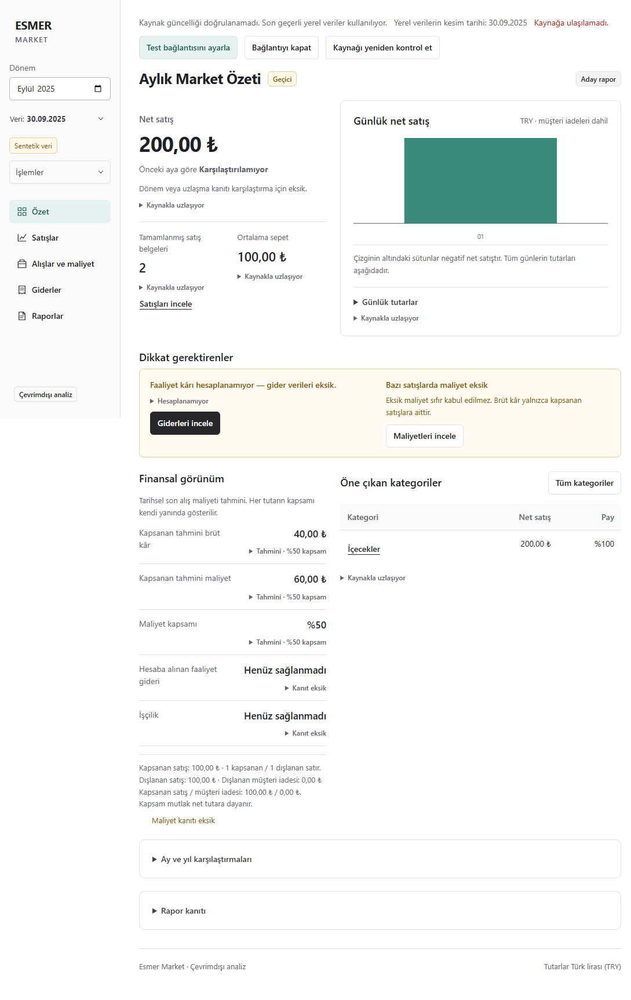

# PR 30 Windows verification

Recorded on 2026-09-26 for [PR #30](https://github.com/AlesSystems/esmer-market-analytics/pull/30), Tasks 10.1 and 11.2, and contributions to A05, A07 and L01. Branch `codex/issue-14-live-sync`. Application build `7828c75daa2ed1a1d86b6d34f3954b142c329c2e`. Test-runner change `2c60f57` does not change the application archive.

The Windows installer, installed application and portable application passed the synthetic checks below. Real financial import remains blocked by [#26](https://github.com/AlesSystems/esmer-market-analytics/issues/26). Neither #14 nor L01 is complete. No source database was opened, restored or inspected in this continuation.

## Environment and artifact identity

Windows 11 Pro x64, version 10.0.26200, Intel Core i9-12900H, 20 logical processors, 33,974,288,384 bytes RAM. Development Node 24.19.0 and npm 10.9.3. Application version 0.2.0 with Electron 44.3.0. This is a development computer, not a clean Windows VM or the owner's computer.

[Machine-readable proof](live-windows-proof.json) records distribution hashes, installer receipts, commands and limitations. [Performance samples](live-windows-performance.json) retain every measurement.

| Artifact | SHA-256 |
| --- | --- |
| NSIS installer | `fc8acc0f68b6b424adf6dbdf1ea0e59f273da5f529eca27766f9761493677bf9` |
| Portable executable | `b903b0155fcfeaf500566dd678d3c9e1a3f625a052864859a194b83383f12bd4` |
| Application archive | `f02dfa3472cee12a45328e3a1c1ff02a075c0170074fb515b843459914b88ebc` |

Both distributions are unsigned. The installed archive, both compressed payloads and the rebuilt directory package have the same application archive hash. Distribution inspection found 78 unpacked files, 3,075 archive files, 80 dependency notices and zero inventory violations. This is the existing allowlist/content inspection, not a general proof that arbitrary private information is detectable.

## Verification results

| Task or gate contribution | Procedure and expected result | Actual result |
| --- | --- | --- |
| 10.1 regression | `npm run test:unit` | 29 passed. |
| 11.1 and 11.2 regression | `npm run test:integration` | 257 passed, 15 skipped. Eleven source-collector cases require POSIX executable fixtures. Three SQL-admin cases and one reader-config case lack an authorized configured SQL instance. These are not Windows passes. |
| 10.1 build checks | `npm run typecheck`, `npm run lint`, `npm run package:win` | Passed. Packaging runs the build, package notices, release inventory and both compressed-distribution comparisons. |
| 10.1 and 11.2 desktop | `ESMER_EXECUTABLE=<isolated installed executable> npm run test:desktop` | All 34 tests passed on the actual NSIS-installed app, without skips. The script also rebuilt the directory package. |
| 11.2 protected settings and fallback | `tests/desktop/live-connection.test.ts`, synthetic loopback port 1 | Refused connection shows stale status, retains the 200 TRY report, omits the sentinel password from status/encrypted bytes, persists disabled configuration, and reopens with the exact local snapshot. Native file selection is substituted in this automated test. |
| A06 platform contribution | `tests/desktop/clean-install-restore.test.ts` | Actual Windows `safeStorage` round-trip and encrypted backup/restore passed. Both profiles and key were on the same host during the test; its temporary root was removed afterward. This is not independent computer-loss acceptance. |
| A07 performance | Three fresh processes with 25,000 synthetic documents and 25,000 lines, literal 2,500,000 TRY sales | All 24 ordinary interactions passed the 2,000 ms limit; maximum 314.5 ms. Startup including the initial calculation took 2,539.4 to 2,599.5 ms and is reported separately. OS caches were not cleared. Full real-source volume remains unverified. |



## Installer and portable lifecycle

The existing `scripts/windows-lifecycle.ps1` checked both registry views and refused unrelated installations and linked paths. There was no existing Esmer NSIS registration. Earlier local test evidence and the prior 0.2.0 installer were preserved under `work/pr30-windows` before testing.

The prior installer was installed in `work/phase-10-lifecycle/installed`. Its synthetic profile contains source history, expenses, adjustments, settings and an accepted monthly report from `populateRecoveryStore`. The old app passed two launches using a scratch copy of the lifecycle test with its old `Rapor sürümleri` label. Running the current `Raporlar` locator against that old UI first failed; that was a test/build mismatch, not an application startup failure.

The PR installer then replaced archive `0b36730f4c7d2a0d86f8a1ea272b4d1f1885ddbedc8492b30494a9d4e4cd85df` with the archive listed above. The database hash remained `f1199c2ddc4a559d6cfbf11b715f0bc4cfbc106bbd3f249a649604c3e346c08c`. Product version stayed 0.2.0.0. This is a same-version code replacement, not proof of a version-increased upgrade. The current lifecycle test then passed two installed launches with exact business-record and accepted-report comparisons.

`scripts/verify-portable.mjs` launched the actual compressed portable wrapper twice with developer runtimes removed from the child PATH. Both processes loaded the expected archive, opened the accepted report, preserved full business-record hashes and exited normally. Expected accepted values were 100 TRY sales, 40 TRY covered gross estimate and 60 TRY expenses. Renderer network blocking was enabled; the physical network was not disconnected.

Uninstall removed the application and NSIS registration while retaining the database hash. The PR installer was then reinstalled with the retained synthetic profile and checked again before final uninstall. Receipts in the proof distinguish these operations. No default user profile was deleted. Both distribution formats normally share `%APPDATA%\esmer-market-analytics`; this run uses an explicit disposable `--user-data-dir`.

## Test-runner correction and native-dialog limit

Uncapped Windows integration runs repeatedly exceeded five-second deadlines in the worker tests. The seven focused worker checks passed. A 15-second total-test experiment passed once, but a later run still exceeded a per-request deadline. The timeout changes were reverted. Windows Vitest concurrency is now two workers, and all original deadlines and assertions remain intact. The default commands passed with this configuration. Reduced contention is an inference supported by these runs; two workers is not claimed to be optimal. The successful integration run took 22.35 seconds.

Native Windows package selection imported the generated `synthetic-business.json` and displayed 200 TRY sales. The separate native connection-file dialog opened, but the automation tool returned stale element IDs, geometry errors and a non-settable-element error after a reset. Native connection-file selection remains unverified. The disposable process was stopped; no real credentials were used. The automated encryption/fallback result above does not close this manual-dialog gap.

## Reproduction and remaining gates

The system npm wrapper uses its neighboring Node 22 executable even when Node 24 is first on PATH. Initial dependency installations produced an engine warning. The final successful `npm ci` invoked npm's CLI explicitly through Node 24. No global configuration changed.

```powershell
$env:PATH = 'C:\Users\esmer\.cache\codex-runtimes\codex-primary-runtime\dependencies\node\bin;' + $env:PATH
$env:npm_config_script_shell = 'cmd.exe'
node 'C:\Program Files\nodejs\node_modules\npm\bin\npm-cli.js' ci
node 'C:\Program Files\nodejs\node_modules\npm\bin\npm-cli.js' run test:unit
node 'C:\Program Files\nodejs\node_modules\npm\bin\npm-cli.js' run test:integration
node 'C:\Program Files\nodejs\node_modules\npm\bin\npm-cli.js' run typecheck
node 'C:\Program Files\nodejs\node_modules\npm\bin\npm-cli.js' run lint
node 'C:\Program Files\nodejs\node_modules\npm\bin\npm-cli.js' run package:win
```

Use the disposable lifecycle sequence in [the installation procedure](../operations/install-tr.md), supplying an identified prior installer for a replacement check. Set `ESMER_EXECUTABLE` to the installed executable for `npm run test:desktop`. Preserve receipts before repeating stages; the scripts refuse to overwrite them. Run `scripts/verify-portable.mjs` with the generated portable executable and the same synthetic lifecycle profile.

Remaining checks include native connection selection, the eleven Windows source-collector cases, actual SQL/TLS/account compatibility on Windows, real mapping and full-population acceptance under #26, a clean Windows account or VM, default-profile lifecycle, failed NSIS upgrade recovery, independent retained-media recovery, and representative source load/freshness/reset proof. Production permission, owner acceptance and rollout remain open. No merge, owner installation or source access occurred.

Poteto's Prove It Works principle selected the actual installed and portable artifacts. Fix Root Causes led to reducing competing test workers after the timeout-only experiment failed. The independent same-family reviewer checked the configuration, log hashes, distribution hashes, lifecycle receipts, skip counts and performance samples. Its correction to the temporary recovery-profile wording is incorporated above; no cross-family review is claimed. The desktop log does not print the installed executable path: that claim relies on the recorded invocation and the tests' executable override, with the performance receipt confirming the archive hash. Local logs and the append-only decision trail are retained in `work/pr30-windows`.
