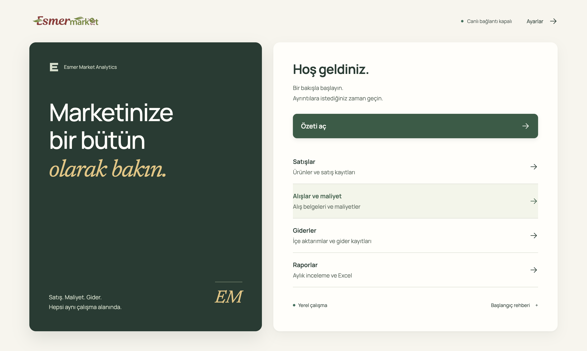
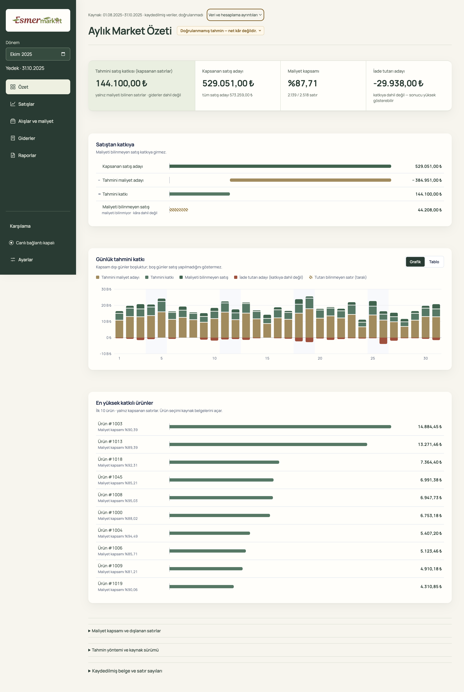
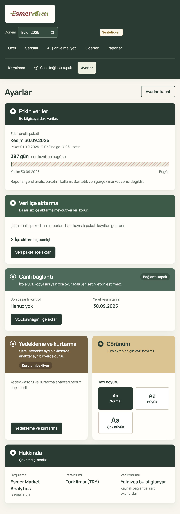
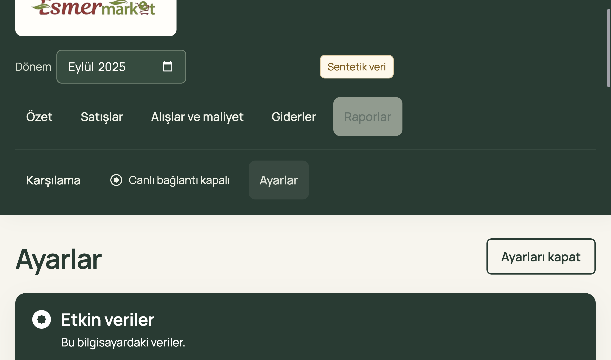

# Owner workspace acceptance — 2026-10-22

Issue #81 / PR #91. The Market ledger palette now covers welcome, all five business pages and Settings. The governing boundaries remain [page control desks](../../contracts/page-control-desks.md), [recorded estimates](../../contracts/recorded-estimates.md) and the [acceptance checklist](../../superpowers/specs/2026-09-04-esmer-market-rebuild-acceptance.md).

## Build and environment

Packaged Electron on macOS arm64, Node 24.15.0, npm 11.12.1. Runtime reviewed through `677f492`, including palette/focus repair `7596bc4`, Settings scroll repair `3f2ecbe` and monthly-read regression `cc1b966`. Fixtures are `richBusinessPackage` with `seedRichExpenses`, and `richEstimatePackage`; every record is synthetic. No source database was accessed.

## Verification and repairs

- `npm run typecheck` and `npm run lint -- --ignore-pattern '.scratch/**'` pass. The exclusion is the local nested worktree, absent from repository checkouts.
- The broad packaged workflow selection passed 44 tests, skipped one private-input test and exposed one Settings restart failure. At saved larger text, the sidebar Settings button was below the viewport. Making the sidebar scrollable repaired the existing behavioral test.
- The final focused packaged run passed all five tests: both owner-workspace profiles, both Settings workflows and overlapping monthly reads. It checks all five routes, welcome and Settings with requested window sizes 1440×900, 680×800 and 1440×1000 (the last with 200% application zoom; macOS can constrain the actual height); current navigation, keyboard skip/traversal, no document overflow, visible financial qualifications, reduced motion and no page errors.
- Keyboard metric outlines were clipped by their rounded container; the focus outline now sits inside the card. The old white workspace and cobalt sales marks were corrected to shared tokens.
- Rapid overview-to-sales navigation exposed identical concurrent monthly reads rejected by the exclusive job runner. Separate PR #95 shares only the matching pending read and preserves exclusive operations. Its packaged regression also asserts the deterministic daily chart scale and bar height. The final chart capture has the expected varied bars; no speculative chart arithmetic change was made.
- Native Electron captures establish 200% zoom layout. The retained Settings capture is 2880×1702 device pixels; requested window dimensions are not assertions of actual content height. Playwright full-page capture at application zoom produced a cropped artifact, so the test uses `webContents.capturePage()` for that case. Independent standards and specification reviewers inspected the implementation and rendered synthetic evidence; both use the same model family.

## Selected rendered evidence

## Limits

This accepts the rendered macOS redesign and tested interactions. It does not establish Windows installation/runtime acceptance, owner acceptance, real-source financial meanings or production rollout. Full merged-main app verification and CI are recorded separately after integration. Existing private-source tests remain skipped without separately authorized inputs.
