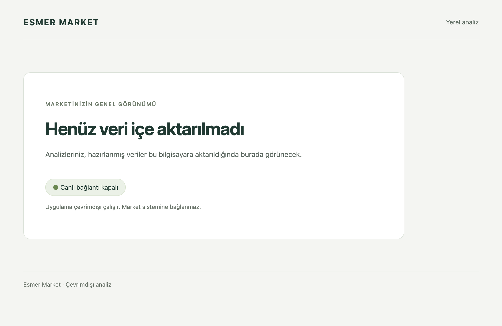

# Phase 1 local verification

## Tested artifact

- Issue and tasks: [#4](https://github.com/AlesSystems/esmer-market-analytics/issues/4), 1.1 and 1.2.
- Fixture: `synthetic-empty-v1`, with no source data or connection.
- Code/test commit: `e582ad9225d6677aa97e523f50a60ef297606d27` on `codex/phase-1-independent-foundation`.
- App version: `0.1.0`.
- Environment: macOS 26.4.1, build 25E253, ARM64; development Node 24.15.0 and npm 11.12.1.
- Packaged runtime: Electron 44.3.0, Node 24.20.0, SQLite 3.53.4.
- Date: 2026-09-15.

The desktop test obtains Electron/Node versions and runs `SELECT sqlite_version()` in the packaged main process. The separate worker also opens SQLite and returns availability through the actual preload/main request path. Development Node alone is not the runtime evidence.

## Commands and outcomes

| Procedure | Expected | Actual |
| --- | --- | --- |
| `npm run typecheck` | Strict source/test and declaration checks pass | Passed, with no `skipLibCheck` suppression |
| `npm run lint` | No lint errors | Passed |
| `npm test` | Full available suite passes | 2 unit, 7 integration, and 1 packaged desktop test passed |
| `npm run build` | Bundle app and stage required runtime notices | Passed |
| `npm run test:unit -- tests/unit/dependency-compatibility.test.ts` | The file filter runs the two dependency checks | Passed during implementation |
| `npm run test:integration -- tests/integration/desktop-boundary.test.ts` | All seven boundary cases pass | Passed during implementation |
| `npm run test:desktop -- tests/desktop/startup.test.ts` | Open an actual host package with an empty isolated profile | Passed during implementation and follow-up verification |
| `npm audit --json` | Report the locked graph's current advisory state | Zero reported advisories |
| `git diff --check` | No whitespace errors | Passed |

The final full suite, typecheck, lint, and build were rerun by the parent agent on the tested commit. The desktop command builds a new host package before launch. It confirms `app.isPackaged` and a canonical temporary `userData` path, then removes that test profile.

## Behavioral evidence

The packaged window displays `Henüz veri içe aktarılmadı` and `Canlı bağlantı kapalı`. No password input appears. The renderer sees exactly one bridge method, `getAvailability`, and has neither `require` nor `process`. The returned ready object contains only the status, empty-store marker, and disabled-live-connection marker.

The integration checks reject untrusted senders, unknown operations, malformed availability payloads, path/credential-bearing payloads, SQL-bearing import requests, and SQL-bearing availability requests. Each rejection leaves the service spy uncalled and excludes the submitted sensitive strings from the result. A valid request can return the Turkish service-unavailable result.

The packaged test inspects sandbox, context-isolation, Node-integration, and webview preferences. It observes an actual `connect-src` policy violation for the attempted external fetch, denied geolocation and popup creation, and a prevented navigation event to an otherwise allowlisted local asset. This is application-level evidence, not a packet capture of every operating-system process.

The initial startup contract at `18ceab4` failed with `ENOENT` because the packaged application did not exist. This is an absent-artifact failure, not an observation of a running UI bug. Boundary checks were validated with a temporary guard-bypass mutation: all six hostile cases failed and the valid service-failure case passed. The guards were restored before commit. No test-first boundary history is claimed.

## Release-content inspection

The app archive is `release/mac-arm64/Esmer Market Analytics.app/Contents/Resources/app.asar`. Its SHA-256 is `f5c113273e22b507d4bdd5890886a1628c5096e132800f937af4260185e69972`.

Inspection used the installed `@electron/asar` library's `listPackage`, `statFile`, and `extractFile` functions. The archive has 646 entries and 540 files. Top-level contents are limited to `dist`, production `node_modules`, and `package.json`. No repository docs/tests/work directories, `.env` files, backups, databases, source maps, vendor test files, local checkout path, or legacy checkout name were found. The [inventory record](phase-1-package-inventory.json) retains counts and hashes.

Eleven dependency licence files remain inside the archive. Electron's `LICENSE` and `LICENSES.chromium.html` are also present under the package's `Resources/licences` directory. The packaged test compares each with the selected downloaded Electron runtime's original. Missing notices fail the build or packaged test.

## Review and remaining gate

Independent Standards and Spec reviews found zero actionable findings at `bb22ada`. A scoped independent review of `bb22ada...e582ad9` accepted the stronger policy assertions and runtime-notice fix. Reviews used separate agents from one model family. Comment review found no source comments to delete; its unnecessary declaration-check suppression finding was removed.

Windows packaging, offline Windows launch, installer/portable smoke, publisher warnings, and native Windows notice verification remain **unperformed**. The app still uses the default Electron icon and an unsigned development package. Persistent data, financial calculations, source access, and later release gates remain outside Phase 1.

Use [the Windows agent prompt](../operations/windows-phase-1-handoff.md) to finish this phase on the same branch. Do not close the Phase 1 exit gate or claim full A01/A05/A07 acceptance from this macOS evidence.
