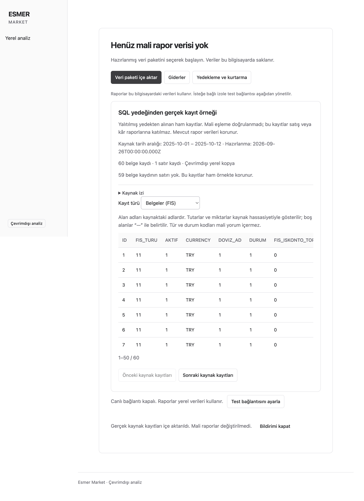

# Real SQL backup record preview

Date: 2026-09-26. Continuation of PR #30, related to #14 and #26 R2–R4.

## Scope

This example imports a bounded projection of real records from the user-authorized restored backup into local SQLite. Source type codes, timestamps and decimals remain recorded values. Financial event identity, units, conversions, costs and reporting meaning remain unvalidated. The preview cannot supply sales, profit, purchasing or accepted financial reports. Existing financial datasets and app-owned records remain separate.

This is a partial real-data example, not completion of #26, #14, A01–A07 or L01.

## Source evidence

The original stopped SQL container stayed stopped. Inspection ran against a disposable volume copy. Setup used administration only on the copy; application extraction used a newly provisioned account with SELECT access only to the existing reviewed columns on FIS, FIS_DETAY and DOVIZ_AD. No private display fields, customer identities, payroll or raw change SQL were selected.

| Observation | Result |
| --- | --- |
| Selected source timestamp window | 2025-10-01 through 2025-10-12 inclusive |
| Header rows | 5,508 |
| Line rows | 18,858 |
| Headers with no current lines | 3, retained |
| TRY classification | All selected headers |
| Extraction elapsed | 4,862 ms on the first fresh restricted read |
| Independent recorded-field checks | Four SQL SUM results equal Python Decimal sums exactly |
| Reference checks | Unique header/line IDs; all lines join a header with matching type code |

The four aggregate checks cover header GENELTOPLAM and KDV_TOPLAM, plus line TOPLAM_KDV_MATRAHI and TOPLAM_KDV. Their equality verifies extraction; it does not prove economic sales, tax rules, rounding or profit. Private expected amounts and source rows stay outside Git.

This is an existing restored SQL Edge volume containing known legacy schema additions. No pristine `.bak` file hash or current production compatibility claim is available. The selected timestamps are source-recorded dates, not an independently validated business calendar. October 2025 is partial and historical.

## Acceptance execution

Build: `cec1634` on `codex/issue-14-live-sync`, Electron 44.3.0, Node 24.15.0, macOS 27, Apple M4 Pro arm64. Private batch: `e2731e28-d5b8-418f-b1fe-b955b1c9de5b`. Package size: 5,920,726 bytes. Its full digest, source schema fingerprint, exact-value oracles and raw snapshots are retained with that private batch outside Git.

| Gate / command or procedure | Expected | Actual |
| --- | --- | --- |
| R2/R3: `node tools/prepare-sql-backup.ts <private-config> <private-output>` | Restricted coherent read; exact reviewed fields; exclusive private output | Pass. Both fresh reads match every header and line. Final output has mode 0600 and no connection credential. |
| R3: `npm run test:unit` | Existing calculations remain valid | 29 passed. |
| R3/A04: `npm run test:integration` | Preview validation and existing store/recovery contracts | 273 passed, 4 optional SQL fixture cases skipped. Those skipped cases are not new evidence. |
| R3/A04: focused `raw-preview.test.ts` after review fixes | Invalid/private fields, corrupt digest, bad dates, duplicate IDs, references, cancellation, repeat-import no-op, preservation and encrypted recovery | 5 passed. Recovery includes the preview, an expense and an accepted report. |
| R4/A07: `ESMER_EXECUTABLE=<packaged Mac executable> npm run test:desktop` | Packaged UI, import, migration and restart | 29 passed, 7 conditional checks skipped. Actual preview check subsequently passed separately. |
| R4: private actual-backup desktop test | Native picker imports real package; local copy survives restart | 1 passed. SQL copy was stopped before this run. |
| R4: private persistent-profile walkthrough | First/last header and line pages match, next-page UI works, financial dataset remains empty | Pass. Import 225 ms; four page queries 88–95 ms on this bounded example. These are single observations, not a full-population performance gate. |
| R4: independent SQLite read after app exit | Persisted package equals prepared bytes exactly; integrity is valid | Pass; full byte/digest equality and `integrity_check=ok`. |
| A05/A07: `npm run typecheck`, `npm run lint`, `npm run build`, `npm run package:local` | Valid types/lint and packaged build | Pass. Unsigned macOS build. |
| A05: `node scripts/verify-package.mjs <app.asar>` | Required notices | Pass: 80 dependencies. No dependency changes in this continuation. |
| A05: `inspectRelease` against a private staging directory containing the built Mac `app.asar` | Archive excludes private input and unexpected files | 3,075 archive files, zero violations. This is archive inspection, not Windows distribution or full macOS runtime inventory. |

The initial desktop run had four existing tests choose a Windows executable on macOS (`ENOEXEC`), and the new preview test expected an incorrect status label. The corrected run explicitly selected the Mac executable and checked the actual disabled live-state contract.

Private Playwright runs set `PLAYWRIGHT_NO_COPY_PROMPT=1`, disable trace/video/screenshot capture and require an output directory outside the repository. This suppresses Playwright's automatic page snapshot on failure. Public screenshot evidence below uses generated raw-shaped rows only. Real screenshot and persistent demonstration profile remain private.

The original container remained stopped. The disposable container, copied volume and networks were removed after verification. Temporary administrator and restricted-reader credentials were deleted. The prepared package and imported local demonstration profile were retained for the user.

## Review and commits

- `1103733`: initial failing contract tests (missing raw-package module, not a passing behavioral run).
- `b2a8dfe`: raw package, preparation command, local storage/recovery and UI.
- `545f0fe`: boundary, recovery and packaged tests.
- `cac0aa0`: correct disabled-state test assertion.
- `b2792ca`: identical imports preserve recovery generation.
- `cec1634`: bounded table, clearer empty financial-state label and private test artifact guards.

Independent Astra High reviewers examined standards/correctness and specification compliance separately. Pagination, private failure snapshots and duplicate-import recovery changes were fixed. Both final reviews reported no remaining actionable findings for this bounded preview. Model the Domain kept raw records separate from financial events; Prove It Works required the actual packaged import and exact source comparison.

## Remaining gates

- Source financial semantics and normalized analytics activation (#26 R1/R3/R4).
- Full population and resource profiling beyond this bounded window (#26 R5).
- Windows verification of this new preview slice and schema upgrade (#26 R6). Earlier PR #30 Windows checks cover the preceding implementation only.
- Actual production engine/TLS compatibility, source acceptance and rollout permission.
