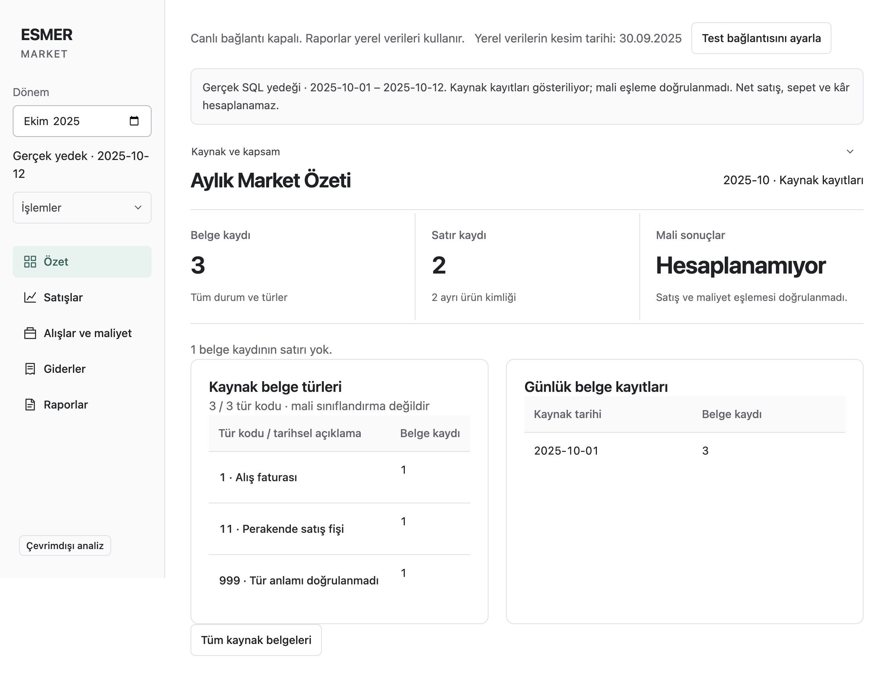

# Real backup across application pages

Continuation of PR #30 after the user reported that importing the raw backup hid the application's other pages.

## Cause and change

`App.tsx` previously supplied sidebar navigation only after `openSales` returned a supported financial report. A profile containing only a source preview could therefore show records but not the application's normal destinations.

The source workspace uses the existing application shell and all five destinations. Source exploration and financial reporting are separate capabilities. A source package does not need a fabricated sales report to make navigation available.

| Page | Available source-backed behavior | Financial boundary |
| --- | --- | --- |
| Özet | Source date window, header/line/product-ID counts, daily counts and type distribution | Record counts are not completed sales or revenue. |
| Satışlar | Source document filters, exact recorded fields and document-line navigation | Source type-code filtering does not validate economic identity, return signs or conversions. |
| Alışlar ve maliyet | Source document and product-ID exploration | Supplier names, historical costs and units absent from this projection remain unavailable. |
| Giderler | Existing expense import, correction and completeness workflow | Source records do not establish expense completeness. |
| Raporlar | Previously accepted report history, original provenance, reading and export | This raw package cannot create an accepted financial candidate. |

Recovery remains available in operations. Existing financial datasets remain independently accessible when present. Source requests use a selected month and package identity to prevent mixing rows from different imported packages.

## Retained real example

The existing private batch `e2731e28-d5b8-418f-b1fe-b955b1c9de5b` contains the selected source timestamp window 2025-10-01 through 2025-10-12. Its independently counted population is 5,508 headers, 18,858 lines, 2,356 distinct product IDs and three headers without lines. The raw-code groups contain 5,216 sales-related and 292 purchasing-related headers. Those labels describe historical dictionary-code filters, not independently validated economic events.

Source rows and actual-value screenshots remain outside Git. This continuation does not access SQL or alter the original backup. It queries the previously imported local copy.

## Verification

Tested application commit: `777d744` on `codex/issue-14-live-sync`. Environment: macOS arm64, Node 24, packaged Electron 44.3.0 application. Continuation acceptance: all-page source navigation requested under issue #14 / PR #30; this does not close the foundation financial or Windows gates.

- `npm run test:unit`: 29 passed.
- `npm run test:integration`: 278 passed, four opt-in SQL cases skipped. No SQL source was accessed by this continuation.
- `npm run typecheck` and `npm run lint`: passed.
- `ESMER_EXECUTABLE=<packaged Mac executable> npm run test:desktop`: built and packaged successfully; final run passed 30 tests, skipped seven optional/platform cases and exposed one test synchronization issue after clearing a filter. The test-only synchronization correction `76e0f0a` waits for the cleared input; `playwright test tests/desktop/source-workspace.test.ts` then passed both workspace tests against the same packaged application. All 31 distinct enabled desktop checks therefore passed across the full run and focused rerun.
- Retained actual package walkthrough: all five destinations opened with period 2025-10 preserved; independent Python counts matched headers, lines, products, missing-line headers, type distribution and daily distribution. Scoped header counts were 5,216 and 292. Product-group navigation worked; a selected document and all first-page lines matched original projected rows exactly. Package-version mismatch was rejected, and all five pages remained available after offline restart.
- Private procedure: `workspace-proof.mjs`; private result: `workspace-result.json`, alongside private page screenshots in the retained evidence directory. The [sanitized result](source-workspace-result.json) contains only batch identity, counts and timings. Page-navigation measurements were 17–195 ms in this one run; this is not a full-history performance claim.
- `node scripts/verify-package.mjs <app.asar>`: all 80 dependency notices present. Archive-only inventory: 3,075 files, zero violations; SHA-256 `b71d00c040e34870e4786eadbfa9cfba2a7d197617a90f6a84691593551a5627`. This does not verify the Windows distribution or all Mac runtime files.
- Independent Astra High Standards and Spec reviews cleared the identified findings. Focused independent integration run: 10 passed.

The first query-contract test exposed the missing module before implementation. Subsequent checks exposed two real regressions: source failure hid maintenance access, and reimport with an unchanged stored hash did not repair damaged package bytes. Product-view testing also exposed a view update overwritten by the filter helper. The fixes have focused regression coverage. An exact-text expense selector was corrected after the rendered table showed the expense was already present. One intermediate desktop invocation attempted the Windows executable on macOS because `ESMER_EXECUTABLE` was omitted; this was a command setup error, not application evidence.

## Open requirements

Financial normalization, source names/unit/cost validation, full historical import capacity and Windows verification of this continuation remain open. The sample's partial source window must remain visible throughout the app.

## Visual evidence

The screenshot below uses generated fixture records only. It verifies the five destinations and source-aware overview layout; no real rows are published.

## Subsequent usability review

The [26 September page audit](2026-09-26-page-audit.md) records all five pages, the real-backup reporting gap, screenshots, label proposals and the future-update backlog. Restored navigation does not complete real financial reporting.
