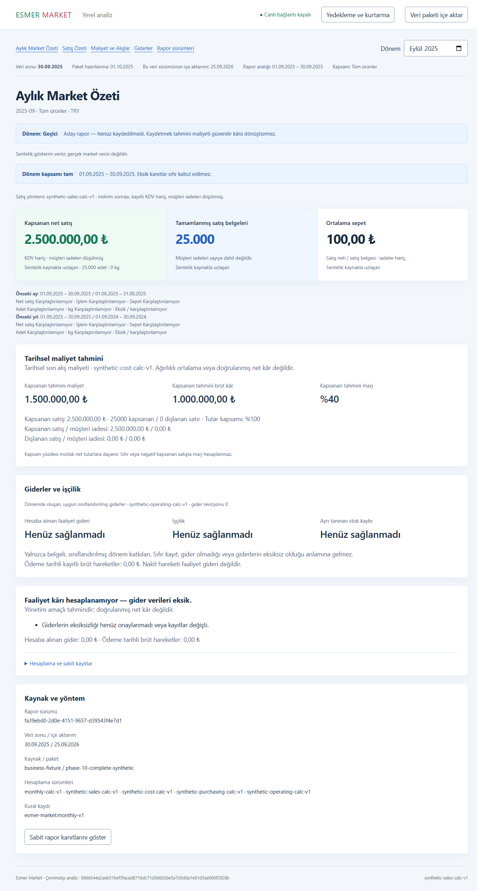

# Phase 10 Windows verification

This is the synthetic Windows verification record for Tasks 10.1 and 10.2, D01/D18 and A01–A07. [Release acceptance](release-acceptance.md) remains blocked by source and independent recovery evidence. The concrete build and fixture hashes are in [phase-10-proof.json](phase-10-proof.json).

## Environment and commands

The test host is Windows 11 Pro, x64, build 26200, Intel i9-12900H, 20 logical CPUs and approximately 32 GiB RAM. The harness uses Node 24.19.0 from the bundled Codex runtime. The system PATH initially selects Node 22, which does not meet `package.json`. Commands explicitly prepend the Node 24 runtime and set process-local `npm_config_script_shell=cmd.exe` so the package scripts' `&&` syntax works. No system Node installation or npm configuration was changed.

The final unit, integration, desktop, typecheck, lint, build and Windows packaging results are recorded in the machine-readable proof. `test:desktop` rebuilds a directory package before Playwright launches actual Electron executables. Tests never use a development web server. Installer/portable lifecycle results use separately identified compressed artifacts; directory-package tests alone are not installer proof.

## Observed failures and fixes

The initial encrypted-backup integration run failed six of nine tests on Windows. Directory `FileHandle.sync()` returned `EPERM`. [The recovery fix and focused evidence](phase-10-windows-recovery-files.md) retain that observation. It now explicitly reports unsupported Windows directory flushing while preserving file fsync, rename errors and journaled process-interruption recovery. This does not establish namespace persistence under power loss.

The new inventory contract initially could not run because `tools/release-inventory` did not exist. Its next run exposed the ASAR library's Windows path separator requirement. Both inventory tests passed after implementation. Independent review then reproduced a false negative for an unexpected root `.dat` file; the tool now allowlists named runtime files and scans nonbinary text. An initial attempt to marker-scan Electron itself matched built-in cryptographic parser strings, so known native binaries are hashed and payload-compared rather than reported as leaked keys.

The first lifecycle worker run used a stale packaged Phase 8 worker against a newly seeded schema-6 fixture. It displayed an unavailable local service. Rebuilding the package passed. A later attempt to drive the portable NSIS wrapper with Playwright's Electron launcher timed out; the wrapper requires native spawn and CDP attachment. That automation failure is retained in `work/phase-10/portable-profile.log` and is not a product startup verdict. The first native probe then compared a compact IPC response with a full stored report and failed. The corrected probe checks literal displayed totals and full stored-record hashes. Both migrated and fresh profiles pass two native portable launches with restricted PATH and renderer offline mode.

## Packaged workload and no-expense reveal

`tests/desktop/full-dataset.test.ts` imports every row in the generated 25,000-document/25,000-line synthetic package into a local store, then launches three fresh packaged processes. It asserts literal 2,500,000 TRY sales and the missing-expenses explanation. It measures first sales navigation, transactions, next page, one receipt, monthly return and warm navigation, including content readiness plus two frames. Startup and initial monthly calculation are recorded separately. OS filesystem caches are not cleared. [All samples](phase-10-performance.json) remain available, including the slowest run.

The ordinary response requirement is below 2,000 ms. This bounded workload passes. The test filename does not mean the historical 529,001 documents and 1,873,553 source lines were imported. Current package limits are 32 MiB and 100,000 total records per package, and accepted mappings are synthetic only. The real full-data gate remains open. Existing `unavailable-states.test.ts` separately proves real background import progress, navigation, cancellation and preservation of the previous dataset.

## Lifecycle and recovery

`scripts/windows-lifecycle.ps1` checks NSIS registrations in both registry views, refuses unrelated installations and linked paths, and writes each receipt once. For the retained Phase 8 disposable installation, a full copy is preserved before upgrade. The 0.1.0→0.2.0 installer changed the executable/archive while leaving the synthetic database hash unchanged. The packaged worker then migrated the schema and preserved sales, expenses, adjustments, settings, source facts and accepted report records through two launches. The test reads its baseline with a read-only SQLite connection so the test itself cannot perform the migration.

Both formats normally share `%APPDATA%\esmer-market-analytics`. The portable launcher does not relocate data beside the `.exe`. Tests supply an isolated `--user-data-dir`. NSIS configuration explicitly preserves app data on uninstall and does not launch the app automatically after setup. Actual isolated installer stages, portable launches and their limitations are itemized in the proof. No default user profile is removed.

The final build was also installed after the prior registration was removed. Its fresh synthetic profile passed two installed launches and two portable launches. Both uninstall procedures removed executables and registration while preserving the isolated database hash. This is a clean application installation on the development host, not a separately clean Windows OS. The versioned upgrade used an earlier generated installer whose application archive is identical to the final archive; both executable identities are retained. Final packaging, payload comparison, clean installation and portable checks use the final distribution hashes.

The packaged clean-restore test uses actual Windows `safeStorage`, verifies that protected bytes differ from plaintext and round-trip correctly, creates a real authenticated backup, deletes the original profile, then restores its report and Excel values into a fresh profile. Native file and confirmation dialogs are substituted by the test. Both profiles, backup and key remain on this host, so this does not satisfy independent computer-loss acceptance. No secret is written into public evidence.

## Remaining manual checks

Use [installation](../operations/install-tr.md), [recovery](../operations/recovery-tr.md), [reveal](../operations/reveal-tr.md) and [limitations](../operations/known-limitations-tr.md) instructions. Remaining checks include a separate clean Windows account/VM, default-profile lifecycle, controlled failed NSIS upgrade with old application recovery, actual disk exhaustion and external-media removal, ACL inspection of plaintext temporary files, namespace power-loss behavior, native dialogs, supported scaling and independent retained-media recovery. Record each against this exact build or re-test a changed build. Do not reuse earlier phase screenshots as current proof.
