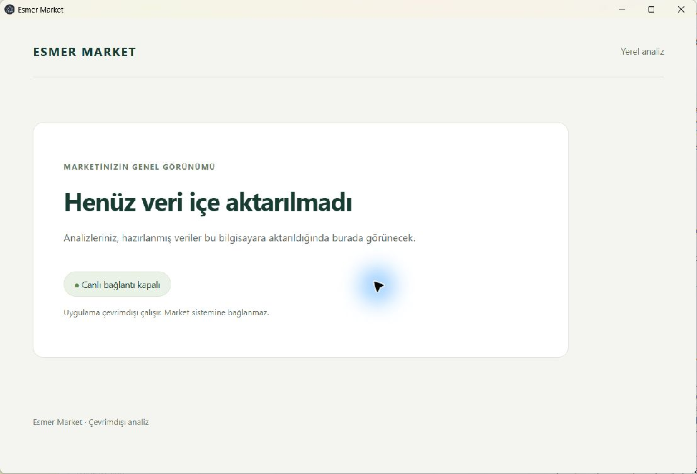
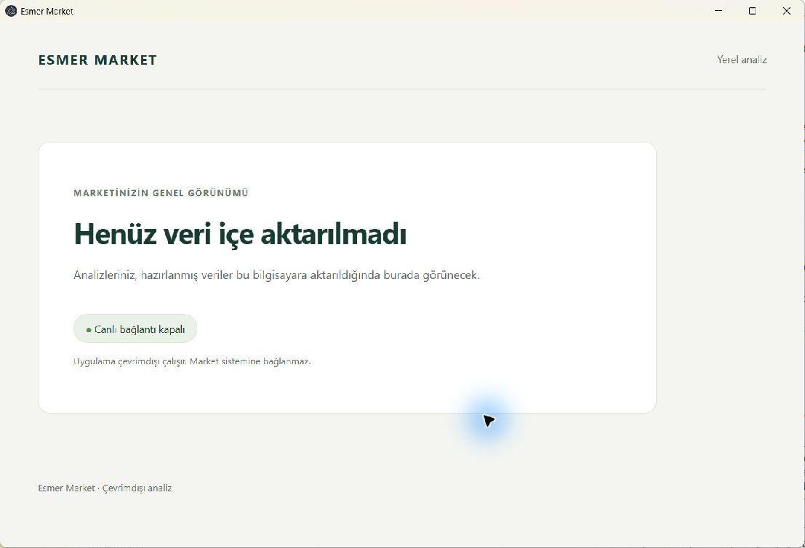

# Phase 1 Windows verification

## Gate status

The Phase 1 exit gate is **complete**. The user reported successful manual startup with networking disconnected. Windows packaging, packaged startup, fresh-profile restart, worker runtime checks, the full available test suite, portable launch, and NSIS install/launch/uninstall passed. The manual offline report and the agent-run checks are distinct evidence sources. This record does not complete A01, A05, or A07.

The user confirmed that the HP is a second development computer and authorized its use for these checks. This is the approved test target for the [Windows handoff](../operations/windows-phase-1-handoff.md). Windows Sandbox is unavailable. Testing used the host directly, not a clean guest VM or Eralp's computer.

## Build and environment

- Date: 2026-09-15.
- Issue and tasks: [#4](https://github.com/AlesSystems/esmer-market-analytics/issues/4), 1.1 and 1.2.
- Existing PR: [#15](https://github.com/AlesSystems/esmer-market-analytics/pull/15).
- Branch: `codex/phase-1-independent-foundation`.
- Fetched baseline: `51255786a47cffc3b4a274e0db4d72ac1d1024fe`. Recorded before any file changes.
- Resumed remote and local baseline after host authorization: `b7308fc16d319d1bd84671dfa904a21571ab432a`. Both matched after fetching; the working tree was clean.
- Application and packaging commit: `709c75f1e64e4f34fcc0042aa24e269b18141e5e`.
- Tested commit: `cc83aa0fab81580216273a597f52ced882b8f99c`. This adds worker-runtime and same-profile restart coverage. Application and packaging contents remain unchanged from `709c75f`.
- Initial working tree: clean, on `main` at `7c0dfee0abda9793fafa7e1145d6603d050fa69b`. The session fetched and switched to the existing remote Phase 1 branch.
- App version: `0.1.0`.
- Fixture: `synthetic-empty-v1`. No business records, source database, backups, credentials, or network services were used.
- OS: Windows 11 Pro 25H2, build `26200.9445`, x64.
- Hardware: HP ZBook Studio 16 inch G9, Intel Core i9-12900H, 14 cores and 20 logical processors, approximately 31.6 GiB reported physical memory. A hypervisor is present. This is not evidence of a clean guest VM.
- Command host: PowerShell 7.6.6.
- Initial development runtime: Node 22.19.0 and npm 10.9.3. These were not used for the verification commands below.
- Verification development runtime: Node 24.15.0 and npm 11.12.1, from the official Windows x64 Node archive, checked against its published SHA-256 list and extracted under ignored `work/`.
- Measured packaged runtime: Electron `44.3.0`, bundled Node `24.20.0`, and SQLite `3.53.4` in both the Windows main process and the instrumented packaged worker instance. These are separate from development Node `24.15.0`.

Machine names, serial numbers, account identifiers, private paths, and raw logs are excluded from this record.

## Commands and actual outcomes

Commands ran from the repository root in PowerShell. The local Node 24 directory was placed first in the process `PATH`. The host's npm configuration sets `script-shell` to `powershell.exe`. This invokes Windows PowerShell 5, which rejects the existing `&&` script separators. The initial build failed before executing application build logic. Setting `$env:npm_config_script_shell = $env:ComSpec` restored npm's standard Windows shell for this session. No global npm setting or repository script changed.

| Command | Actual outcome |
| --- | --- |
| `git status --short` | Clean baseline |
| `git branch --show-current` | Recorded `main`, then switched to the requested branch |
| `git rev-parse HEAD` | Recorded the initial checkout and fetched Phase 1 SHA above |
| `node --version` | `v24.15.0` after local runtime selection |
| `npm --version` | `11.12.1` after local runtime selection |
| `npm ci` | Passed, 410 packages installed, 411 audited, zero reported vulnerabilities |
| `npm run typecheck` | Passed |
| `npm run lint` | Passed |
| `npm run test:unit` | Passed, 2 tests |
| `npm run test:integration -- tests/integration/desktop-boundary.test.ts` | Passed, 7 tests |
| `npm run test:desktop -- tests/desktop/startup.test.ts` | Baseline passed after host confirmation; enhanced worker-runtime and same-profile restart test passed, 1 test |
| `npm run build` | Initial host-shell parse failure; passed with the session shell setting above |
| `npm run package:win` | Passed with the session shell setting; produced x64 NSIS and portable executables; final check printed `PACKAGE_NOTICES_OK 6 dependencies` |
| `npm test` | Passed on the tested commit, 2 unit tests, 7 integration tests, and 1 packaged desktop test |
| `git diff --check` | Passed for the final changes |

After the packaging fix and test enhancement, typecheck, lint, the full available suite, build, and Windows packaging passed again. The enhanced desktop check measures the worker runtime and restarts the same fresh profile. No application source, IPC contract, or sandbox preference changed.

The installer uses electron-builder's default per-user, one-click NSIS configuration. The observed installation and removal cycle is recorded below, separately from packaging success.

## Artifact hashes

SHA-256 values were measured with `Get-FileHash -Algorithm SHA256` after packaging completed. Artifacts remain local under ignored `release/`. They have not been deployed or attached as a production release.

| Artifact under `release/` | SHA-256 |
| --- | --- |
| `Esmer Market Analytics Setup 0.1.0.exe` | `d9c39da63b1bbf91d054b0067d79dd5f910d97d115585b815ccf4ab037c7bb5d` |
| `Esmer Market Analytics 0.1.0.exe` | `76b3ead33356cea2bcc280027f663432690cf839b57b843f725b370b28920fe7` |
| `win-unpacked/Esmer Market Analytics.exe` | `06fbf01c3bc9f00bd668bf67c8b306a355499f069d4de180ae27195e6f1b673d` |
| `win-unpacked/resources/app.asar` | `3ea55989fa43f7cd974b46376f1dda1479d765ec0c6df78fb0f5c82f1f757460` |

`Get-AuthenticodeSignature` reports `NotSigned` for all three application executables. The builder's log says it runs a signing step, but these outputs have no Authenticode signature. Neither local NSIS installation nor the native portable launch displayed a SmartScreen, publisher, or UAC warning during observation. These were locally generated artifacts. This observation does not establish warning behavior for a downloaded copy or another Windows configuration.

## Boundary and release-content evidence

The seven integration cases passed. Unknown operations, malformed availability payloads, untrusted senders, path/credential-bearing payloads, and SQL-bearing import or availability requests return safe failures without calling the service. The valid service-failure case preserves its typed Turkish response.

The Windows desktop test opens the actual packaged executable and verifies `app.isPackaged`. Its renderer exposes only `getAvailability`, with neither `require` nor `process`. Context isolation and sandboxing remain enabled; Node integration and webviews remain disabled. The test observes denied geolocation and popup creation, prevented navigation, and a `connect-src` policy violation for an external fetch. The availability reply is exactly `{"status":"ready","store":"empty","liveConnection":"disabled"}`. These policy assertions do not establish that the machine's network was physically disconnected.

The enhanced test closes the application and reopens the same executable with the same temporary profile. The Turkish empty-state heading and `Canlı bağlantı kapalı` appear again. No password input appears. The test checks the canonical profile path and the ready availability response after reopening.

The committed [runtime measurements](windows-phase-1-runtime.json), copied from `test-results/runtime.json`, record separate `main` and `worker` measurements. The test creates an additional Electron worker instance that loads the exact packaged `dist/service/worker.cjs`. Test-only instrumentation attaches runtime versions and `isMainThread: false` to that module's actual availability response, then terminates the instance. It does not inspect the application's already-running private worker object or expose a production diagnostic method. Both contexts measured Electron `44.3.0`, Node `24.20.0`, and SQLite `3.53.4`; the worker returned ready empty-store availability.

Inspection used the installed `@electron/asar` library's `listPackage`, `statFile`, and `extractFile` functions. Windows inspection requires native path separators for the archive API. The final archive contains 349 entries and 301 files. Its top-level contents are `dist`, production `node_modules`, and `package.json`. Searches found no prohibited private input paths, `.env` files, source backups, databases, source maps, credential files, repository fixtures, or local checkout/user-home paths. Public dependency documentation is retained, including `write-excel-file/docs/IMAGES.md`.

The [Windows inventory](windows-phase-1-package-inventory.json) records release file names, sizes, hashes, dependency versions, and notices. The local `builder-debug.yml` contains generated build diagnostics with machine paths. It is not a distribution artifact, is ignored by Git, and must not be uploaded with the installer or portable executable. Only its filename, size, and hash appear in the inventory.

Electron's `LICENSE` and `LICENSES.chromium.html` in `resources/licences` match the downloaded Windows Electron runtime byte for byte. The final archive includes six dependency licence files for six production dependencies. All six notices are present and nonempty. No unresolved notice omission remains in this Phase 1 archive. The Excel reader still requires a distribution decision before its later implementation phase.

## Reproduced packaging defect and fix

The baseline archive contained 12 dependencies and 11 licence files. Its SHA-256 was `0ad314bb1e9f23c840a2653e2e46b10ceb1ab3310a87b5c8adaba955771009c7`. `worker-f` 0.1.20 declared MIT but omitted a licence notice in both its npm package and exact upstream tree. The [runtime decision](../decisions/runtime.md#decimal-and-excel-limits) records the provenance and later-phase requirement.

The new behavioral check ran against that actual Windows archive before the dependency fix:

```text
node scripts/verify-package.mjs release/win-unpacked/resources/app.asar
PACKAGE_NOTICE_MISSING worker-f@0.1.20
```

It exited with code 1. The failing-check commit `5b62c06aee746c7e18bc655805e5ae339a20141b` precedes the fix in history. The first inspection draft hit a Windows path-separator error; that tooling error was corrected before reproducing the missing notice.

The fix keeps `read-excel-file` pinned as a development dependency for the synthetic compatibility test. No Phase 1 application source imports it. Electron-builder therefore excludes it and its unused transitive dependencies from the distribution. Dependency versions and integrity hashes are unchanged. `package:win` now runs the notice check after packaging. On the rebuilt archive it exited with code 0:

```text
PACKAGE_NOTICES_OK 6 dependencies
```

## Windows lifecycle and screenshots

The first NSIS cycle installed the app and launched it automatically. Visual inspection confirmed the Turkish empty state and disabled live connection. After closing the app, the uninstaller confirmation was accepted. The installed executable was absent afterward, and the matching current-user uninstall registry entry count was zero.

The final installer with the hash above was then installed and launched automatically. Its screenshot shows the expected application state. The final test installation was removed with its NSIS uninstaller using `/S`. The installed application executable was absent afterward, and the matching current-user uninstall registry entry count was zero. No test installation remains.



The portable executable also launched natively with a Windows-only `PATH`, without a development Node executable on that path. Visual inspection confirmed the same Turkish empty state. This screenshot is from the earlier portable artifact, whose `app.asar` hash matches the final artifact.



The final portable artifact passed two additional launches using a local test driver. The driver spawns the portable executable, connects to a unique loopback Chrome DevTools Protocol port, verifies process ownership, and checks the running window. These checks do not require a production network service. The driver preserves the application sandbox and context isolation.

A direct Playwright `_electron.launch` attempt against the portable wrapper timed out after 30 seconds. Local dependency inspection found that Playwright waits for Electron's inspector output from the launched process in `playwright-core/lib/coreBundle.js`. Electron-builder's `templates/nsis/portable.nsi` instead uses `ExecWait` to launch the extracted application as a child. The wrapper does not provide the direct Electron inspector stream expected by that launcher. Native launch and the separate spawn-and-connect check passed without relaxing security flags. The packaged desktop command tests the unpacked executable; the portable wrapper uses the separate local smoke procedure.


The default NSIS uninstall confirmation uses English text, as shown above. The application UI remains Turkish. Installer localization remains a recorded limitation.

## Manual offline evidence and final review

On 2026-09-15, the user reported disconnecting networking and seeing `Henüz veri içe aktarılmadı` and `Canlı bağlantı kapalı`, with no failures or warnings. This is user-performed manual evidence, reported in response to the procedure to disconnect networking and then open the packaged app. The report does not identify a particular artifact variant or explicitly describe reopening each. Those additional observations are not attributed to the user. Same-profile restart and portable execution are supported by the separate checks above. No screenshot or adapter telemetry from the manual check was supplied. The original gate requires offline packaged startup, portable execution, and an installer lifecycle smoke; it does not require repeating every variant and restart while physically disconnected.

The unattended offline runner ended with `OFFLINE_WAIT_TIMEOUT` before collecting any offline launches. Its existing portable results belong to the earlier connected driver check and are not offline evidence. The timeout is a test-coordination result, not an application failure. Final test-installation removal passed as recorded above.

Independent read-only review at the fetched baseline found no confirmed Windows application defect and no code comments or lint/TypeScript suppressions. It identified the then-missing restart, worker-version measurement, disconnected-network, portable, and installer evidence. A separate reviewer examined commit `709c75f` and its evidence and found no actionable code or evidence inconsistency. All 81 release-file hashes recorded at that review matched its local artifacts. Reviews used separate agents from the same model family. Final independent review of the enhanced test and evidence found no remaining actionable defect. The reviewer verified all 81 current release-file hashes and checked the screenshots for private identifiers. The review identified a stale-process risk in the scratch portable smoke driver; unique debug ports, process ancestry verification, and exit checks resolved it before the final driver run. The user-performed offline report supplies the disconnected-startup observation. The prior automated and native checks supply the separately recorded restart, portable, runtime, security, and installer evidence. Final independent review accepted this combined coverage against the original Phase 1 gate. It required the manual report to answer a launch-after-disconnection procedure, which the conversation establishes. It did not require offline repetition of every artifact or restart.

Poteto's Prove It Works principle required an actual disconnected-startup observation and kept manual reports separate from automated results. Test Behavior, Not Implementation required the failing and passing check against real archives. Sequence Work into Verifiable Units put the failing check before the fix. Laziness Protocol limited the fix to dependency classification. Model the Domain represented each shipped package with its name, version, directory, and notice files.

Phase 10 retains upgrade, recovery, performance, and full-dataset acceptance. Persistent business storage and Phase 2 remain outside this work.
