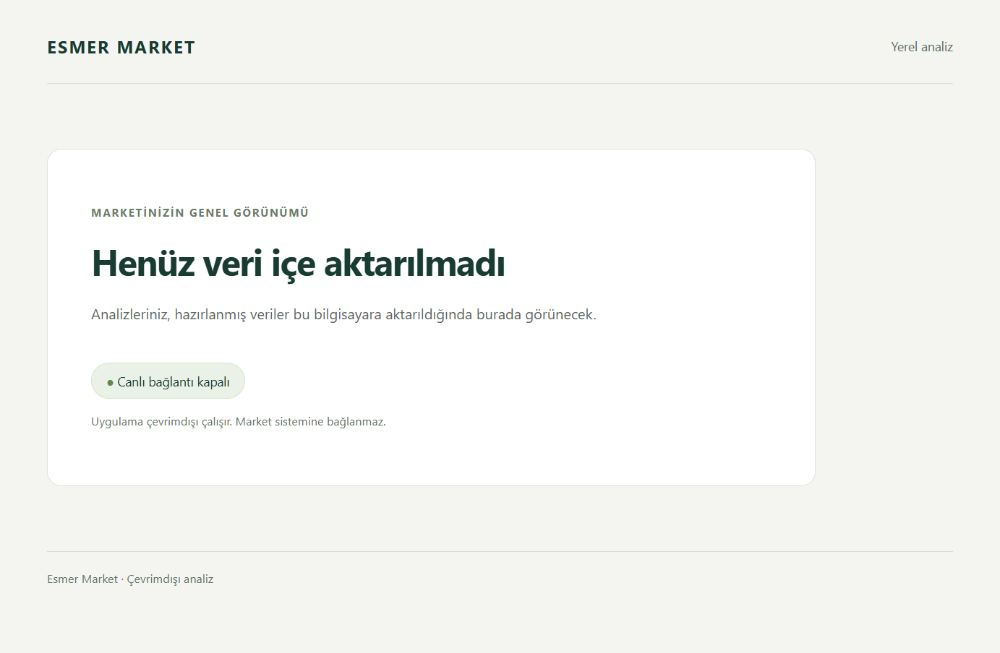
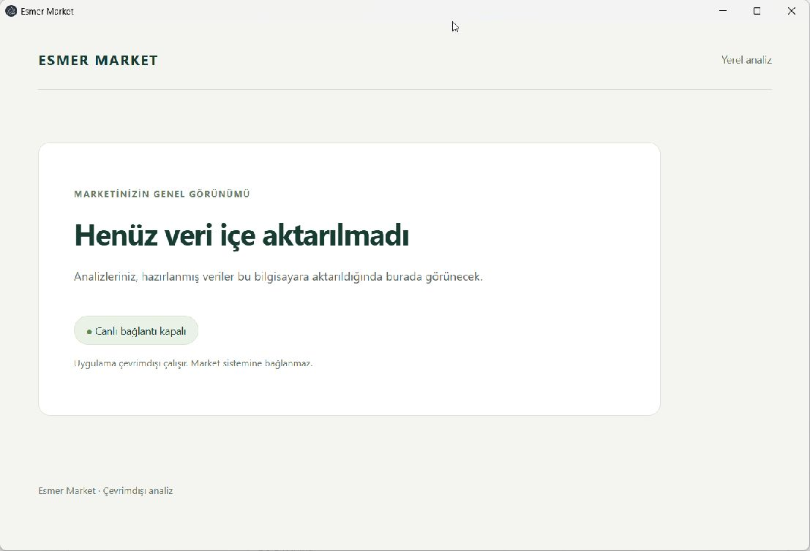
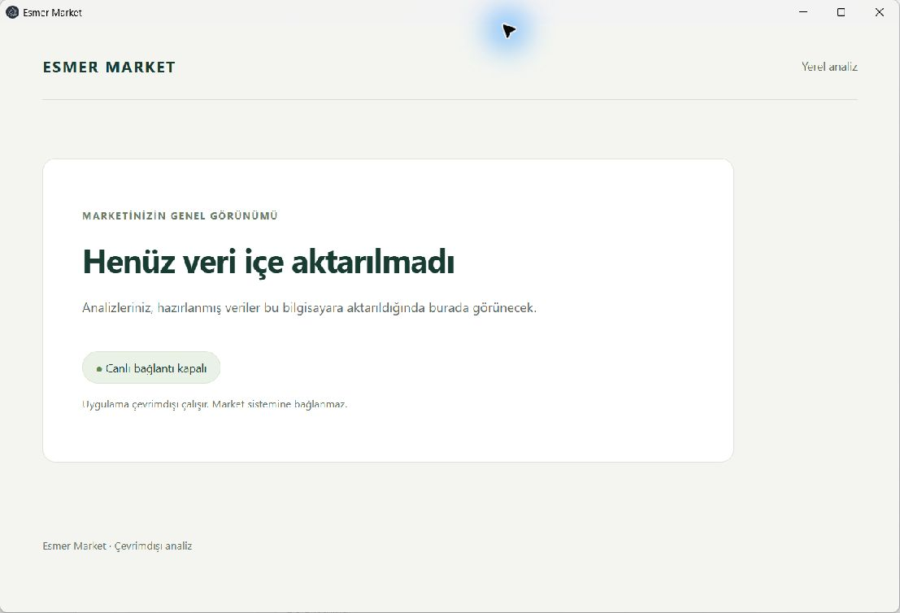

# Phase 2 Windows verification

## Scope and identity

This record covers [issue #5](https://github.com/AlesSystems/esmer-market-analytics/issues/5), tasks 2.1 and 2.2, on `codex/phase-2-source-contract`. The existing PR is [#16](https://github.com/AlesSystems/esmer-market-analytics/pull/16). The user authorized Windows implementation, testing and an update to that PR, with a stop after Phase 2.

- Date: 2026-09-16.
- Initial checkout: clean `main` at `035dd9734ca0d3aebb3ba3b996fd9d8f6f88ed7e`, with one worktree.
- Fetched branch SHA, recorded before edits: `a64f4f0bce4f9416156da161a040aa390f2a0c8b`.
- Final tested code/build SHA: `a64f4f0bce4f9416156da161a040aa390f2a0c8b`. This Windows continuation changes evidence only. Application, fixture, dependency and packaging inputs are unchanged.
- Dependency #4 is closed. Issue #5 remains open with its `enhancement` label.
- App version: `0.1.0`. Desktop fixture: `synthetic-empty-v1`.
- Fixture mapping: `source-contract-v1`. The 25 entries comprise eight golden scenarios, fourteen edge cases, two snapshots and one privacy case across five JSON files.
- Source A and B share `synthetic-market-1`. The reset case uses `synthetic-market-reset`. Accepted-report expectations pin `source-a`, `synthetic-calculation-v1` and app revision `1`.

No source database, container, backup, credential or private business record was accessed. No financial engine, extractor, persistent importer, report engine or new UI was added. The [source contract](../contracts/source.md) continues to mark real-source financial rules unsupported.

## Environment

The test host is the HP development computer documented in [Phase 1](windows-phase-1.md), separate from Eralp's computer and production. Tests used fresh local profiles on this host, not a clean guest VM.

| Item | Measured value |
| --- | --- |
| Windows | Windows 11 Pro 25H2, build `26200.9457`, x64 |
| Hardware | HP ZBook Studio 16 inch G9, Intel Core i9-12900H, 14 cores, 20 logical processors, 31.6 GiB physical memory |
| Command host | PowerShell `7.6.6` |
| Development runtime | Node `24.15.0`, npm `11.12.1` |
| Packaged main and worker | Electron `44.3.0`, Node `24.20.0`, SQLite `3.53.4` |

The existing verified official Node x64 runtime under ignored `work/windows-phase-1/` was prepended to the command process `PATH`. Node 22 and npm 10 on the default host path were not used for verification. The process-only setting `$env:npm_config_script_shell = $env:ComSpec` selects npm's normal Windows command shell, as in Phase 1. No global runtime, shell, system clock or timezone setting changed.

## Commands and results

Each command ran in PowerShell from the repository root. Its exit code was checked before the next command in the required sequence.

| Command/procedure | Expected | Actual |
| --- | --- | --- |
| `git status --short --branch`; `git rev-parse HEAD` | Correct clean branch and recorded baseline | Passed at the fetched SHA above |
| `node --version`; `npm --version` | Node `>=24.15.0 <25`, npm 11 | `v24.15.0`, `11.12.1` |
| `npm ci` | Locked dependencies install | Passed, 410 packages installed, 411 audited, zero reported advisories |
| `npm run test:integration -- tests/integration/fixture-contract.test.ts` | Synthetic contracts and rejection cases pass | 65 passed |
| `npm run typecheck` | TypeScript succeeds | Passed |
| `npm run lint` | No lint errors | Passed |
| `npm run build` | Desktop, preload, worker, UI and runtime notices build | Passed |
| `npm run package:win` | x64 NSIS and portable output, dependency notices present | Passed, `PACKAGE_NOTICES_OK 6 dependencies` |
| `npm test` | Unit, integration and actual packaged Windows desktop checks pass | Passed, 2 unit, 72 integration and 1 desktop test |
| Focused fixture command with process `TZ=UTC` | Same synthetic expectations | 65 passed |
| Focused fixture command with process `TZ=Pacific/Honolulu` | Same synthetic expectations | 65 passed |
| `git diff --check` and local evidence verifier | Valid Markdown links, matching hashes and consistent lifecycle records | Passed, 39 local links, 79 release hashes and four lifecycle runs |

The timezone procedure saved both the prior `TZ` value and whether it existed, then restored that state in `finally`. Restoration was verified. An initial helper used a null-versus-empty comparison that reported false after both tests passed. The corrected helper restored absence with `Remove-Item Env:TZ` and reran both checks successfully. This was evidence-script bookkeeping, not an application failure. These checks exercise synthetic date-only expectations. An actual market-local source timestamp interpreter does not exist yet.

`npm ci` reported deprecation warnings for existing transitive packages `rimraf`, `glob` and `boolean`. No dependency or lockfile changed. Raw command logs remain in ignored `work/windows-phase-2/`; they are not distribution artifacts and are not committed because tool output can contain local paths.

The full suite also emitted Node's `DEP0190` warning for the existing desktop runner's `spawnSync` shell option and a `NO_COLOR`/`FORCE_COLOR` warning. Neither failed a test. No shell arguments or security settings were changed to suppress warnings or obtain a pass. No behavioral defect was found, so no application or test change was needed.

## Packaged runtime and boundary checks

The desktop test launches `release/win-unpacked/Esmer Market Analytics.exe` after packaging and asserts `app.isPackaged`. It observes the Turkish empty state, no password input and the actual preload/main/worker availability reply `{"status":"ready","store":"empty","liveConnection":"disabled"}`. It then restarts the same fresh profile and checks the same result.

The renderer exposes only `getAvailability`, without `require` or `process`. Sandbox and context isolation remain enabled. Node integration and webviews remain disabled. The test checks denied navigation, popups, geolocation and external fetch. These checks do not prove a physically disconnected host. Sender and payload rejection passed in the integration suite. No `--no-sandbox`, raw IPC exposure or weakened `webSecurity` setting was used.

The [runtime measurements](windows-phase-2-runtime.json) distinguish main-process measurements from an additional instrumented worker that loads the exact packaged `dist/service/worker.cjs`. That worker returns its actual availability response and is then terminated. This is test instrumentation, not a new production diagnostic API or inspection of the app's private running worker object.

## Artifact hashes and privacy inventory

Hashes were measured with `Get-FileHash -Algorithm SHA256` and checked with Node's `createHash('sha256')`. The unsigned artifacts remain local under ignored `release/`; no release was deployed or published.

| Artifact under `release/` | SHA-256 |
| --- | --- |
| `Esmer Market Analytics Setup 0.1.0.exe` | `c3fe7a9927be135563cb9171e60b017410630aa92824fc154bd41104496ee1e4` |
| `Esmer Market Analytics 0.1.0.exe` | `cf9524861ebdb376ce86209f7fd91b3b0f18bba7f516c0b77656025e1ec1d91c` |
| `win-unpacked/Esmer Market Analytics.exe` | `06fbf01c3bc9f00bd668bf67c8b306a355499f069d4de180ae27195e6f1b673d` |
| `win-unpacked/resources/app.asar` | `3ea55989fa43f7cd974b46376f1dda1479d765ec0c6df78fb0f5c82f1f757460` |

The [safe inventory](windows-phase-2-package-inventory.json) records 349 ASAR entries, 301 files, production dependency versions/notices and 79 surrounding release files with sizes and hashes. Inspection used installed `@electron/asar` APIs `listPackage`, `statFile` and `extractFile`, with native path separators. `scripts/verify-package.mjs` checks notices only; it was not used as proof of complete privacy.

ASAR top-level contents are `dist`, production `node_modules` and `package.json`. Inspection found no repository tests, synthetic or private attack fixtures, repository docs, work files, source backups, credentials, local databases, source maps, local checkout paths or user-home paths. Searches across extracted archive files found no `SYNTHETIC_PRIVATE_`, `synthetic-market-1`, `synthetic-market-reset` or `source-contract-v1` content. Public dependency documentation remains, including `write-excel-file/docs/IMAGES.md`. Source inspection found no desktop, service, UI or build import of the source contract.

The six dependency notices are nonempty. Both copied Electron notices match `node_modules/electron/dist` byte for byte. The ASAR hash is also unchanged from Phase 1, consistent with the source contract having no desktop entry-point import.

The installed runtime has 77 files and the extracted portable runtime has 76. Every corresponding file matches the 74-file unpacked runtime by hash, with no missing files. Both distribution runtimes additionally contain builder-generated `resources/app-update.yml` and `resources/elevate.exe`. NSIS also adds its uninstaller. The inventory records those extra hashes. The update YAML contains only the public repository/provider and app cache name; no updater code was added or exercised. The actual portable and installed ASAR hashes were checked during each launch, not inferred from filenames.

`builder-debug.yml` is an ignored local build diagnostic that can contain machine paths. It is outside both distribution executables and must not accompany them. Its name, size and hash are recorded without its contents. The surrounding release inventory contains the expected Electron binaries, locale resources, notices, installer, portable executable, block map and update metadata. This inspection covers the current empty distribution, not a future extractor or analytics package.

## Portable and NSIS lifecycle

The final NSIS executable installed into the default per-user test location and launched the app automatically. The agent inspected the native window through Windows Computer Use. It showed `Henüz veri içe aktarılmadı` and `Canlı bağlantı kapalı`, without login or financial demo data.

A local runner reused the Phase 1 Playwright/CDP smoke procedure, adapted under `work/windows-phase-2/lifecycle-smoke.mjs`. The command was `node work/windows-phase-2/lifecycle-smoke.mjs` with process `ESMER_SMOKE_ONLINE=1`, explicitly selecting connected-host checks. It launched the final portable executable twice and the installed executable twice, with the same fresh profile for each artifact. It used a Windows-only `PATH` and cleared Node-specific options. Each launch verified process ancestry, package hash, exact service availability, the narrow preload API, absence of renderer Node powers and the expected UI. All four checks passed. The [lifecycle results](windows-phase-2-lifecycle.json) record adapter status without device or account identifiers. Networking remained connected.

The agent then opened the final portable artifact natively without debugging flags and inspected the same empty view. These visual observations are agent observations, separate from the automated assertions and from any human report.

`Get-AuthenticodeSignature` reported `NotSigned` for both distribution executables. No SmartScreen, publisher or UAC prompt was observed during these local launches and installation. The installer advanced before its progress window could be captured; the resulting app window was captured. These locally built files do not establish warning behavior for downloaded copies or other Windows configurations.

The final test installation was removed with its NSIS uninstaller using `/S`. The uninstaller returned exit 0. The installed executable was absent afterward, the matching current-user uninstall registry entry count was zero, and no app processes remained. The [removal record](windows-phase-2-uninstall.json) retains those checks. No test installation remains. This is an empty-app lifecycle check, not upgrade, data-preservation, recovery or performance acceptance.

## Manual offline status

The host has an active Ethernet adapter and the agent session lacks administrator access. The user explicitly chose to leave the physical-disconnect check open. No networking-disconnected launch or new human observation is claimed for Phase 2. The prior Phase 1 human report is historical evidence, not a substitute for this build's missing check.

## Independent review and remaining gates

Separate Astra low workers reviewed Standards and Spec for `035dd97...a64f4f0`. Both returned no actionable findings. They read the actual fixtures and assertions. The comment review found no changed TypeScript comments or suppressions. These are independent same-model reviews, not cross-model or human certification.

Both workers also reviewed this Windows evidence against the logs, JSON records and screenshots. Both passed. The Standards reviewer independently rehashed all 79 release files. The local verifier checked 39 Markdown file targets, all 79 hashes, the four lifecycle records and removal evidence. Final diff and identifier checks passed.

| Task/gate | Evidence in this phase | Remains open |
| --- | --- | --- |
| 2.1 / A02 / A03 | Unsupported source registry and explicit populations/consequences | Authorized clean-source revalidation, lineage/backup identity, schema comparison, units, KDV, discounts, rounding, business dates, economic identity and conversion/return semantics |
| 2.2 / A02 | G01 through G08, edge oracles and exact synthetic arithmetic checks | Actual financial engine correctness and source reconciliation |
| 2.2 / A04 | Concrete paired snapshots and preservation expectations | Persistent import activation, concurrency, recovery and failure injection |
| 2.1 and 2.2 / A05 | Synthetic allowlist and private-sentinel rejection | Reviewed real raw mappings, reduced real fixtures and actual extractor/log/publication privacy |
| A07 | Windows regression evidence recorded here | Physical-disconnect launch, full dataset, upgrades, recovery, performance and later reporting acceptance |
| L01 | Live connection remains disabled | All production permission and rollout gates |

Synthetic success does not promote source financial rules, estimated profit or any full A02/A03/A04/A05/A07 release gate. The Phase 2 source-dependent exit gate stays open. No Phase 3 work, merge or automatic issue closure is authorized by this record.
