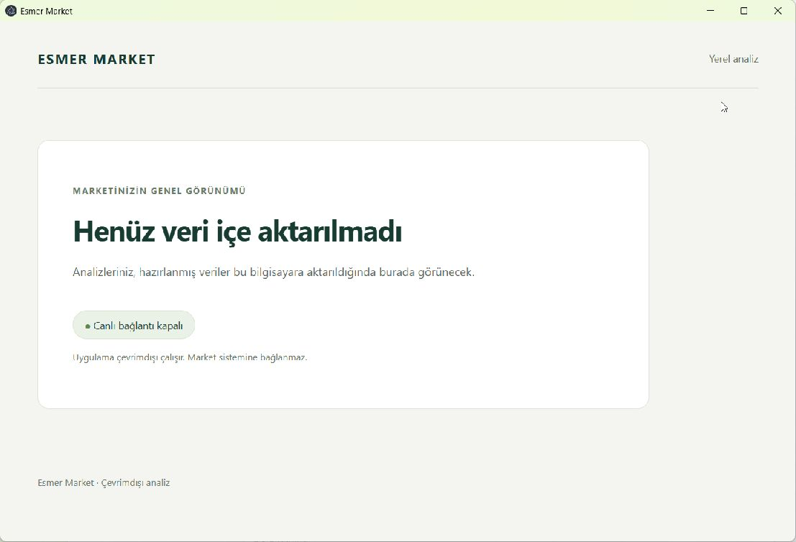
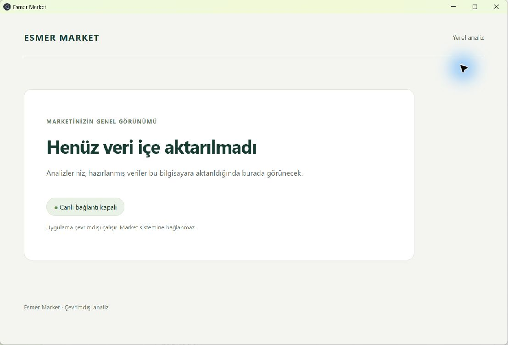

# Phase 3 Windows verification

## Scope and identity

This record covers [issue #6](https://github.com/AlesSystems/esmer-market-analytics/issues/6), tasks 3.1 and 3.2, on `codex/phase-3-analytics-packages`. The existing PR is [#17](https://github.com/AlesSystems/esmer-market-analytics/pull/17). The user authorized Windows verification, necessary Phase 3 fixes and an update to that PR. Merge, issue closure and Phase 4 remain outside this work.

- Date: 2026-09-17.
- Initial checkout: clean `main` at `035dd9734ca0d3aebb3ba3b996fd9d8f6f88ed7e`, one worktree.
- Fetched Phase 3 SHA: `301884b07373899a6c085531561045343988563a`.
- Final tested code/build SHA: `3e20828dfa41162ee4a4939b7e032a63f7da68d1`. Subsequent commits change evidence only. The only Windows code change is test-fixture setup; shipped application inputs remain unchanged from the fetched SHA.
- Issue #6 is open with the `enhancement` label. Dependency #5 is closed; its source-dependent evidence remains unresolved.
- App version: `0.1.0`. Desktop fixture: `synthetic-empty-v1`.
- Extraction fixture: `createSyntheticSource` in `tests/helpers/synthetic-source.ts`. Mapping `synthetic-relational-v1`, lineage `synthetic-test`, extraction ID `synthetic-batch-1`, partial coverage 2026-01-01 through 2026-01-02, extraction timestamp `2026-01-03T00:00:00.000Z`.

No market source, source container, restored backup, credential or private business record was accessed. Negative write and administration tests ran only on disposable synthetic SQLite databases. The desktop still has no package import or activation operation and displays its empty/offline view.

## Environment

This is the HP development test host used in [Phase 2](windows-phase-2.md), separate from Eralp's computer and production. Tests use fresh profiles on the existing host, not a clean guest VM.

| Item | Measured value |
| --- | --- |
| Windows | Windows 11 Pro 25H2, build `26200.9457`, x64 |
| Hardware | HP ZBook Studio 16 inch G9, Intel Core i9-12900H, 14 cores, 20 logical processors, 31.6 GiB memory |
| Command host | PowerShell `7.6.6` |
| Development runtime | Node `24.15.0`, npm `11.12.1` |
| Packaged main and worker | Electron `44.3.0`, Node `24.20.0`, SQLite `3.53.4` |

The verified Node x64 runtime retained under ignored `work/windows-phase-1/` was prepended to the command process `PATH`. Process-only `npm_config_script_shell` selected `ComSpec`. No global runtime or system setting changed.

An initial setup command displayed Node 22.19.0/npm 10.9.3 but incorrectly continued into `npm ci`. That installation exited zero with `EBADENGINE` and is excluded from verification. The agent corrected the runtime selection, enforced the versions and reran `npm ci` successfully with Node 24/npm 11. The lockfile did not change. Both logs remain locally available.

## Commands and regression fix

Commands ran from the repository root in PowerShell. Each exit code was checked before continuing the required sequence. The first package test failure stopped that sequence.

The existing package tests reproduced two five-second Vitest timeouts on Windows. The failing cases created hundreds of fixture rows through individual SQLite autocommits. A focused reproduction reported 5,846 ms for pagination and 6,860 ms for shadowed row identifiers. These were test-fixture setup failures, not incorrect package acceptance or an extraction deadline failure.

Separate measurements compared identical generated rows with and without a fixture-only transaction. Individual inserts took 2,233–3,005 ms per fixture; extraction or rejection took 37–56 ms. Transactional inserts took 12–22 ms. The fix wraps each bulk insertion loop in a transaction before the read-only workflow begins. It changes no source or package code, assertions, timeout, dependency, desktop privilege or financial behavior.

The [fixture timing record](windows-phase-3-fixture-timing.json) retains the measured comparison. The existing failing tests preceded the fix; no new failing assertion or application defect is claimed. The focused reproduction changed from two timeouts to two passing tests in 2.08 seconds, with all seven package tests passing afterward.

| Command/procedure | Expected | Actual |
| --- | --- | --- |
| `git status --short --branch`; `git rev-parse HEAD` | Correct branch and recorded baseline | Clean at fetched SHA |
| `node --version`; `npm --version` | Node `>=24.15.0 <25`, npm 11 | `v24.15.0`, `11.12.1` after setup correction |
| `npm ci` | Install locked dependencies | Passed; 410 installed, 411 audited, zero reported advisories |
| `npm run test:integration -- tests/integration/source-readonly.test.ts` | Synthetic denial and cleanup pass | 6 passed |
| `npm run test:integration -- tests/integration/source-privacy.test.ts` | Allowlist and CLI diagnostics pass | 2 passed |
| `npm run test:integration -- tests/integration/analytics-package.test.ts` | Precise round-trip, rejection and publication pass | 7 passed after fixture fix |
| `npm run typecheck` | TypeScript succeeds | Passed |
| `npm run lint` | Lint succeeds | Passed |
| `npm run build` | Desktop and service bundles build | Passed |
| `npm run package:win` | x64 NSIS and portable build with notices | Passed; `PACKAGE_NOTICES_OK 6 dependencies` |
| `npm test` | Complete suite and actual packaged desktop pass | 2 unit, 87 integration and 1 desktop test passed |
| `node --disable-warning=ExperimentalWarning work/windows-phase-3/cli-proof.mjs` | Synthetic CLI, deterministic output, rejection and cleanup | Passed |
| `node work/windows-phase-3/inspect-package.mjs` | Safe archive inventory and matching notices | Passed |
| `node work/windows-phase-3/lifecycle-smoke.mjs`, process `ESMER_SMOKE_ONLINE=1` | Portable and installed start/restart | Four launches passed |
| NSIS uninstaller `/S` | Remove test installation | Exit 0, executable and registry entry absent |

The complete post-fix sequence reran the three focused files, typecheck, lint, build, Windows packaging and full suite. The desktop runner rebuilt the directory package and launched `release/win-unpacked/Esmer Market Analytics.exe`; it asserted `app.isPackaged`. Its ASAR and executable hashes matched those recorded immediately after Windows packaging. The later lifecycle check used the final portable and installed artifacts themselves.

The [runtime record](windows-phase-3-runtime.json) measures the main process and an additional instrumented worker loading the exact packaged service module. It is test instrumentation, not a production diagnostic API. The desktop test verifies actual service availability, same-profile restart, sandbox/context isolation, absent renderer Node powers, narrow `getAvailability` API, denied navigation/popups/geolocation and blocked external fetch. No security setting or validation was weakened.

`npm ci` reported existing transitive deprecations for `inflight`, `rimraf`, `glob` and `boolean`. The full suite emitted the existing `DEP0190` shell-option and color-environment warnings. These did not fail verification. Raw logs and local proof scripts remain in ignored `work/windows-phase-3/` because command output can contain machine paths. Neither source records nor credentials appear in committed evidence.

## Synthetic preparation and cleanup

The agent followed [prepare-package.md](../operations/prepare-package.md) with the committed synthetic fixture helper. The local command `node --disable-warning=ExperimentalWarning work/windows-phase-3/cli-proof.mjs` exited zero and wrote the [safe CLI record](windows-phase-3-cli.json). Its subprocesses invoke the actual `tools/prepare-backup.ts` command with the documented metadata.

Two unused destinations received byte-identical 1,029-byte packages. Their SHA-256 is `387c1055231c9e331b11a8cd2873cc27e37e052ace8e7fda023c2ded9f063a41`, also matching the macOS synthetic result. The reader returned `SYNTHETIC_ONLY`, `PARTIAL_COVERAGE` and `MISSING_COST`. The source file SHA-256 remained `39496f404b2ee38ac3a791aa35ea0f4525ad11146248cd77ab6a148ac8c7db0d` before and after the complete procedure.

Round-trip records retained the literal expected decimal strings, stable ID beyond JavaScript's safe integer range and null cost. An independently rehashed unknown field and truncated input were rejected. A repeated destination returned `PREPARATION_FAILED` without replacement. Unsupported `source-contract-v1` mode returned `PREPARATION_ARGUMENTS_INVALID`. Captured stdout/stderr contained only fixed diagnostics and no synthetic private sentinels or paths.

Aborted and timed-out preparation preserved the existing destination. Deadline expiry while a consumer was paused released the SQLite lock before the consumer resumed; the next read returned `EXTRACTION_TIMEOUT`. A subsequent source rename and restoration succeeded. The output directory contained exactly the two successful packages and the unchanged generated source, with no failed publication or partial file. The focused integration tests separately exercise active cancellation, early exit, initialization and mid-extraction failure, retry, denied private reads, DML, DDL and administration.

This tests ordinary handled failures on this Windows filesystem. A process or machine crash can leave an unpublished `.partial` file as documented. No power-loss, disk-full, real-source account or full-volume guarantee follows from these checks.

## Distribution inspection and lifecycle

The [safe inventory](windows-phase-3-package-inventory.json) contains all 349 ASAR entry names, 301 file entries, six production dependency versions/notices and 79 surrounding release files with sizes and SHA-256 hashes. Inspection used the installed `@electron/asar` `listPackage`, `statFile` and `extractFile` APIs with native path separators. `scripts/verify-package.mjs` establishes dependency notices only; it was not treated as a privacy inventory.

| Artifact under `release/` | SHA-256 |
| --- | --- |
| `Esmer Market Analytics Setup 0.1.0.exe` | `b2e9ee9a7a7665defa36d7fa5df4a59309a4edccc6b5fb7da391422dcb18b6cd` |
| `Esmer Market Analytics 0.1.0.exe` | `30229b393a131aed7b3f8330cfdf1bf7fb68fbabc29e3f4d8cd1e250e58841c1` |
| `win-unpacked/Esmer Market Analytics.exe` | `06fbf01c3bc9f00bd668bf67c8b306a355499f069d4de180ae27195e6f1b673d` |
| `win-unpacked/resources/app.asar` | `3ea55989fa43f7cd974b46376f1dda1479d765ec0c6df78fb0f5c82f1f757460` |

ASAR top-level entries are exactly `dist`, production `node_modules` and `package.json`. Repository source, tests, fixture databases, tools, docs and work files are absent, as are backups, credentials, local databases and source maps. All extracted archive files were checked for local checkout/home paths, Phase 2/3 mapping markers, preparation/extraction-worker markers and known synthetic private sentinels. No match occurred. Public dependency documentation remains. The two Electron notices match the runtime originals byte for byte.

The portable runtime had 76 files and the installed runtime had 77. Every file corresponding to the 74-file unpacked runtime matched by hash. The inventory records the extra builder-generated `resources/app-update.yml`, `resources/elevate.exe` and NSIS uninstaller. The inspected update YAML contains only the public GitHub repository/provider and app cache name. No updater code was added or exercised. `builder-debug.yml` is an ignored local diagnostic outside the distribution executables; its name, size and hash are recorded, but it must not accompany a release.

The [lifecycle record](windows-phase-3-lifecycle.json) records portable and installed launch/restart with fresh profiles and a Windows-only `PATH`, without a developer Node runtime. Each launch verified process ancestry, the running archive hash, the exact empty/ready/disabled service response and renderer API. All four passed. Physical adapters were connected throughout those automated checks.

The NSIS installation used the default per-user test location and launched the application. Removal used its own uninstaller with `/S`. The [uninstall record](windows-phase-3-uninstall.json) confirms exit zero, absent installed executable, zero matching current-user uninstall entries and no remaining app processes at that checkpoint. The portable artifact was subsequently reopened for the separate manual check. No NSIS test installation remains.

## Manual observations and offline startup

The agent inspected both installed and portable native windows through Windows Computer Use without debugging flags. Both showed `Henüz veri içe aktarılmadı` and `Canlı bağlantı kapalı`, without login or financial demo data. These are agent visual observations, separate from automated assertions or human reports.

`Get-AuthenticodeSignature` reported `NotSigned` for both distribution executables. No publisher, SmartScreen or UAC prompt was observed during local installation and launches. The one-click installer progressed before its window could be captured; the resulting installed application was inspected. Local builds do not establish warning behavior for downloaded copies or other Windows configurations.

Physical-disconnect startup is pending a human report. The agent opened the final portable artifact and asked the user to close it, disconnect Ethernet/Wi-Fi, reopen it twice, verify the expected empty/offline text, reconnect and report any warning. This non-administrative session cannot physically unplug the connection. Phase 2's human report is not reused as Phase 3 evidence.

## Review and remaining gates

Independent same-model Standards and Spec reviewers found no actionable findings in the fetched Phase 3 code. Comment review found no changed TypeScript comments or suppressions to remove. A separate Spec review of the Windows fixture fix found no contract change and checked the measured root cause and CLI proof.

Both reviewers also checked the final Windows evidence against logs, scripts, JSON and all three screenshots, with no actionable findings. The Standards reviewer independently rehashed all 79 release files and matched the exact 349-entry archive inventory. The parent verifier checked 43 local Markdown targets, all release hashes, runtime measurements, four lifecycle runs and uninstall results. Final logs contained no known synthetic private sentinels. `git diff --check` passed. These reviews are independent same-model checks, not human or cross-model certification. The physical-disconnect report remains pending and is not implied by review success.

| Task/gate | Evidence contributed here | Still open |
| --- | --- | --- |
| 3.1 / A01 | Synthetic SQLite lifecycle, denial, bounded reads and cleanup | Dedicated restricted SQL Server account and complete real-driver lifecycle proof |
| 3.1 / A05 | Synthetic allowlist, purchasing-only supplier IDs, payload and diagnostic sentinel checks | Reviewed real raw-column mapping, approved reduced real fixtures and real-data privacy |
| 3.2 / A04 | Deterministic package, strict validation and no-overwrite preparation | Phase 4 activation, app-owned preservation, recovery and accepted-report reproducibility |
| A02 / A03 | Exact transport strings and explicit synthetic-only status | Source semantics, financial calculations and source reconciliation |
| A07 | Windows verification recorded above | Full-dataset operation, upgrades, recovery, reporting and full-volume performance |
| L01 | Live connection remains disabled | Owner acceptance, production permission and separate rollout direction |

The source-dependent Phase 3 exit gate remains open. SQLite denial is not SQL Server account permission proof. A valid synthetic package is never source-reconciled data. No complete A01–A07 or L01 release gate is claimed.
