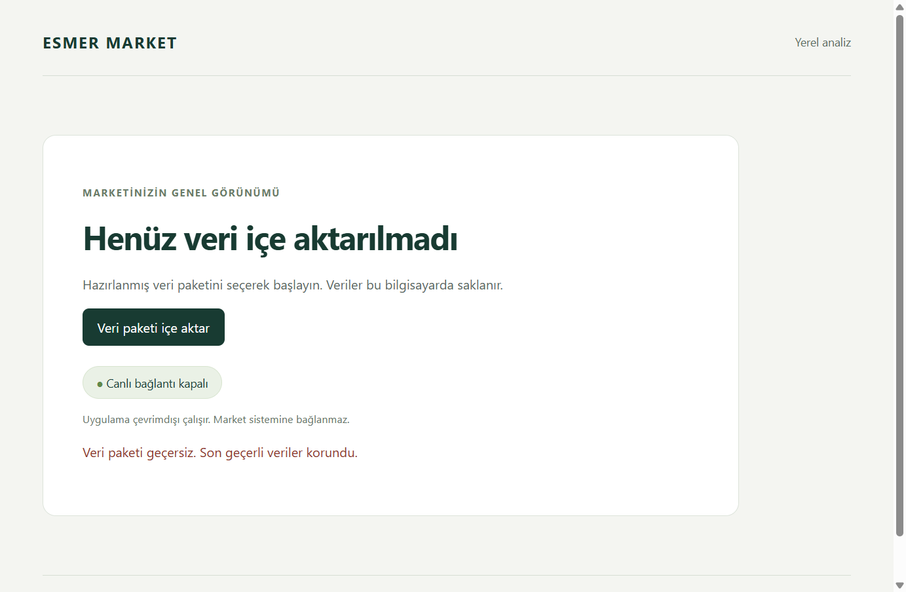
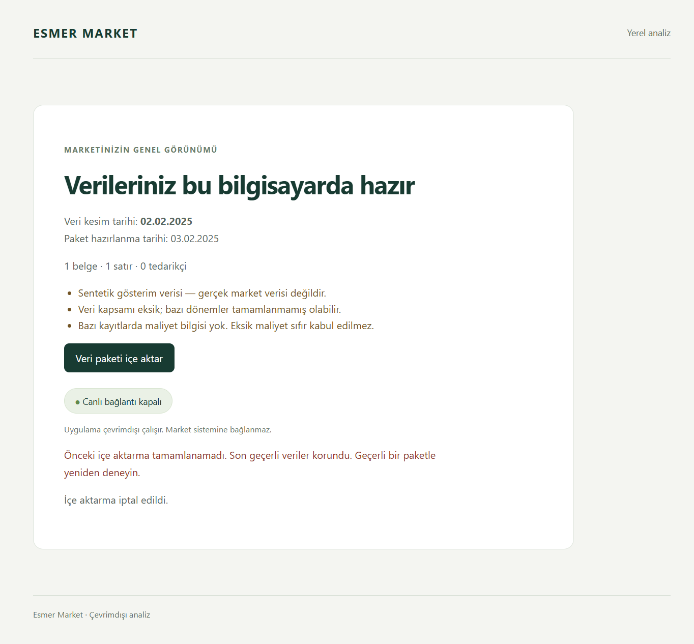

# Phase 4 Windows verification

## Scope and identity

This record covers [issue #7](https://github.com/AlesSystems/esmer-market-analytics/issues/7), [Tasks 4.1 and 4.2](../superpowers/plans/esmer-market-implementation-plan.md#phase-4--durable-local-storage-and-safe-imports), and existing [PR #18](https://github.com/AlesSystems/esmer-market-analytics/pull/18). The user authorized Windows continuation, necessary Phase 4 fixes, commits, push and updating that PR. Merge, issue closure and Phase 5 remain outside this work.

- Date: 2026-09-18.
- Initial checkout: clean `codex/phase-3-analytics-packages` at `552569ede50df056be43a75804d5930d6a8a3a2e`, one worktree.
- Fetched and checked-out Phase 4 SHA: `a3771aed5d22bf7532b5cafa7a84db8ea8abb0e9`.
- Final tested code/build SHA: `3a3f3272745482fe76e427001cbb0d01daaa6420`. Subsequent changes record evidence only.
- Branch: `codex/phase-4-durable-imports`. Issue #7 is open with `enhancement`; dependencies #4, #5 and #6 were closed at inspection. Their source-dependent gates remain open.
- Application version: `0.1.0`. No dependency or lockfile changed.

All data came from generated synthetic packages and disposable app-owned SQLite databases. No source container, market database, private backup, credential or operational source was accessed. This work adds no financial engine, spreadsheet expense workflow, report/export UI, backup/recovery or live integration.

## Environment and fixtures

The test host is the HP development computer used for earlier Windows evidence. It is not Eralp's computer. Profiles were isolated on the existing host; this was not a clean Windows VM.

| Item | Measured value |
| --- | --- |
| Windows | Windows 11 Pro 25H2, build `26200.9457`, x64 |
| Hardware | HP ZBook Studio 16 inch G9, Intel Core i9-12900H, 14 cores, 20 logical processors, 31.6 GiB RAM |
| Shell | PowerShell `7.6.6` |
| Development runtime | Node `24.15.0`, npm `11.12.1` |
| Packaged main and worker | Electron `44.3.0`, Node `24.20.0`, SQLite `3.53.4` |

The default shell reported Node 22.19.0/npm 10.9.3. Before installation or verification, the retained Node runtime under ignored `work/windows-phase-1/node-v24.15.0-win-x64` was prepended to process `PATH`. Process-only `npm_config_script_shell` selected `ComSpec`. No global runtime or system setting changed. `npm ci` installed 410 packages, audited 411 and reported zero advisories. Existing transitive deprecation warnings remain; this is a point-in-time audit result.

The [runtime record](windows-phase-4-runtime.json) measures the packaged main process and a separate probe worker loading the shipped service module. The probe uses its own disposable database. The actual owning-worker tests separately verify migration and availability of `analytics.sqlite` under the selected `userData` profile.

The A/B fixtures and literal oracles are unchanged from [local evidence](phase-4-local.md). Packages use `synthetic-relational-v1`, lineage `synthetic-market-1`, extraction IDs `source-a` and `source-b`, cutoff `2025-02-02`, and preparation timestamp `2025-02-03T00:00:00.000Z`.

| Fixture/package | SHA-256 |
| --- | --- |
| `tests/fixtures/source-a/snapshot.json`, Windows checkout bytes | `8213be6a82ccc3b4e0a81126f93bd2993cf1c8393ca0c2bb7a1e1ac2203cec7f` |
| `tests/fixtures/source-b/snapshot.json`, Windows checkout bytes | `2e98452205d03ee79b463a00ce996aabfd1a5348ec859f0e9b2b35eabcf09857` |
| Source A Git blob, LF bytes | `5c1c36c8890fb29e7134fa37f606df68778a21064dbb2d028f465939b1293116` |
| Source B Git blob, LF bytes | `f3d59dd196f7b3d79c365bd39df0016ad7671fb80d9dc780ed2ea84af580cf53` |
| Native/lifecycle package, `synthetic-windows-phase-4/windows-lifecycle-v1`, 936 bytes | `fdce8fe24be98f5579ea710fa9e6719ab2789b1cd868c7a813859b4297d4f0a1` |

Git's Windows checkout uses CRLF, so its file hashes differ from the unchanged LF blobs recorded on macOS. The parsed fixture values and canonical package encoding are unchanged.

The native/lifecycle fixture has one sale document, one line and no suppliers. It preserves quantity `0.125000000000000001`, net text `12345678901234567890.123456789` and null cost. Coverage is explicitly partial. These are transport values, not financial calculations or reconciled market results.

## Reproduced defects and fixes

Independent Standards and Spec review identified two defects in the inherited implementation.

First, the import attempt was inserted inside the candidate transaction. Killing the process during reading, persistence, validation or summary generation preserved the prior data but lost the restart warning. The expanded test actually terminated a child process blocked at the requested boundary. Four assertions failed because `lastImportError` was absent; ten other tests passed. Commit `fb81d97` records that contract. Commit `ab75d3f` persists the attempt before candidate work while retaining the atomic candidate and activation transactions. Current-package retries clear the warning; historical-package attempts remain cancelled and preserve it. Difference assertions now identify their activation batch instead of assuming it is the final history entry.

Second, cancelling the native picker hid a persisted warning because any import result suppressed the warning paragraph. Both empty and loaded packaged regressions failed with no alert element. Commit `045a3d1` records those failures. Commit `ffbec7d` keeps unresolved warnings visible after cancellation and historical-package selection. Successful import still clears the warning. No IPC operation, privilege or schema changed.

Commit `3a3f327` extends the termination matrix to empty and loaded databases and adds packaged owning-worker migration/restart preservation. It also checks historical-package selection while a warning exists. These tests retain the original source, adjustment and report-pin assertions.

The first full-suite attempt passed 2 unit and 114 integration tests but encountered `EBUSY` while rebuilding the executable. The agent had launched a focused desktop test against the same output concurrently. This was test orchestration interference, not an application locking defect. A wrapper invocation with a multiword `-g` pattern also returned `No tests found`; the directly invoked single-word filter ran correctly. Neither attempt counts as final verification. Final packaging and desktop execution were serialized and passed. One intermediate TypeScript error in the new test's union narrowing was corrected before the passing sequence.

## Final command results

Commands ran in PowerShell with the supported runtime. Each command's exit code was checked before the next command. Checkout, runtime selection and `npm ci` occurred at the fetched SHA. The final validation sequence from the ownership test through `npm test` exited zero at code/build `3a3f327`.

| Command/procedure | Expected | Actual |
| --- | --- | --- |
| `git status --short --branch`; `git rev-parse HEAD` | Preserve work and identify the requested branch | Clean fetched branch; SHA recorded above |
| `node --version`; `npm --version`; `npm ci` | Supported locked installation | Node 24.15.0, npm 11.12.1, installation passed |
| `npm run test:integration -- tests/integration/store-ownership.test.ts` | Migration, precision, immutable reports and schema rejection | 3 passed |
| `npm run test:integration -- tests/integration/import-activation.test.ts` | Overlap, concurrent edits, lineage, retention and idempotency | 5 passed |
| `npm run test:integration -- tests/integration/import-failures.test.ts` | Handled failures, real termination, storage pressure and restart | 19 passed |
| `npm run typecheck` | TypeScript succeeds | Passed |
| `npm run lint` | Configured lint succeeds | Passed |
| `npm run build` | Bundle desktop, service and UI | Passed |
| `npm run package:win` | x64 NSIS/portable outputs and dependency notices | Passed; six dependency notices checked |
| `npm test` | Complete suite, including the actual packaged Windows executable | 2 unit, 119 integration and 5 desktop tests passed |
| Independent focused review run | Recheck changed store behavior | 27 tests passed across the three Phase 4 files |
| Archive and release inspection | Exclude prohibited inputs and record exact outputs | 349 archive entries, 301 archive files, 79 surrounding release files; no prohibited findings |
| Native picker and lifecycle procedures below | Preserve synthetic state across allowed outcomes | Passed within the stated limits |

`test:desktop` rebuilt the directory package and launched `release/win-unpacked/Esmer Market Analytics.exe`. Tests assert `app.isPackaged`, selected `userData`, real service responses, sandboxing, context isolation, absent renderer Node/process access, named preload methods, blocked external fetch, denied navigation/popups/geolocation, and dependency notices. Boundary tests reject arbitrary SQL, paths, credentials, unknown operations and untrusted senders before privileged work.

Raw command logs and local proof scripts remain under ignored `work/windows-phase-4/`. Final logs are named `final-ownership.log`, `final-activation.log`, `final-failures.log`, `final-typecheck.log`, `final-lint.log`, `final-build.log`, `final-package-win.log` and `final-full-suite.log`. Raw logs are not committed because they contain local paths. The existing `DEP0190` shell-option warning and color-environment warnings did not fail the final run.

## Durability, interruption and storage pressure

Task 4.1 tests preserve precise source values, expense corrections, original revision evidence, settings, confirmations, adjustment targets and accepted-report pins. The packaged test starts with schema v1 and proves the owning worker advances it to v2. After two same-profile launches, the source/app snapshot, earlier pinned snapshot and accepted report remain equal to their pre-launch values. The closed database can be renamed and restored on Windows.

Task 4.2 tests replace A with B, retain app edits made between staging and activation, and mark changed/deleted targets review-required without reassignment. Identical and previously activated superseded packages do not duplicate source facts or silently select old data. A reset lineage treats reused IDs as distinct. Retention preserves active/rollback datasets, report pins and adjustment evidence while pruning unreferenced candidates and keeping deduplication history.

Caught exceptions cover reading, persistence, validation, summary and activation separately from crash proof. Ten additional tests terminate an actual child process with `SIGKILL` at those five boundaries, in both empty and loaded profiles. Restart retains the prior source/app snapshot, records `INTERRUPTED`, and a successful retry clears it. These are process-termination tests on Windows, not power-loss tests.

Packaged tests separately reopen nonterminal persisted candidates and check Turkish interruption warnings in both empty and loaded screens. Cancellation and historical selection retain the warning; successful import clears it. The packaged tests seed the interrupted candidate directly rather than killing Electron itself. The process-kill tests above exercise the store code in a real Node child.

The storage-pressure test sets SQLite `max_page_count` on a disposable database and inserts a larger synthetic candidate. SQLite returns actual `SQLITE_FULL`, mapped to `STORAGE_FULL`; prior state and `integrity_check=ok` survive restart. This is not physical disk exhaustion. No volume was filled. Physical disk-exhaustion and power-loss acceptance remain open.

The package reader closes its file in `finally`. Windows tests reject oversized/nonregular files and exercise cancellation/failure paths. After the native flows and application shutdown, exclusive file opens succeeded for all three synthetic profile databases and both selected package files. Both package files could be renamed and restored. Lifecycle launches also renamed each closed database. These observations show release at those checkpoints; they do not claim a handle census during every instruction or prove power-loss behavior.

## Native picker, install, upgrade and uninstall

The [lifecycle record](windows-phase-4-lifecycle.json) contains fixture/environment identity, six instrumented lifecycle launches, five real-picker outcomes, signatures and uninstall comparisons. Lifecycle commands were `node work/windows-phase-4/lifecycle-proof.mjs baseline`, `upgraded` and `portable` under Node 24. The launch environment contained only Windows directories in `PATH`, with no developer Node dependency. CDP verified launched-process ancestry and running archive hashes.

NSIS installation used `/S /D=<isolated work/windows-phase-4/nsis-app>` with process-only `APPDATA` directed to `work/windows-phase-4/installer-appdata`. No existing application installation was present. Explicit test profiles were `work/windows-phase-4/installed-profile`, `portable-profile` and `native-profile`. No personal profile was deleted or modified by these procedures.

Before installation, the two lifecycle profiles received schema-v1 synthetic state. An accepted report pins revision 1, while the current state has five revisions including a precise expense correction, adjustment, setting and incomplete confirmation. The original installer was installed and launched twice. The final installer then replaced that installation and launched twice with the same profile. Both migrated/reopened the data and preserved current and accepted state. Portable launch/restart passed the same checks.

This was an in-place code upgrade with both installers labelled `0.1.0`, not a version-number upgrade. The running baseline archive hash was `0a1d43fce5452f599ae8a67cfa27de9a0e0c717a3f2f5bae6f741c1b8f65e64c`; the upgraded archive matched the final hash below. Version-increasing upgrades and failed-upgrade recovery remain later packaging acceptance. The baseline installer was retained outside Git before the final build; a separately copied unpacked archive is not used as the baseline identity.

The agent operated the installed app's real Windows file picker through Computer Use. Dialog results were not substituted for these five outcomes:

1. Invalid synthetic input on an empty profile retained the empty screen and showed a Turkish error.
2. Native cancellation retained empty state and the prior error warning.
3. The valid synthetic package loaded successfully and displayed synthetic-only, partial-coverage and missing-cost warnings.
4. Invalid input after success retained the complete loaded dataset and reported the failure.
5. Cancellation after that failure retained both the dataset and unresolved warning.

CDP read availability and captured screenshots after native interaction; it did not replace the file dialog. The automated packaged tests additionally substitute dialog return values to cover repeat/historical import and interrupted restart. These are separate methods of evidence.

The agent visually inspected these screenshots. They contain only synthetic state. Native-dialog screenshots with surrounding personal directory listings were not committed.

The test installation's own uninstaller ran with `/S`, exited zero, removed the installed executable and left zero matching current-user uninstall entries. All three synthetic profile database hashes were unchanged afterward. No application processes remained at the checkpoint. The explicit profiles remain in ignored `work/windows-phase-4/` for evidence; uninstall did not delete them.

With ordinary launch settings, Electron places `analytics.sqlite` under `app.getPath("userData")`, normally `%APPDATA%/esmer-market-analytics` for both installer and portable builds. The portable launcher does not relocate it beside the executable. This test verifies preservation at the explicit isolated `--user-data-dir` locations above. Preservation/deletion behavior of an existing personal default profile was deliberately not exercised.

## Offline and publisher observations

All six lifecycle launches loaded a previously imported package, then reloaded with the browser context set offline. The packaged migration test also checks this behavior. Live connection stayed disabled, the stored dataset remained readable, and no developer runtime was on the lifecycle application's `PATH`.

The host's physical networking was not disconnected for these checks. Browser-emulated offline reload does not establish a cold launch with physical adapters disconnected or inspect all possible main-process networking. No Phase 4 human physical-disconnect observation was supplied. Earlier phases' human reports are not reused here. That manual check remains open.

`Get-AuthenticodeSignature` reported `NotSigned` for both final executables. No publisher, SmartScreen or UAC prompt was observed during these local silent installations or launches. Silent local execution does not prove that a downloaded copy will show no warnings. No paid signing service was introduced.

## Distribution inspection and hashes

The [safe package inventory](windows-phase-4-package-inventory.json) records every archive file and surrounding release file with SHA-256. Inspection used installed `@electron/asar` APIs independently of `scripts/verify-package.mjs`, which checks notices only. Archive contents consist of the built app, production dependencies and `package.json`. Store and package-reader code is expected in `dist/service/worker.cjs`; source extraction and preparation tooling is absent.

Repository source, tests, fixtures, work files, private backups, local databases, credential-file patterns, source maps and known synthetic private sentinels were absent. Upstream dependency documentation remains. Inventory is a bounded build-input/content inspection, not real-source privacy certification. Local `builder-debug.yml` is inventoried outside the executables and must not accompany a distribution.

| Artifact under `release/` | SHA-256 |
| --- | --- |
| `Esmer Market Analytics Setup 0.1.0.exe` | `fb99997aecd2e91d334d7db5fe19eccd1bfa73be6556ee3eca62b9c175943d9c` |
| `Esmer Market Analytics 0.1.0.exe` | `4acfaa7bebf34a7d180a99de7c25032bb6158f3cf7f68e9330f021d84c135dfa` |
| `win-unpacked/Esmer Market Analytics.exe` | `666df479dd05d3eecec8442086b7170ce2d0debb67efbaf91f496206724ee8de` |
| `win-unpacked/resources/app.asar` | `ced2a5d0e57cb1ed1c0d2739a0a8654db13246a6296abc62c9eedae6879d4e14` |

Installed and portable running archives matched the final unpacked archive after the full suite rebuilt its directory package. Their inventories and process-ancestry checks remain in the local lifecycle proof directory. No release executable or database is committed.

## Review and remaining gates

Independent same-model Standards and Spec follow-ups reported no remaining actionable code findings at `3a3f327`. The Standards delegate separately reviewed the fixes. The reviewer reran 27 focused tests and independently inspected the stable Windows distribution. These are agent reviews, not human or cross-model certification.

Final evidence review matched all 79 release-file hashes and 301 archive-file hashes, checked 58 local documentation targets/anchors, compared committed runtime/lifecycle JSON with the original results, and visually inspected both screenshots. It also confirmed the three retained database hashes still match the post-uninstall record. `git diff --check` passed. Setup-versus-final commit attribution and timestamp serialization were corrected during review; no evidence findings remain.

The Prove It Works principle changed verification to actual process termination and packaged-worker reads. Fix Root Causes placed the durable marker outside the rollback transaction and kept the warning tied to unresolved persisted state. Model the Domain retained the existing import-batch state model instead of adding another recovery flag. Test Behavior, Not Implementation kept assertions on reopened snapshots, report pins and visible warnings. Build the Lever produced the committed expanded termination and packaged migration tests.

| Task/gate | Evidence contributed | Open obligations |
| --- | --- | --- |
| 4.1 / A04 | Windows migration, source/app revisions, report pins and retention | Later expense-import provenance/duplicates and encrypted recovery |
| 4.2 / A04 | Idempotency, overlap, concurrent edits, lineage reset, failure injection, actual process termination, SQLite page pressure and native import | Physical volume exhaustion and power-loss behavior are not proven |
| A01 / A05 | Validated IPC, renderer restrictions, synthetic-only inputs and inspected Windows distribution | Real mapping, restricted SQL Server permissions, reconciliation and real-data privacy |
| A02 / A03 | Exact transport precision and explicit missing/synthetic coverage | Financial formulas, source semantics, confidence and report/export behavior |
| A06 | No claim | Encrypted backup and independent recovery remain Phase 9 |
| A07 | Windows packaged tests, real picker, portable/NSIS restart, same-version code upgrade and uninstall preservation | Human physical-disconnect cold launch, versioned/failed upgrades, clean VM, full-volume performance and complete usability/export acceptance |
| L01 | Live access remains disabled | Owner acceptance, source permission and separate rollout direction |

The bounded synthetic Phase 4 Windows checks passed. Full A04 and first-release acceptance remain open. No merge, issue closure or Phase 5 work follows from this record. Continue any remaining Phase 4 acceptance on the same branch and existing PR.

For the remaining human physical-disconnect check, close the app, disconnect Ethernet/Wi-Fi, and launch the hashed final portable executable with `--user-data-dir=<repository>/work/windows-phase-4/portable-profile`. Verify the loaded synthetic record, historical cutoff, missing-cost/partial-coverage warnings and disabled live connection. Close and reopen it with the same profile, then reconnect and record the actual result. Do not substitute an earlier phase's observation or use a personal profile.
