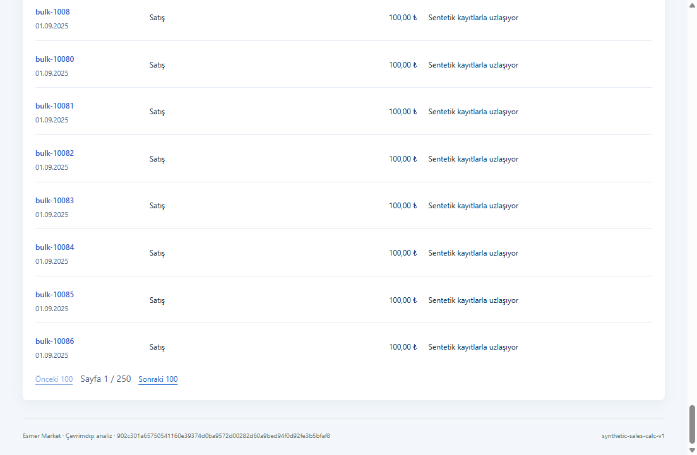
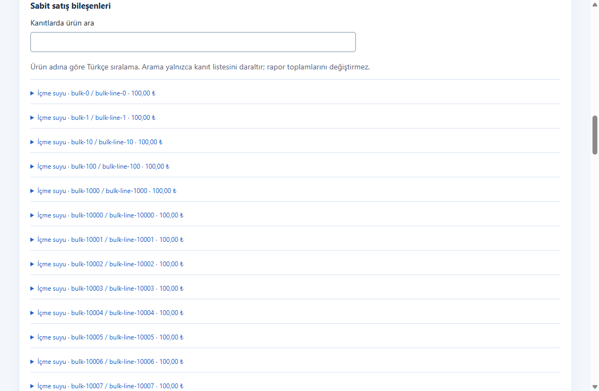

# Phase 8 performance continuation

This is the bounded performance continuation for [PR #22](https://github.com/AlesSystems/esmer-market-analytics/pull/22), [issue #11](https://github.com/AlesSystems/esmer-market-analytics/issues/11), Tasks 8.1/8.2 and D18/A07. The baseline is `ffa0fb3f71d3c717995459fb14f49e1530e1e6e4`; application changes end at `6d9ec28` on `codex/phase-8-reporting`. Ordinary dashboard and drill-down completion must be under two seconds. Background calculation has a separate measurement.

**Result:** all 48 measured ordinary interactions (16 actions in three fresh packaged Windows processes) passed below two seconds; the slowest was 1.037 seconds. Source correction, accepted-value preservation, real cancellation and retry passed. This satisfies the measured synthetic workload, not full source-volume or release acceptance. [Reduced proof](windows-phase-8-performance-proof.json) retains every sample; [the profiler and procedure](windows-phase-8-tools/README.md#repeat-the-performance-continuation) reproduce it.

## What the baseline established

The exact existing synthetic workload contains 25,000 documents and 25,000 lines, 16,442,389 bytes, SHA-256 `902c301a65750541160e39374d0ba9572d00282d60a9bed94f0d92fe3b5bfaf8`. The original full monthly response is 61,785,673 JSON bytes; the sales response is 4,540,611 bytes. No original market backup or source connection was used.

| Baseline stage | Observed milliseconds | Interpretation |
| --- | --- | --- |
| SQLite snapshot read, three samples | 324.9 / 296.2 / 287.6 | Includes all snapshot records; not evidence that an index is missing |
| Sales calculation, three samples | 298.0 / 269.9 / 265.8 | Pure calculation |
| Gross calculation, three samples | 636.1 / 681.7 / 636.0 | Included repeated sales work |
| Purchasing calculation, three samples | 641.3 / 644.3 / 644.3 | Included repeated gross/sales work |
| Sales report open, three samples | 903.8 / 875.7 / 805.5 | Read, calculate and construct response |
| Monthly assembly and full clone, one sample | 3407.9 | In-process service diagnostic, not UI latency |
| Full monthly JSON, three samples | 206.2 / 208.0 / 219.9 | Serialization only |
| Clean transaction click through two animation frames | 3943.4 | 25,000 rendered rows; 175,073 DOM nodes |

The clean render measurement used a direct DOM click in the renderer and waited for the expected heading and row count before two animation frames. It performed no Playwright role/accessibility lookup inside the measured interval. Its receipt is `work/performance/clean-render-baseline.json` (SHA-256 `9ee1c317c0a1ec1c0e320e2caa9c36f5f1bf900803cddc8c99294e1b3f0d1cf1`). Stage samples are in `work/performance/profile-kPEsqW/service-checkpoint.json`.

An earlier diagnostic reported an 86.7-second transaction action. Its CPU profile attributed 45,977 of 61,963 samples to Playwright accessibility/name computation; that is a contaminated application timing, not a baseline for the fix. Likewise, the previous Windows record's 49–59 second monthly calls returned the entire graph through the automation bridge. They do not isolate background calculation. The recorded roughly 2.34 million KB renderer peak includes that instrumentation path. These failed measurement approaches remain in ignored evidence rather than being silently replaced with favorable samples.

## Changes chosen from those measurements

The existing `SalesReports` session now lazily reuses exact-range sales calculations and period gross/purchasing results. Reopening invalidates the session; source dataset, app revision, period and calculation versions stay pinned. The monthly candidate has one identity within the session. No persistent cache, schema migration, dependency, SQL index or financial rule changed.

Monthly IPC responses project the summary before cloning or transferring it. Sales/source evidence is requested in service-bounded pages of 100 rows for a selected report identity. Full accepted output and exports preserve the existing artifact. Purchasing evidence loads only when opened. Sales and purchasing tables render at most 100 rows per page while filters and totals retain their full population. A shared date formatter avoids creating one formatter for every visible date.

Accepted artifacts remain immutable. Querying an older accepted candidate overlays only current stale flags on the response; reading the saved version still returns its saved values and review. Historical evidence never recalculates from current source data. Full-artifact public reads, compact responses and page results isolate caller mutations. A separate design review rejected a new persistent cache/paging subsystem in favor of these changes within existing session and report-version classes.

## Packaged Windows result

The passing receipt is `work/performance/profile-fixed-HecqT7/profile.json`. It ran on 22 September 2026, Windows 11 Pro 25H2 build 26200.9457, x64, Intel i9-12900H (20 logical CPUs), 33,974,288,384 bytes RAM, with Node 24.19.0 for the harness. Packaged Electron 44.3.0 embeds Node 24.20.0, Chromium 152.0.7977.78 and SQLite 3.53.4. Actual display scale was 100%, 2560 × 1440; no forced scale was used. No builds or tests ran alongside the benchmark.

| Artifact | SHA-256 |
| --- | --- |
| Packaged executable | `8c04c7f7e39e98b139d5b4a694c3221020d1abc33ae69a77d4800e3e09ba7015` |
| `app.asar` | `4c65457685aa6b213d0e24e79bfbfbac660ef07d20e119a62b7bd0b1e57ea8fd` |
| NSIS installer | `b6323b853f9811fc1f9e464604beaef1bbfa731b2d8d6fc093533cfb291f59e0` |
| Portable | `4946cb471f37b8bd41b5e8a10737b2bcac33e242ba6b8d53eab3998fc953d094` |

Both distribution executables report `NotSigned`. Application files were committed at `6d9ec28`; documentation and the profiler were uncommitted during measurement. The reduced proof includes their source-state note and the profiler hash. The binary hashes identify the actual tested application.

Times below include renderer content readiness and two animation frames after a direct click. First entry means the first navigation to that view in a fresh process after its normal initial monthly calculation. Warm means a repeated navigation in that process. OS filesystem caches were not cleared. Three samples establish the observed median and maximum, not a reliable population p95.

| Ordinary action | Median ms | Maximum ms |
| --- | ---: | ---: |
| Sales first entry | 418.4 | 1036.9 |
| Transactions first entry | 308.9 | 1010.5 |
| Sales warm | 451.0 | 489.4 |
| Transactions warm | 295.3 | 468.8 |
| Next transaction page | 15.4 | 15.8 |
| Transaction detail | 16.5 | 16.5 |
| Monthly return | 16.1 | 16.1 |
| Monthly warm | 19.4 | 22.3 |
| Current purchasing | 641.1 | 689.3 |
| Purchasing source detail | 16.3 | 16.4 |
| Monthly after purchasing | 16.2 | 16.4 |
| First monthly evidence page | 277.3 | 386.1 |
| Next monthly evidence page | 222.0 | 264.9 |
| Selected candidate purchasing evidence | 677.0 | 773.6 |
| Report versions | 137.5 | 137.8 |
| Saved accepted-report open | 253.2 | 259.2 |

Transaction samples were 296.4, 308.9 and 1010.5 ms, with 100 rows and 777 DOM nodes rather than the baseline's 25,000 rows and 175,073 nodes. The slower third process is retained. Current/saved purchasing responses still load complete purchasing graphs, but these measured interactions pass; service paging of those graphs was not added speculatively. The selected-candidate purchasing evidence timing is distinct from accepted-report open, as shown above.

The monthly summary is **3,942 JSON bytes**, versus the unchanged full artifact's 61,785,673 bytes. A final in-process diagnostic measured database read 222.1 ms; sales 264.0 ms; whole-history sales 252.8 ms; gross with reused sales 96.4 ms; purchasing with reused gross 11.9 ms; sales open 745.3 ms. First full monthly assembly plus defensive clone took 1332.2 ms, and a warm full-artifact clone took 464.4 ms. Full JSON serialization took 173.1 ms; compact projection plus clone took 0.707 ms and compact JSON 0.029 ms. These are single diagnostic samples, separate from UI timing. Warm named monthly IPC roundtrips, timed inside the renderer without sending graphs to Playwright, were 0.9, 0.9 and 6.3 ms, including service dispatch and response cloning.

Background monthly readiness from the first-window evaluation took 1516.4, 1509.6 and 2048.1 ms. This excludes earlier process-launch work and is not an ordinary interaction measurement. After the corrected import, an uncached monthly job was cancelled during sales in 163.0 ms. Navigation to the expense heading plus two frames took 12.7 ms while work was active; that measures the navigation shell, not completion of an expense read queued behind the worker. Retrying calculation completed in 756.5 ms and returned the independent expected net 2,500,020. The accepted report kept net 2,500,000 and original first-line contribution 100.

The renderer heap grew from 12.6–13.0 MB before navigation to 125.9–126.7 MB after exercising all views, including purchasing. Renderer process peak working sets were 342,204–349,132 KB. These samples do not reproduce the old roughly 2.34-million-KB automation-heavy renderer peak. They do not establish a continuous total-app peak, absence of leaks or production-volume safety. The reduced proof retains all app-process memory samples. Larger expense lists and revision-comparison payloads remain unmeasured.

Two prior failed benchmark receipts are retained. `profile-fixed-KhgTQe` completed its sales/monthly samples but its correction generator changed a shared nested object in every row; replacing row zero's nested objects fixed the probe. `profile-fixed-LIHRHU` expected the wrong purchasing heading and timed out; the assertion now uses the observed heading. Neither was an application assertion failure. The passing run repeats the complete expanded procedure after both corrections.

## Correctness and verification

The initial compact-display contract failed because the display operation was missing, and the packaged pagination contract failed with 201 rows instead of 100. A preserved baseline module also produced a different monthly identity on repeated calls, while the updated module preserves it. The first attempted cache test failed from a test-owned non-cloneable proxy, which was removed; a later controlled cache fault is not represented as an original baseline failure.

The baseline and updated complete monthly artifacts are canonically equal on the same `businessPackage()` snapshot after normalizing only five generated UUID fields: report ID and the report/sales/purchasing/operating session IDs. Totals, precision, method versions, explanations, ordering and evidence were not normalized. Receipt: `work/performance/baseline-equivalence.json`.

Fresh review found that revisiting an accepted candidate could lose its stale notification after an expense or source change. Two focused contracts failed with `stale: false`, then passed after the response-only overlay fix. They also verify unchanged accepted output after restarting the report reader. A separate earlier regression, losing review state when reusing an accepted candidate, was exposed and fixed before the independent reviews.

| Command/procedure | Expected | Actual | Evidence under `work/performance` |
| --- | --- | --- | --- |
| `npm run test:unit` | All unit contracts pass | 29 passed | `full-unit.log` |
| `npm run test:integration` | All integration contracts pass | 181 passed on unchanged retry; 183 passed after review contracts/fix | `full-integration-retry.log`, `final-integration.log` |
| `npm run test:desktop` | Actual packaged Windows behavior | 21 passed at `e4dce3e` | `full-desktop.log` |
| Packaged monthly, pagination and unavailable-state files | Final application build remains correct | 5 passed at `6d9ec28` | `final-desktop-focused.log` |
| Accepted-stale fix plus cache/revision contracts | Stale notice, fixed values, unchanged stored history | 13 passed at `6d9ec28` | `accepted-stale-green.log` |
| `npm run typecheck`, `npm run lint` | Exit 0 | Passed after the final application fix | `final-typecheck.log`, `final-lint.log` |
| `npm run package:win` (includes build) | Windows NSIS/portable and notices | Exit 0; seven notices | `package-win-final.log` |

The first full integration run had two existing activation-crash tests time out at 5 seconds, followed by temporary-file cleanup `EPERM`; the unchanged rerun passed all 181. An earlier focused concurrent boundary run also timed out and passed unchanged on retry. These failures are retained (`full-integration.log`, `boundaries-green.log`, `boundaries-retry.log`); their environmental cause is not proven. No timeout was increased. The first packaging attempt failed because the host npm script shell was Windows PowerShell 5 and rejected `&&`. Setting the process-local script shell to `cmd.exe` fixed the toolchain invocation; it was not an application failure.

## Review and remaining gates

Both fresh reviewers used Sol at high reasoning and were independent of implementation. Standards identified the accepted-candidate stale-state defect and verified its fix. Spec independently identified the same defect. It initially treated the old 3.943-second render as a post-change failure; review of the new 100-row measurements corrected that interpretation. Unmeasured expense and revision-comparison payload limits are retained as full-volume limitations, not asserted regressions.

Standards: zero remaining findings after verifying the response-only stale overlay. Spec: zero remaining actionable findings after inspecting the final purchasing, correction and cancellation measurements. The no-comments/deslop pass removed an unnecessary full clone from the compact path and consolidated duplicate pagination controls before the fresh reviews.

Physical network disconnection on this build, publisher/downloaded SmartScreen behavior, a separate clean account, versioned and failed upgrades, actual source-volume behavior, real-source semantics and owner acceptance remain open. Old native Excel, scaling and lifecycle receipts remain tied to their original archive. This continuation does not rerun or upgrade those gates. Phase 9, Phase 10 and L01 are outside scope. No merge, source inspection, production access, owner contact or deployment is authorized by this evidence.

## Engineering choices

**Build the Lever** produced the committed profiler and retained failure receipts. **Model the Domain** kept the cache within the existing pinned session and made compact summaries and evidence pages distinct typed responses. **Sequence Work into Verifiable Units** separated failing contracts, calculation reuse, display/paging, boundary checks and review fixes into commits. **Prove It Works** required actual packaged Windows interactions, source correction and cancellation, with background duration reported separately.
