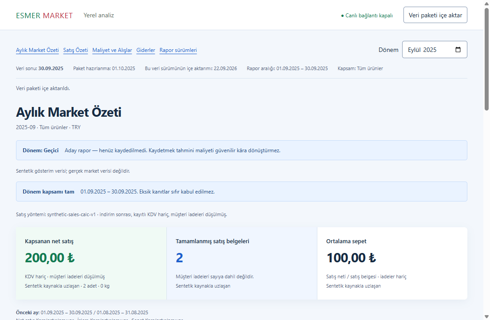
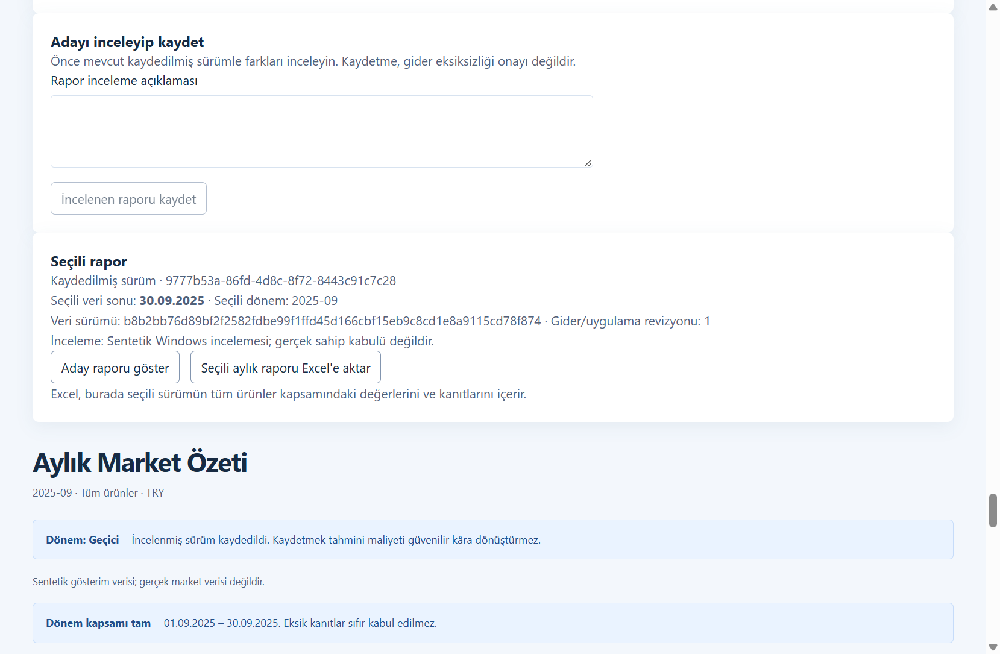
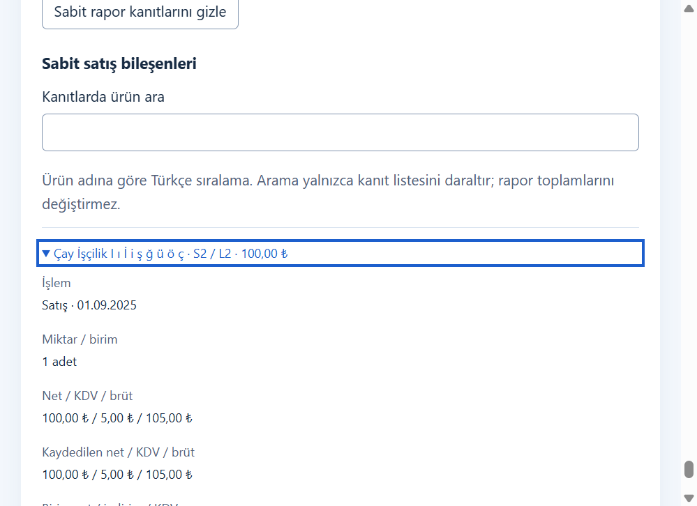

# Phase 8 Windows verification

Windows continuation of [issue #11](https://github.com/AlesSystems/esmer-market-analytics/issues/11), Tasks 8.1 and 8.2, on `codex/phase-8-reporting` in [PR #22](https://github.com/AlesSystems/esmer-market-analytics/pull/22). The tested application source is `98a540a4f681b2909af45ef7b66bed10617c9009`. This continuation adds repeatable verification and evidence. It changes no application code, schema, dependencies or financial rules.

Verification commits are `cf2446011e2e6b372b1f56958cf6683d7883c405` for the installer guard contract and `f78d646b50f5ce1e74f0cdb1cd147da0526c35bf` for the guarded probes. The evidence follows in a separate documentation commit.

The synthetic Windows reporting and export checks passed. The two-second performance gate remains unmet. A 25,000-document synthetic report took about 59 seconds to calculate. This is not complete A03/A07 acceptance, a real-source validation or an owner acceptance record.

## Environment and artifacts

Tests ran on 22 September 2026 on Windows 11 Pro 25H2, build 26200.9457, x64, Intel Core i9-12900H and 33,974,288,384 bytes RAM. Development used Node 24.19.0, npm 10.9.3 and PowerShell 7.6.6. The packaged runtime reports Electron 44.3.0, Node 24.20.0, Chromium 152.0.7977.78 and SQLite 3.53.4. Microsoft Excel reports 16.0.15128.20246.

The active external display was 2560 × 1440. Windows Settings selected actual 100%, 125% and 150% scaling. Electron independently reported each scale; no Chromium scale override was used. The initial 100% setting was restored after testing.

| Artifact | SHA-256 |
| --- | --- |
| `release/Esmer Market Analytics 0.1.0.exe` | `815592da8761d2e43db782ebeb39442fc852e54ab702d30e78d2b4c2b0ce108c` |
| `release/Esmer Market Analytics Setup 0.1.0.exe` | `9410ee2faaf6d5e61c552cfd0c55890eea0bbee991cd324b39afa954b51636b4` |
| `release/win-unpacked/resources/app.asar` | `4c966a6aec7da48cf49aa859c8a1af0bc45a457d9434c8256a0d02cfcdd9a4a5` |

Both distribution executables are unsigned. The package inventory checked 305 archive entries and 81 distribution files, with no inventory issues. Seven shipped dependency notices passed. These checks do not establish downloaded-installer SmartScreen behavior.

Raw logs, profiles, workbooks and JSON receipts remain under ignored `work/windows-phase-8`. The [reduced proof](windows-phase-8-proof.json) retains fixture identities, measurements and assertions. [Repeatable tools](windows-phase-8-tools/README.md) describe substitutions and isolated paths. Excel workbooks stay outside Git because Excel can add local author metadata.

## Commands and expected results

All application commands used the locked Node 24 runtime. The initial `npm ci` invoked the host's unsupported Node 22 before the task-local npm wrapper was corrected. A subsequent Node 24 `npm ci` installed 410 packages with zero audit vulnerabilities. The first invocation is a toolchain setup mistake, not a failed application assertion.

| Procedure | Expected | Observed | Raw evidence |
| --- | --- | --- | --- |
| `npm run typecheck` and `npm run lint` | Exit 0 | Passed | `typecheck.log`, `lint.log` |
| Focused report revisions integration | Preserve reviewed objects and compare changes | 5 passed | `revisions.log` |
| Focused Excel integration | Frozen identity, exact decimals, safe text, blanks | 4 passed | `excel.log` |
| Focused desktop boundary integration | Named validated operations and safe export | 14 passed | `boundary.log` |
| `npm run test:unit` | All unit contracts pass | 29 passed | `unit.log` |
| `npm run test:integration` | All integration contracts pass | 175 passed | `integration.log` |
| `npm run test:desktop` | Actual packaged Windows application passes | 20 passed | `desktop.log` |
| `npm run package:win` | Build NSIS and portable, check notices | Exit 0, 7 dependency notices | `package-win.log` |
| Release inventory | No forbidden development/private payloads | No issues | `package-inventory.json` |
| Final `npm test` and lint | Full Windows suite remains green | 29 unit, 175 integration, 20 packaged desktop; lint exit 0 | `test-final.log`, `lint-final.log`, `final-checks.json` |

The desktop suite exercises monthly overview, unavailable states, sales, purchasing, expenses and startup. It includes actual packaged shutdown. The macOS shutdown timeout did not recur in the Windows suite or the passing packaged proof runs. No committed timeout was increased.

## Reporting, revisions and native export

The native fixture has two sales of 100 and one supported historical cost of 60. The independent expected values are net sales 200, covered estimated gross 100 minus 60 equals 40, and unavailable operating profit when completeness is unknown. The packaged review probe adds expense 50. The native fixture identities are in `fixtures.json`; the initial sales package is `6ee3e935e5bbf55db1d0d3bcaceb5508cd2e97c78cad1dcba449babdd6146ef8` and its deletion correction is `060a1421d8246107e5d462fd4d0d33eb09d3f7d1225e5c2375641ba92735bce0`.

| Task/gate | Procedure and expected result | Observed result | Evidence and limit |
| --- | --- | --- | --- |
| 8.1, A03/A05 | Save reviewed monthly output, restart three times, retain values and explanations | Exact accepted object and 200/60/40/50 values persisted | Packaged proof at each scale; synthetic review only |
| 8.1, A03/A04 | Correct source 100 to 120, delete second sale, correct expense 50 to 60; compare candidate without changing accepted output | Accepted values, old Turkish evidence and saved object remained unchanged; comparison included expense difference on a later page | Packaged proof; source semantics remain synthetic |
| 8.2, A03/A05 | Open real native picker and import Turkish path | Package activated successfully | `native-proof.json` |
| 8.2, A03/A07 | Cancel real native save dialog | `Excel kaydı iptal edildi.` with no false success | `native-proof.json` |
| 8.2, A03/A07 | Keep real save dialog open while source correction activates; export selected older report | All 17 sheets retained the original identity and 200/60/40 values | Native save was real; concurrent import picker result was substituted through the existing named operation |
| 8.2, A03/A07 | Save to Turkish folder/filename, then overwrite disposable destination | Native overwrite confirmation appeared and saved correctly | `sentetik-İşçilik/Seçili-İşçilik-Çığ.xlsx`; final hash in workbook verification |
| 8.2, A03/A07 | Open in installed Excel, inspect totals, Save As and read back | No repair prompt; all 17 sheets retained equal values and types, Turkish labels and formula-like text; no generated formulas | `native-workbook-verification.json`; raw Excel file excluded from Git |
| 8.2, A03/A07 | Native Excel Save As with fractional/oversized decimals encoded as text | `0.125000000000000001` and `12345678901234567890.123456789` survived exactly, with equal values/types across every sheet | `native-precision-proof.json`; quantities deliberately substituted in a separate compatibility workbook, not a reconciled report fixture |
| 8.2, A03/A07 | Native save to a disposable file held with read/write sharing but no delete sharing; retry after releasing the handle | Atomic replacement failed with `Rapor dosyası kaydedilemedi. Seçili rapor korundu; yeniden deneyin.`; destination hash and accepted object unchanged; retry saved all 17 sheets correctly | `native-save-failure.json`; genuine filesystem lock and native dialog, no write-operation substitution |
| 8.1, A07 | Minimum 680 × 520 window, long Turkish evidence and overflowing comparison table | Horizontal wheel scroll and Enter on focused retained evidence passed | Actual OS scaling proof; screenshots below |
| 8.1, A04/A07 | Cancel large import before activation, navigate, retry; cancel monthly calculation and retry | Active dataset, expense 60 and accepted report preserved; both retries succeeded | Timings below; import cancellation observed during file reading |

The first packaged probe failed because its assertion looked for the expense difference only on the first 100 comparison rows. The probe now pages through all rows. The failed receipt remains in `packaged-1-LRGEJA`; it is not a product regression. Passing runs use unique profiles. No test converts estimates or synthetic review into owner-verified profit.

## Performance and responsiveness

At actual 125% Windows scale, four small-fixture process starts reached the monthly view in 1.382–1.474 seconds. Three warm calls through the named report operation took 3.6–4.0 ms; source-detail calls took 0.8–1.3 ms. Warm values measure operation completion, not a full user-perceived render. Cold means a new process with normal OS filesystem caching.

The large fixture contains 25,000 documents and 25,000 lines, 16,442,389 bytes, SHA-256 `902c301a65750541160e39374d0ba9572d00282d60a9bed94f0d92fe3b5bfaf8`.

| 125% run measurement | Observed |
| --- | --- |
| Import retry | 9.448 s |
| Open sales | 8.256 s |
| Monthly calculation retry | 59.156 s |
| Import cancellation during reading | 25.6 ms |
| Navigation during import | 62.4 ms |
| Monthly cancellation during sales phase | 1.600 s |
| Navigation during calculation | 27.1 ms |

These values leave D18/A07 performance unmet even for this synthetic workload. They do not diagnose a cause or establish full imported-dataset behavior. The 100% run briefly overlapped integration tests and is unsuitable as a quiet timing baseline. The 125% run ran without competing test or installer work. Post-calculation Electron metrics include per-process peak working sets, including about 2.34 million KB for the renderer; they are not a continuously sampled total-app peak.

The separate 150% run confirmed the slow large-fixture behavior. Import took 7.47 seconds, sales 8.30 seconds and monthly calculation 48.57 seconds. Monthly cancellation took 1.205 seconds, with navigation in 40.5 ms. Small-fixture process starts ranged from 1.60 to 2.53 seconds. All four shutdowns completed in 0.13–0.19 seconds. The full receipts retain repeated samples rather than selecting only the fastest result.

## Synthetic screenshots

The screenshots contain synthetic application content only. The minimum-window capture is scrolled to retained evidence, where Enter expands the focused row. The comparison table's separate wheel assertion is recorded in the proof JSON.

## Isolated lifecycle

Task 8.1 and the bounded A04/A07 preservation checks passed. The prior Phase 7 installer SHA-256 is `4f0e812ed64f10f7262079c9c362cd6c172224e4d03da97cd5d8cbfcb44a43b9`, with archive `a1b29602e60fa2903da96efef91cd83d49a5ae9fa5d8b77fec4053534a46f973`. The current installer replaced it in an isolated directory. Both releases identify as 0.1.0, so this is a same-version code upgrade, not a version-number or schema migration test.

Ten launches passed, two each for prior baseline, upgraded installation, current installation with monthly review, portable extraction and reinstallation. Each retained schema 5, expense imports/correction/reversal/restoration, synthetic completeness, accepted output and pinned facts. The current report's independent estimate is covered gross 40 minus expense 50 equals -10. It remained explicitly estimated and provisional. These are synthetic confirmations, not an owner's declaration of complete expenses.

Silent uninstall removed the installed executable. The explicit synthetic profile's database SHA-256 remained `4380493786c32e8c9a7a284c39ab25cd5ccabba39f75f4b6df94f08910f60d25` before uninstall, after uninstall and after reinstall. Both portable and installed launches used a restricted child PATH without the development Node runtime. Per-launch executable/archive hashes and results are retained in the proof. All lifecycle stages exited zero; no product or probe failure occurred. The final isolated installation remains under ignored `work/windows-phase-8/lifecycle/installed` for inspection.

This procedure uses an explicit profile and process-local installer APPDATA. NSIS still writes real registry registrations, shortcuts and a local installer cache. APPDATA is not a sandbox. It does not prove default-profile removal, a separate clean Windows account, failed-upgrade recovery, physical disconnection or power-loss recovery.

Standards review found a repeatability risk after the recorded lifecycle run. NSIS may execute a registered uninstaller outside `/D`. The committed probe now reads both registry views of HKCU/HKLM and refuses any unrelated installation/uninstaller before invoking an installer. Fresh installation refuses all existing registrations. A focused contract initially failed because the guard module did not exist, then passed empty/isolated inputs and five refusal cases after implementation. This is a missing verification guard, not a reproduced application failure. A read-only preflight against the actual host passed with only the expected disposable registration. The previous lifecycle receipts predate this guard; the installer sequence was not repeated after adding it. See `registration-before.log`, `registration-after.log` and `registration-preflight.json`.

Final full-suite rebuild preserved the exact tested archive SHA-256. Subsequent changes are confined to the PowerShell preflight, its focused contract and documentation.

## Remaining acceptance

Physical network disconnection on this build, interactive publisher/downloaded SmartScreen behavior, a separate clean Windows account, failed/versioned upgrades, actual full-volume performance and source-dependent correctness remain open. Browser network blocking is distinct from physical disconnection. Earlier phase human reports are not reused as Phase 8 evidence.

The native failure and precision checks above supplement integration coverage. They do not establish physical disk exhaustion or compatibility with spreadsheet applications other than the recorded Excel version.

Phase 9 recovery, Phase 10 reveal and L01 remain outside this continuation. No real-source inspection, production access, owner contact or deployment occurred. Do not merge or close the issue from this record alone.

## Engineering choices

**Prove It Works** led to actual packaged executables, native dialogs and installed Excel. **Build the Lever** led to committed rerunnable probes with retained receipts. **Model the Domain** led to a fixture/proof record that keeps expected values, actual outcomes, substitutions and limitations together. The performance measurement remains a failed gate rather than being hidden by passing small fixtures.

## Standards review

The review found one P1 repeatability issue in installer registration isolation. It is fixed and the reviewer verified the focused contract and preflight placement. No actionable findings remain. The no-comments/deslop pass found no comments, suppressions or unrelated abstractions to remove.

## Spec review

The separate Spec axis found no actionable discrepancies between the handoff and the recorded Windows evidence. Its reviewer had authored the packaged probe earlier, so this is not a fresh independent review of that script. The Standards reviewer was separate. The final full-suite result and guard disposition were checked afterward. Total remaining findings are zero for Standards and zero for Spec; the expressly unperformed acceptance gates above remain open.
