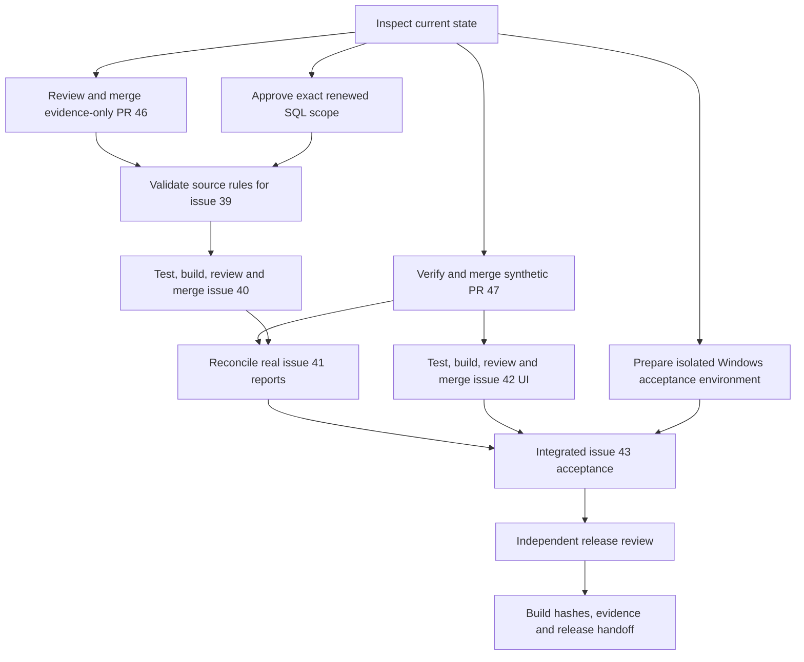

# Prepare Esmer Market for a real-data profit release

Deliver an offline Windows application for Eralp with explainable monthly product profit.
Keep historical cost labelled as an estimate and unsupported financial meanings unavailable.
Continue issues #39, #40, #41, #42, and #43 under trackers #36 and #3.
Reuse PR #46 for recorded source evidence and PR #47 for synthetic reports.
This document is an execution checklist for those issues, not a replacement roadmap.
Execution began on 2026-10-01. Current receipts and blocked gates are recorded in [execution/status.md](execution/status.md). No release acceptance is claimed until the named gates pass.

## How to read this

One box is one unit of work. Every box names the evidence that checks it. Check a box only when its evidence exists. Record the commit, build hash, fixture or opaque source-batch ID, environment, procedure, expected result, actual result, artifact path, and limitations.

The program runs `pstack/skills/poteto-mode/playbooks/orchestrate.md` through the [Codex adapter](/Users/altanesmer/agent-library/skills/also/poteto-mode/references/codex.md). Use Feature for implementation, Babysit in drive mode for merge readiness, and Shipping for independently verified merges. Use the pinned bundle, never a project-local imitation of pstack.

The user has authorized implementation, testing, PR creation, and merging. The coordinator may merge qualifying PRs without asking for that permission again. The user has now directed execution of this plan. The user subsequently authorized bounded inspection of the retained isolated backup and gave full permission to complete the non-Windows gates. The reviewed R39 scope and private evidence boundaries still apply; routine inspection setup needs no repeated permission. Windows checks remain assigned to the user. Owner contact, installation on Eralp's computer, public distribution, and production rollout require separate direction.

Tests alone are not sufficient verification. A PR is verified only when its unit, live, and perf boxes are all checked.

Read [graph.json](graph.json) for work contracts and current states. Read [planning-evidence.md](planning-evidence.md) for the planning audit and [decisions.tsv](decisions.tsv) for decisions. GitHub issues remain the delivery authority. Local state is a resumable execution record.

## Program checklist

### Arm the program

- [ ] Read this plan and the task acceptance predicate. Complete the five remaining issues only when their real-data gates pass, merge verified changes, and produce one identified Windows release candidate with all applicable A01 through A07 evidence. Keep L01 outside the first release. The user will personally run Windows checks, as confirmed on 2026-10-01.
- [ ] Recheck `git status --short --branch`, `git worktree list`, and GitHub issue comments, labels, PR heads, checks, and reviews. Preserve the user's changes in `src/ui/App.tsx` and `tests/desktop/startup.test.ts`.
- [ ] Use an exclusive managed worktree for each writer. Inspect existing worktrees before creating one. Base new work on current `origin/main`; do not reset, stash, or update the dirty main checkout as a side effect.
- [ ] At the start and each checkpoint, read pinned workflow files. Read the wrapper, adapter, Orchestrate, swarm, how, control-ui, control-cli, opening-a-pr, deslop, no-comments, technical-writing, and show-me-your-work as they become applicable.
- [ ] Keep the decision trail and graph current. Skip native goal creation and a 30-minute heartbeat because neither was requested. No unattended continuation across a restart is promised. Send a status message on material progress, blockers, and handoff.
- [ ] Prepare the existing Poteto helper outside skill/cache directories if it is unavailable. Run `python3 /Users/altanesmer/agent-library/skills/also/poteto-mode/scripts/poteto.py prepare --work-dir /tmp/esmer-market-poteto-plan-20261001`. Read `orch --help` through the adapter before initializing a task-local execution store. Use its unit, inbox, and verdict ledger operations. Do not add an application orchestration framework.
- [ ] On a pause, stop writers and record branch, SHA, node state, artifacts, and next ready nodes. On resumption, check liveness and GitHub heads before dispatch.

### Spawn owners

- [ ] Follow the graph below and the contracts in `graph.json`. Start a node only after all predecessors complete. `blocked` names an unmet permission, evidence, or environment requirement. A failed test creates a repair and retest dependency before review resumes.
- [ ] Use one worker per active write scope and an independent reviewer for each PR. Use `worker` with `gpt-6.1-sol` low and `reviewer` with `gpt-6.1-sol` high. The host supports four total active agents, including the coordinator. Ten verification lanes are logical scenarios run in bounded waves, not ten concurrent agents. Disclose the single model family.
- [ ] Pass each delegate its node contract, wrapper and adapter paths, leaf prompt, exclusive worktree, allowed files, upstream decisions, literal expected results, commands, and artifact locations. Keep private rows and credentials out of briefs.
- [ ] Start R47 synthetic reporting review and R39 scope preparation independently after BASE. R42 synthetic UI follows R47. R40 financial mapping follows validated R39. R41 real reconciliation follows R40 and R47. R43 joins the real report, UI, and Windows environment paths.
- [ ] Serialize integration and overlapping edits in `src/reports/**`, `src/store/**`, `src/service/**`, and shared desktop contracts. A branch owner may work independently, but integrate only one PR at a time. Do not treat #46 and #47 as a stack; both currently target main independently.
- [ ] Record a throughput checkpoint after the first verified behavioral unit. Compare actual review/test time and conflict cost with the next unit. Keep one coordinator, at most two writers plus available review capacity, and no sub-coordinator. Source investigation and Windows access have unknown lead time, so make no completion-date promise.

### PR mechanics, for every PR

- [ ] Use `gh` for tracker and PR operations as required by `docs/agents/issue-tracker.md`. Reuse #46 and #47. New PR numbers remain unassigned until GitHub creates them. R39, R40, R41, R42, and R43 below are local work-unit IDs, not invented PR numbers.
- [ ] Review #46 as a documentation prerequisite. Check its four changed files, local links, privacy boundaries, and evidence claims at its current head. Merge only after an independent docs verdict. Record that #39 remains open. Runtime lane matrices do not apply to this evidence-only PR.
- [ ] Preserve small Conventional Commits. First expose a missing behavioral contract with a focused failing test, then implement the smallest fix, then add boundary coverage and evidence where needed. Record toolchain failures separately from application failures.
- [ ] Run deslop before commits and no-comments before code review. For docs-only changes, check the diff and links instead of rerunning the application suite. Do not modify unrelated comments or files.
- [ ] Run focused tests, `npm run typecheck`, `npm run lint`, and `npm run build` for application changes. Run relevant integration and packaged-desktop checks before declaring the unit complete. Do not install new test frameworks.
- [ ] Open a reviewable PR when its intended behavior is verified. Link the issue, P02 through P06 task, approved contract, evidence, and risks. Explain schema, security, privacy, and deployment impacts. Use a body file for multiline text and attach every created or continued PR to its execution chat.
- [ ] Triage all review and automated security findings against the code. Record fixes or evidenced dismissals. Missing GitHub checks or reviews are not a pass.

### Verdict and merge, for every PR

- [ ] At the candidate head, obtain an independent verdict against the diff, test receipts, live scenarios, and performance evidence. Record head SHA, base SHA, and stable patch ID. Self-reported success alone does not permit merge.
- [ ] Show screenshots and a short video for changed interactions. R42 is the main UI review gate. R40 and R43 also require visual evidence where their existing workflows change. This evidence obligation does not add a repeated merge-permission request. Ask the developer only if a concrete change conflicts with the approved contract or requires a new product decision.
- [ ] Preserve detailed commits using the repository's supported non-squash merge method. If repository settings prevent that, record the conflict before choosing a different history policy. Do not force-push a shared branch.
- [ ] Refresh the base and reconcile changes only in the owned worktree. A changed head invalidates runtime receipts. If the patch ID is unchanged, retain applicable code-review findings but rerun current-head checks and the affected packaged behavior after integration.
- [ ] Merge only one independently verified PR at a time. Confirm its merge SHA on main, then recompute dependencies. Partial synthetic or evidence-only merges cannot close a real-data issue.

### Boot recipe, for every live lane

- [ ] On the tested host, read `package.json`, use Node 24 within the declared engine range and `npm ci`, and record OS, architecture, hardware, runtime, branch, and full SHA. Give each lane an isolated app profile and disposable output directory.
- [ ] Use `npm run test:desktop -- tests/desktop/<selected-file>.test.ts` for packaged Electron behavior. The existing wrapper rebuilds `package:local` before Playwright. Record the executable actually exercised, rather than assuming it matches a previously built installer. On macOS ARM64, set `ESMER_EXECUTABLE="$PWD/release/mac-arm64/Esmer Market Analytics.app/Contents/MacOS/Esmer Market Analytics"` for packaged test commands. Do not count the Windows-only full-dataset skip as a local performance result.
- [ ] Use the existing Playwright Electron controls through control-ui and existing CLI entry points through control-cli. Diagnostic IPC calls supplement interaction checks; they do not replace an owner-facing journey.
- [ ] For Windows, run `npm run package:win`, retain hashes for the NSIS, portable, and unpacked artifacts, and use `ESMER_EXECUTABLE` with the existing tests for the exact installed or portable executable. Recheck hashes after any rebuild. Account for every conditional skip.
- [ ] Run each trunk/head comparison against the same fixture, host, profile policy, and condition. If trunk lacks the new feature, state that fact and measure shared work separately from added work and the final visible state.
- [ ] Save lane artifacts under a restricted evidence root keyed by work-unit and SHA. Public screenshots and videos use synthetic data only. Real rows, exact-value reconciliations, credentials, and source locators remain private, referenced by opaque identity. A PNG name below denotes a synthetic screen; retain associated timing or assertion logs beside it. Synthetic screenshots do not prove real execution. Judge real-data lanes by the restricted receipts and independent expected results, with only opaque evidence references in public output.
- [ ] For unchanged ordinary interactions, first measure trunk and then run five interleaved trunk/head observations with cold/warm labels. Fail if any required ordinary Windows interaction reaches two seconds. Investigate a median regression over 20 percent before merge. The 20 percent rule is a proposed engineering guard, not a previously measured source fact.

## Prove the source rules (R39)

**Depends on.** BASE, evidence-only #46, and explicit renewed scope permission. This is issue #39 / P02. Risk is high.

**Files.**

- [ ] Reuse `tools/collect-source-evidence.ts`, `src/source/sql-server.ts`, and `tests/integration/source-evidence.test.ts` for their approved scopes.
- [ ] Update `docs/contracts/source.md`, `calculations.md`, `privacy.md`, and `src/source/contract.ts` only for demonstrated rules. Store public evidence under `docs/evidence/`; retain private receipts outside Git.

**Build.**

- [ ] Write the exact proposed columns, joins, queries, month, dependency closure, source identity, reader, timeout, and output policy before renewed inspection. Existing permission for the September 30 observation pass does not grant expanded unit, product-name, or relationship inspection.
- [ ] Resolve completed sales, types 11/35, other supported sale/return types, void/deletion treatment, converted documents, stable identities, and join cardinality. Resolve business dates, TRY, units/multipliers, discounts, recorded KDV, cost basis, documented zero, and original-sale attribution.
- [ ] Use independent source documentation or reviewed examples plus literal decimal expectations. A raw SUM match, nonzero cost, plausible field name, or current price cannot establish meaning. Fetch only approved earlier-period dependencies.
- [ ] Publish a per-rule capability matrix with source provenance, included/excluded counts, nullable measurable exposure, expected/actual results, and unresolved dependencies. Keep unsupported metrics disabled. Do not enable a month globally because a sample matches.

**You see.**

- [ ] A reviewer can explain each enabled rule and reproduce its expected value. If critical semantics remain unproven, #39 and real financial activation remain blocked.

**Verify, unit.** Tests alone are not sufficient verification. A PR is verified only when its unit, live, and perf boxes are all checked.

- [ ] Run `npm run test:integration -- tests/integration/source-evidence.test.ts tests/integration/source-readonly.test.ts tests/integration/source-privacy.test.ts`. Add focused red/green tests only when a demonstrated mapping changes behavior.

**Verify, live.** Tests alone are not sufficient verification. A PR is verified only when its unit, live, and perf boxes are all checked. Ten lanes on the configured Codex worker model at the PR head, per the boot recipe.

- [ ] Lane 1. Regression lane against trunk. Exercise recorded-row display with the same synthetic input on trunk and head. Save `R39/lane-01.png`. Pass when the existing raw values and labels remain unchanged.
- [ ] Lane 2. Run the approved restricted reader lifecycle on the isolated clone and inspect its safe receipt. Save `R39/lane-02.png`. Pass when approved reads succeed and source-write/administration permissions are denied without testing production.
- [ ] Lane 3. Check sale completion and type-11/type-35 examples against independent references. Save `R39/lane-03.png`. Pass when included records have proven economic identity or remain excluded.
- [ ] Lane 4. Check invoice/dispatch and header/line joins. Save `R39/lane-04.png`. Pass when recognized events occur once and orphan or ambiguous links block the affected rule.
- [ ] Lane 5. Check month boundaries and outside-month dependencies. Save `R39/lane-05.png`. Pass when market-local dates are evidenced and dependency rows add no current-month contribution.
- [ ] Lane 6. Check currency, units, and fractional multipliers. Save `R39/lane-06.png`. Pass when TRY and units are proven and unsupported exposure is never guessed.
- [ ] Lane 7. Check discounts, KDV, charges, and rounding examples. Save `R39/lane-07.png`. Pass when line and header values reconcile under an evidenced rule.
- [ ] Lane 8. Check historical cost samples including missing, zero, negative, and conflicting evidence. Save `R39/lane-08.png`. Pass when each unsupported case has its own exclusion and no current-price fallback.
- [ ] Lane 9. Check original-sale and cumulative-return evidence. Save `R39/lane-09.png`. Pass when attribution is supported or return cost is excluded.
- [ ] Lane 10. Inspect the resulting projection and public artifacts with synthetic privacy sentinels. Save `R39/lane-10.png`. Pass when no customer, employee, supplier, unapproved product-name, or secret field escapes.

**Verify, perf.** Tests alone are not sufficient verification. A PR is verified only when its unit, live, and perf boxes are all checked.

- [ ] Metric. Measure common bounded extraction wall time, per-query duration, row/byte count, and cancellation latency at trunk and head. Separately measure any newly approved query.
- [ ] Probe. Run the same approved frozen-clone workload interleaved only after authorization. Use synthetic equivalents for public traces. Keep existing 15-second reader request, 60-second extraction deadline, and 45-second collector bounds unless separately reviewed evidence requires a change.
- [ ] Baseline. Record trunk timings and permitted workload before any reader change. Existing #46 timings establish only that earlier workload.
- [ ] Rule. Fail on a timeout, an unbounded read, a leaked connection, or a proposed query without an explicit bound. Investigate over 20 percent regression on identical work. If added evidence cannot fit reviewed limits, split the bounded evidence procedure before rerunning.

**Review gate.** None. R39 is not review-gated for a new owner interaction. Independent technical and evidence review still applies.

**Merge.**

- [ ] Record an independent passing verdict for the current head and complete review-comment triage.
- [ ] Merge only the demonstrated mapping/evidence contract. Do not close #39 until it supports a meaningful, explicitly scoped financial population with all required rule evidence. Observation-only results cannot unblock R40.

## Import a validated financial SQL population (R40)

**Depends on.** R39-MERGE with a supported financial population. This is issue #40 / P03. Risk is high.

**Files.**

- [ ] Reuse `src/source/contract.ts`, `sql-server.ts`, `sql-package.ts`, `package.ts`, `raw-package.ts`, `src/store/store.ts`, `src/service/worker.ts`, and the existing developer preparation tools.
- [ ] Extend the existing live-mapping, raw-report-readiness, analytics-package, import-activation, import-failures, store-ownership, and recovery tests. Add only the separate financial projection and mapping files that the approved representation needs.

**Build.**

- [ ] Keep `sql-backup-preview-v1` unchanged. Define a separate versioned financial projection from R39; reject unknown fields and unsupported mapping capabilities before persistence. Keep IDs and decimals exact strings.
- [ ] Fit the selected month and approved original-sale/conversion dependencies within measured package, row, memory, and disk budgets. Current 32 MiB and 100,000-record limits are not full-history acceptance. Do not raise them blindly. If they cannot fit, scope and review the smallest streaming or partition change with its own failure tests.
- [ ] Reuse candidate staging, validation, atomic activation, and lineage identity. Preserve preview records, concurrent expenses, adjustments, settings, accepted reports, and recovery. Report per-population warnings without relabelling raw records.
- [ ] Prepare a reviewed, authorized analytics package for offline import. Keep development SQL restoration and credentials out of the delivered application. Production live startup remains disabled.

**You see.**

- [ ] Import activates only a validated financial dataset. Failure keeps the previous dataset usable, and recorded-row browsing continues independently.

**Verify, unit.** Tests alone are not sufficient verification. A PR is verified only when its unit, live, and perf boxes are all checked.

- [ ] Run `npm run test:integration -- tests/integration/live-mapping.test.ts tests/integration/raw-report-readiness.test.ts tests/integration/analytics-package.test.ts tests/integration/import-activation.test.ts tests/integration/import-failures.test.ts tests/integration/store-ownership.test.ts tests/integration/recovery-equivalence.test.ts`. Resolve file names against the execution revision before adding a genuinely missing test.

**Verify, live.** Tests alone are not sufficient verification. A PR is verified only when its unit, live, and perf boxes are all checked. Ten lanes on the configured Codex worker model at the PR head, per the boot recipe.

- [ ] Lane 1. Regression lane against trunk. Import the same synthetic raw-preview package on trunk and head. Save `R40/lane-01.png`. Pass when raw browsing and unsupported-profit labels agree.
- [ ] Lane 2. Import the approved financial package through the native picker. Save `R40/lane-02.png`. Pass when the candidate identity, interval, capabilities, and active dataset match the reviewed manifest.
- [ ] Lane 3. Reimport the same package. Save `R40/lane-03.png`. Pass when no duplicate financial events or app revisions appear.
- [ ] Lane 4. Import an overlapping correction/deletion snapshot. Save `R40/lane-04.png`. Pass when the current source changes once while accepted reports and app-owned records remain intact.
- [ ] Lane 5. Import a different lineage or broken essential ID/reference. Save `R40/lane-05.png`. Pass when activation fails with a useful error and the active dataset survives.
- [ ] Lane 6. Inject a malformed package, unknown field, unsupported mapping, or privacy sentinel. Save `R40/lane-06.png`. Pass when validation rejects unsafe input before activation.
- [ ] Lane 7. Cancel extraction and candidate calculation. Save `R40/lane-07.png`. Pass when resources close and navigation plus the last dataset remain usable.
- [ ] Lane 8. Terminate and restart during staging and activation using disposable profiles. Save `R40/lane-08.png`. Pass when no partial active batch or lost app-owned record appears.
- [ ] Lane 9. Exhaust disposable destination space while an expense is saved during import. Save `R40/lane-09.png`. Pass when failure preserves that expense and the prior coherent dataset.
- [ ] Lane 10. Disconnect SQL after preparation and restart the packaged app offline. Save `R40/lane-10.png`. Pass when reports read the local imported store with no live-source requirement.

**Verify, perf.** Tests alone are not sufficient verification. A PR is verified only when its unit, live, and perf boxes are all checked.

- [ ] Metric. Measure import elapsed time, peak memory, package size, retained disk growth, cancellation latency, and ordinary UI response at trunk and head.
- [ ] Probe. Use `tools/profile-import.ts` with its documented arguments from `docs/operations/profile-import.md` and the same synthetic package, then the approved real package on head. Record added normalization time separately if trunk rejects that mapping.
- [ ] Baseline. Record common-path trunk import and UI measurements first. Record that unsupported real mapping has no comparable trunk success time.
- [ ] Rule. Keep all ordinary Windows interactions below two seconds. Fail if documented resource limits are exceeded, import becomes uncancellable, or interrupted work loses data. Before a larger package change, freeze numeric resource budgets from the measured admitted workload.

**Review gate.** Present working interactions for review. Existing merge authorization remains valid.

- [ ] Save representative screenshot artifacts and a 30 to 60 second synthetic video under `R40/review/`.
- [ ] Present screenshot and video evidence to the operator in chat before merge. Resolve contract conflicts with the developer; preserve any subsequent hold or correction.

**Merge.**

- [ ] Record an independent passing verdict for the current head and complete review-comment triage.
- [ ] Merge after independent financial/import review. Keep #40 open until an authorized real package has passed mapping, privacy, reconciliation, failure, and preservation acceptance.

## Verify and land the existing synthetic reports (R47)

Completed synthetic work. PR #47 merged at `df7387dab8a7c1e9b0caea215cc216e513a57fe9`, reviewed head `328453e1dafc0a5fc8aba72ccc62ffbcafef72e1`. See [execution checkpoint](execution/overview.md), [Standards recheck](execution/r47-standards-recheck.md), [Spec recheck](execution/r47-spec-recheck.md), and [committed verification record](../docs/evidence/issue-41-synthetic-product-profit.md#r47-review-repair-2026-10-01). The verification record distinguishes original measurements from the repaired package; unchanged receipts are not relabelled. Checked boxes here cover local synthetic implementation and evidence only. Windows and real-data obligations remain open.

**Depends on.** BASE and approved #38. Existing PR #47 implements the synthetic part of issue #41 / P04. It does not depend on PR #46. Risk is high.

**Files.**

- [x] Continue PR #47 in its owned worktree. Review `src/analytics/product-profit.ts`, `src/reports/**`, shared desktop contracts, `src/service/worker.ts`, and stored/recovery validation.
- [x] Reuse `tests/unit/product-profit.test.ts`, `tests/desktop/product-profit.test.ts`, report display/revision, Excel, cost-provenance, and recovery-equivalence tests already present on that branch.

**Build.**

- [x] Audit current PR head against `monthly-product-profit-v1` and E01 through E12. Reuse `buildProductProfit`, `monthlyCandidate`, `reportProducts`, and saved v1/v2 output. Fix only demonstrated contract gaps.
- [x] Preserve exact product/day/month sums, nullable unavailable values, known-unit quantities, full-population summary, fixed product paging, pinned evidence, complete exports, and original v1 meanings.
- [x] Rerun current-head verification. The recorded 44 unit, 289 integration, and 34 packaged macOS results are tied to earlier 9d9d356, not a fresh proof of d2a83cb.

**You see.**

- [x] Synthetic product and day totals match the monthly artifact, and saved v1/v2 reports reopen and export without active-data reconstruction.

**Verify, unit.** Tests alone are not sufficient verification. A PR is verified only when its unit, live, and perf boxes are all checked.

- [x] Run `npm run test:unit -- tests/unit/product-profit.test.ts tests/unit/cost-coverage.test.ts tests/unit/return-cost.test.ts tests/unit/decimal-boundaries.test.ts`, relevant report/export/recovery integration files, and `npm run test:desktop -- tests/desktop/product-profit.test.ts`. Run the full unit/integration suites for this cross-module change.

**Verify, live.** Tests alone are not sufficient verification. A PR is verified only when its unit, live, and perf boxes are all checked. Ten lanes on the configured Codex worker model at the PR head, per the boot recipe.

- [x] Lane 1. Regression lane against trunk. Open and export the same accepted v1 report at trunk and head. Save `R47/lane-01.png`. Pass when stored values and meanings remain unchanged.
- [x] Lane 2. Exercise E01 through E03 in the packaged report path. Save `R47/lane-02.png`. Pass when full, return, and partial-cost results equal the independent contract examples.
- [x] Lane 3. Exercise E04 and E05 across month boundaries. Save `R47/lane-03.png`. Pass when returns stay in the return month and unsupported return cost remains excluded.
- [x] Lane 4. Exercise zero, loss, and nonpositive-denominator examples. Save `R47/lane-04.png`. Pass when null, exact zero, and negative values remain distinct.
- [x] Lane 5. Exercise fractional units, changed historical prices, and tiny nonzero amounts. Save `R47/lane-05.png`. Pass when precision is preserved and units are never added together.
- [x] Lane 6. Search, sort, and page more than 100 synthetic products. Save `R47/lane-06.png`. Pass when table rows change while full summary and daily values remain fixed.
- [x] Lane 7. Refresh source/app data during a pinned report session. Save `R47/lane-07.png`. Pass when the report stays coherent and indicates a newer revision.
- [x] Lane 8. Read selected-product evidence and a full document with other products. Save `R47/lane-08.png`. Pass when selected scope and document totals remain separately labelled.
- [x] Lane 9. Save, restart, export, and restore v1/v2 artifacts. Save `R47/lane-09.png`. Pass when the same pinned totals, warnings, and complete rows survive.
- [x] Lane 10. Send invalid product/evidence requests through the protected boundary. Save `R47/lane-10.png`. Pass when unknown keys, invalid sorts, oversize search, bad offsets, and expired identities are rejected.

**Verify, perf.** Tests alone are not sufficient verification. A PR is verified only when its unit, live, and perf boxes are all checked.

- [x] Metric. Measure shared monthly-report open, evidence page, export, and restore time at trunk/head; separately measure added aggregation and product paging.
- [x] Probe. Use the `phase-10-complete-synthetic` fixture construction in `tests/desktop/full-dataset.test.ts`, with 25,000 documents and 25,000 lines. On Windows run that test; on macOS reuse its fixture and packaged controls in a scoped measurement probe because that test skips there. Measure added `buildProductProfit` work separately from the whole monthly request and graph serialization. Use five observations per condition.
- [x] Baseline. Capture trunk v1 timings first. State that trunk has no product-profit report, then record head aggregation and full visible report time separately.
- [x] Rule. For the named 25,000-document fixture, fail R47 merge if any added aggregation sample exceeds 5,000 ms, a cold monthly request exceeds 60,000 ms to a coherent report, or an ordinary product/evidence page reaches 2,000 ms. These are proposed engineering ceilings to verify, not measured results. Keep progress and cancellation responsive during background calculation. Record local macOS results separately and rerun on Windows before platform acceptance. If a ceiling fails, diagnose and repair or record a reviewed budget change before continuing; never mark an unmeasured value passed.

**Review gate.** None. R47 is not review-gated for a new owner interaction. Independent technical and evidence review still applies.

**Merge.**

- [x] Record an independent passing verdict for the current head and complete review-comment triage.
- [x] Revalidate and independently review #47 at its current head before merge. Keep #41 open for R41 and Windows evidence. This PR alone does not implement the owner-facing one-page UI.

## Reconcile product reports with the real financial import (R41)

**Depends on.** R40-MERGE and R47-MERGE. This is the real-data completion of issue #41 / P04. Risk is high.

**Files.**

- [ ] Reuse `src/analytics/product-profit.ts`, `src/reports/**`, source-backed normalization tests, and `docs/evidence/issue-41-synthetic-product-profit.md` as historical context.
- [ ] Add a separate real-reconciliation evidence record under `docs/evidence/` and only focused tests or fixes required by the approved mapping. Store exact real expectations outside Git.

**Build.**

- [ ] Bind an independently reviewed expected-results set to the authorized package, lineage, mapping/calculation version, cutoff, and supported population.
- [ ] Compare normalized lines, product totals, daily totals, monthly totals, excluded exposures, and Excel against independent expectations. Confirm same-period and cross-period returns and costs.
- [ ] Prove accepted artifacts survive a real refresh and remain reproducible. Keep unknown source populations explicit and preserve the gross-estimate meaning. Do not fabricate expense completeness.
- [ ] Fix discrepancies at their source and rerun the affected source/import/report dependencies. Do not change literal expectations merely to match the application.

**You see.**

- [ ] Each enabled real financial amount can be traced to the same reviewed source population and method, with exclusions visible and historical cost still estimated.

**Verify, unit.** Tests alone are not sufficient verification. A PR is verified only when its unit, live, and perf boxes are all checked.

- [ ] Rerun the R47 focused tests plus `tests/integration/cost-provenance.test.ts`, `report-revisions.test.ts`, `excel-report.test.ts`, and `recovery-equivalence.test.ts`. Run a private reconciliation procedure with independently derived expected values and record only its opaque receipt publicly.

**Verify, live.** Tests alone are not sufficient verification. A PR is verified only when its unit, live, and perf boxes are all checked. Ten lanes on the configured Codex worker model at the PR head, per the boot recipe.

- [ ] Lane 1. Regression lane against trunk. Compare the same synthetic report through the integrated real-mapping changes. Save `R41/lane-01.png`. Pass when E01 through E12 still pass with unchanged expected values.
- [ ] Lane 2. Compare representative real supported sales to independent evidence. Save `R41/lane-02.png`. Pass when line, document, and product net amounts agree exactly under the approved rounding rule.
- [ ] Lane 3. Compare a known return to its original-sale evidence. Save `R41/lane-03.png`. Pass when signed sales and cost use the return month and validated original cost.
- [ ] Lane 4. Compare every included daily bucket to the monthly total. Save `R41/lane-04.png`. Pass when the complete daily and product partitions equal the monthly result.
- [ ] Lane 5. Inspect missing and unsupported cost populations. Save `R41/lane-05.png`. Pass when counts and signed exposures agree and no excluded amount is silently zero.
- [ ] Lane 6. Inspect complete empty days and days outside coverage. Save `R41/lane-06.png`. Pass when real zero activity and unknown gaps remain distinct.
- [ ] Lane 7. Filter and page products while checking report identity. Save `R41/lane-07.png`. Pass when financial scope stays all products for the selected month.
- [ ] Lane 8. Export while activating a newer source revision. Save `R41/lane-08.png`. Pass when all workbook sheets use the selected pinned report.
- [ ] Lane 9. Reopen accepted v1 and v2 reports after correction/deletion. Save `R41/lane-09.png`. Pass when old values and explanations remain recoverable.
- [ ] Lane 10. Review no-expense and loss cases with the real-capability policy. Save `R41/lane-10.png`. Pass when gross estimates remain qualified and operating profit is unavailable without its own prerequisites.

**Verify, perf.** Tests alone are not sufficient verification. A PR is verified only when its unit, live, and perf boxes are all checked.

- [ ] Metric. Measure report calculation, ordinary query/drill-down, export, memory, and retained accepted-report size at trunk/head on the same admitted dataset.
- [ ] Probe. Run five interleaved comparisons after R40 merges. Compare independent reconciliation values as well as timings; exclude private values from timing logs.
- [ ] Baseline. Capture the integrated pre-reconciliation trunk measurements and identify the full admitted population, not a smaller convenient sample.
- [ ] Rule. Fail on any financial mismatch or ordinary Windows interaction at or above two seconds. Compare background work separately; fail if it exceeds frozen memory/disk budgets or loses progress/cancellation.

**Review gate.** None. R41 is not review-gated for a new owner interaction. Independent technical and evidence review still applies.

**Merge.**

- [ ] Record an independent passing verdict for the current head and complete review-comment triage.
- [ ] Merge the real reconciliation fixes/evidence only after independent financial review. Close #41 only when both synthetic and real acceptance are met, with Windows evidence linked from R43 if still pending.

## Compose the one-page monthly profit experience (R42)

Synthetic implementation merged as PR #49 at `5a91017728c027732aac5912aab8c4681ba16215`, reviewed head `3219c0cbbb77b10a9af8991fa081d5b2b86dd44b`. [Exact evidence](../docs/evidence/r42-monthly-profit-page.md) and [final review](execution/r42-spec-recheck.md) cover local synthetic verification. The Windows performance box and admitted-real-data rerun remain open; this limited synthetic merge is explicitly allowed by the Merge contract below and does not complete #42 or release acceptance.

**Depends on.** R47-MERGE and the approved #38 composition. Synthetic work can precede R39/R40. Real completion waits for R41 and R43. This is issue #42 / P05. Risk is medium.

**Files.**

- [x] Compose within `src/ui/overview/MonthlyWorkspace.tsx`, `MonthlyOverview.tsx`, `ReportEvidence.tsx`, `src/ui/SalesWorkspace.tsx`, and existing `AppShell` navigation. Add a focused product section only where it reduces duplication.
- [x] Extend the packaged monthly-overview, product-profit, unavailable-states, report-pagination, source-workspace, report-version-comparison, and workspace-subviews tests. Touch `App.tsx` only in an isolated worktree after reconciling the existing user edits.

**Build.**

- [x] Use one existing month selector and one scrolling monthly page. Show scope/cutoff/version, monthly covered result, daily trend, product table, selected-product detail, and evidence in the approved order.
- [x] Show at most three graphs using the same pinned monthly report. Provide numerical/table alternatives, signed loss values, true gaps, Turkish formatting, and visible coverage/exclusions. Reuse existing styling and chart patterns without adding a chart package by default.
- [x] Keep search/sort/page/selection as table state. Preserve the market-wide summary and charts. Match responses by month/report/product, reject stale results, preserve scroll, and restore keyboard focus.
- [x] Retain raw records, expenses, purchasing, import, saved v1/v2 reports, export, and recovery through existing navigation. Preserve empty, unsupported, partial, no-cost, zero, loss, stale, loading, and retry states.

**You see.**

- [x] Eralp can read the monthly result, find a product, and inspect its evidence on one page without losing warnings or changing report scope.

**Verify, unit.** Tests alone are not sufficient verification. A PR is verified only when its unit, live, and perf boxes are all checked.

- [x] First expose the owner journey in `tests/desktop/product-profit.test.ts`. Run it with monthly-overview, unavailable-states, source-workspace, report-pagination, report-version-comparison, and workspace-subviews through `npm run test:desktop -- <files>`. Include Turkish search/sort and late-response behavior.

**Verify, live.** Tests alone are not sufficient verification. A PR is verified only when its unit, live, and perf boxes are all checked. Ten lanes on the configured Codex worker model at the PR head, per the boot recipe.

- [x] Lane 1. Regression lane against trunk. Open the same old monthly and accepted v1 reports on both builds. Save `R42/lane-01.png`. Pass when existing values, navigation, and export remain available.
- [x] Lane 2. Open the full synthetic month and follow summary to product to document. Save `R42/lane-02.png`. Pass when the journey stays on one scrolling page and evidence matches the pinned report.
- [x] Lane 3. Search Turkish text, sort positive/zero/negative/unavailable values, and page 101 or more rows. Save `R42/lane-03.png`. Pass when global ordering is correct and summary/charts remain all products.
- [x] Lane 4. Select a product, hide it with search, then return to the table. Save `R42/lane-04.png`. Pass when the selected product identity, hidden-selection explanation, scroll, and focus behave as specified.
- [x] Lane 5. Change months and product selections with delayed responses. Save `R42/lane-05.png`. Pass when old results never overwrite the new selection.
- [x] Lane 6. Exercise partial, unknown-cost, unsupported, and stale inputs. Save `R42/lane-06.png`. Pass when nearby labels explain the missing population and no invented zero appears.
- [x] Lane 7. Exercise empty, genuine zero, loss, return-only, and unknown-day states. Save `R42/lane-07.png`. Pass when the correct amount or unavailable label and graph gaps appear.
- [x] Lane 8. Use keyboard only, 200 percent zoom, and narrow windows. Save `R42/lane-08.png`. Pass when focus stays visible, chart alternatives work, and no essential action is inaccessible.
- [x] Lane 9. Save/export the complete report after table filtering. Save `R42/lane-09.png`. Pass when the stored/exported population remains complete with warnings and version metadata.
- [x] Lane 10. Reach import, expenses, purchasing, raw records, saved reports, and recovery. Save `R42/lane-10.png`. Pass when every existing secondary workflow remains reachable.

**Verify, perf.** Tests alone are not sufficient verification. A PR is verified only when its unit, live, and perf boxes are all checked.

- [x] Metric. Measure same-month opening, search/sort/page, selection-to-detail, DOM size, and response during import at trunk/head.
- [x] Probe. Use existing packaged Playwright and performance tools with the same fixed synthetic workload and later the admitted real dataset. Capture five interleaved observations and screenshots at required states.
- [x] Baseline. Measure trunk monthly navigation and evidence first. For the new product composition, also record time from month change to a coherent visible report.
- [ ] Rule. Require each ordinary interaction below two seconds on documented Windows hardware. Bound product rendering to 100 rows, keep graphs to three, and fail on stale results or blocked navigation. Avoid timing the entire imported graph transfer as if it were service calculation.

**Review gate.** Present working interactions for review. Existing merge authorization remains valid.

- [x] Save representative screenshot artifacts and a 30 to 60 second synthetic video under `R42/review/`.
- [x] Present screenshot and video evidence to the operator in chat before merge. Resolve contract conflicts with the developer; preserve any subsequent hold or correction.

**Merge.**

- [x] Record an independent passing verdict for the current head and complete review-comment triage.
- [x] Merge the independently tested synthetic UI after presenting screenshots/video. Keep #42 real-data/platform completion open until the integrated journey passes R43. Cosmetic preferences do not justify changing the approved financial contract.

## Accept the integrated Windows release candidate (R43)

**Depends on.** R40-MERGE, R41-MERGE, R42-MERGE, and WIN. Existing #47 must already be integrated. This is issue #43 / P06. Risk is high.

**Files.**

- [ ] Reuse Windows and release evidence in `docs/evidence/`, the current release inventory scripts, and existing packaged full-dataset, package-lifecycle, clean-install-restore, and report tests.
- [ ] Update `docs/evidence/release-acceptance.md`, `docs/operations/install-tr.md`, `recovery-tr.md`, `reveal-tr.md`, and `known-limitations-tr.md`. Fix application code only for a reproduced release blocker through a scoped repair PR.

**Build.**

- [ ] Freeze the integrated candidate SHA, Node/dependency lock, authorized dataset identity, cutoff, supported population, target Windows version/hardware, and exact installed/portable artifact hashes.
- [ ] Run the full required suites on Windows. Map each applicable A01 through A07 item to current-build evidence or an explicit block. Reconcile older evidence rather than inheriting its pass status.
- [ ] Exercise independent restore on a clean user/VM or second machine using separately retained backup and key. Test clean/default-profile lifecycle, failed upgrade, physical disconnection, disposable storage exhaustion/removal, and Windows temporary-file permissions.
- [ ] Inspect both distributions for privacy and licences, verify downloaded unsigned-publisher behavior on an isolated acceptance environment, and document real limitations. Keep live access disabled and test without a developer runtime.
- [ ] Prepare the Turkish walkthrough and release manifest. Close the five delivery issues only on evidence. Reconcile #36 and #3, leaving separately gated L01 work open or separately tracked. Do not contact Eralp or install on his computer.

**You see.**

- [ ] One identified installer and portable build complete the real-data offline workflow on Windows, and an independent installation can recover the same accepted reports.

**Verify, unit.** Tests alone are not sufficient verification. A PR is verified only when its unit, live, and perf boxes are all checked.

- [ ] Run `npm run test:unit`, `npm run test:integration`, `npm run typecheck`, `npm run lint`, `npm run build`, `npm run package:win`, and `npm run test:desktop` on Windows. Then test exact installer/portable outputs and record hashes after all rebuilds. Report skipped SQL tests separately and run applicable authorized isolated-source checks.

**Verify, live.** Tests alone are not sufficient verification. A PR is verified only when its unit, live, and perf boxes are all checked. Ten lanes on the configured Codex worker model at the PR head, per the boot recipe.

- [ ] Lane 1. Regression lane against trunk. Run the same load-bearing import, report, export, and recovery journey on the integration base and candidate. Save `R43/lane-01.png`. Pass when new behavior meets the contract and existing app-owned data/report meanings survive.
- [ ] Lane 2. Install and run both NSIS and portable outputs on a clean Windows environment. Save `R43/lane-02.png`. Pass when startup/import/view work without a developer runtime or production connection.
- [ ] Lane 3. Disconnect networking physically and cold-launch/restart the application. Save `R43/lane-03.png`. Pass when the last local dataset, reports, export, and recovery stay usable.
- [ ] Lane 4. Run real reconciliation from month to product/day/line and complete Excel output. Save `R43/lane-04.png`. Pass when all values and excluded populations match independent evidence for the pinned report.
- [ ] Lane 5. Import expenses, preserve provenance, and omit owner completeness confirmation. Save `R43/lane-05.png`. Pass when gross product results remain usable and operating profit is withheld appropriately.
- [ ] Lane 6. Perform versioned upgrade, failed upgrade, uninstall, and reinstall in disposable profiles. Save `R43/lane-06.png`. Pass when documented app-data preservation and rollback succeed.
- [ ] Lane 7. Lose the original profile and OS credential store, then restore on an independent clean installation. Save `R43/lane-07.png`. Pass when separately retained media/key recover expenses, adjustments, v1/v2 reports, and matching exports.
- [ ] Lane 8. Inject bad key, corrupt backup, disk exhaustion, external-media removal, and interrupted operations. Save `R43/lane-08.png`. Pass when the working store and latest good backup survive with useful recovery messages.
- [ ] Lane 9. Use native dialogs, Excel, 100/125/150 percent Windows scaling, 200 percent zoom, and keyboard navigation. Save `R43/lane-09.png`. Pass when Turkish text, precision, accessibility, cancellation, and secondary workflows work.
- [ ] Lane 10. Inspect packaged contents, permissions, licence inventory, startup traffic, and unsigned-download warnings. Save `R43/lane-10.png`. Pass when no private source/secret material or live requirement ships and limitations are accurately documented.

**Verify, perf.** Tests alone are not sufficient verification. A PR is verified only when its unit, live, and perf boxes are all checked.

- [ ] Metric. Measure ordinary dashboard/drill-down times, full admitted import/report/export/recovery duration, peak memory, and disk retention on documented Windows hardware.
- [ ] Probe. Use the existing full-dataset and import-profile tools plus five interleaved base/head runs. Include cold/warm conditions, multiple processes, selected queries, row/byte counts, background cancellation, and the actual authorized workload.
- [ ] Baseline. Measure current integration-base values first. Historical 25,000-document synthetic results are context only; they do not prove full-market capacity.
- [ ] Rule. Every required ordinary dashboard/drill-down sample stays below two seconds. Background work fits recorded resource budgets and stays cancellable/responsive. Any source-safety, privacy, data-loss, required independent-recovery, or financial-reconciliation failure blocks release.

**Review gate.** Present working interactions for review. Existing merge authorization remains valid.

- [ ] Save representative screenshot artifacts and a 30 to 60 second synthetic video under `R43/review/`.
- [ ] Present screenshot and video evidence to the operator in chat before merge. Resolve contract conflicts with the developer; preserve any subsequent hold or correction.

**Merge.**

- [ ] Record an independent passing verdict for the current head and complete review-comment triage.
- [ ] After independent release review, merge verified acceptance changes, rebuild at the merge SHA, and confirm artifact equivalence plus packaged smoke checks. Changed outputs require renewed relevant verification. Report a release-ready candidate only when all applicable gates pass; distribution/owner installation remain a separate direction.

## Close the program

- [ ] Verify every completed node against its artifacts and every merged PR against its reviewed head. Resolve or explicitly retain all blocked nodes. An unavailable source or Windows host cannot become a pass.
- [ ] Reconcile #39 through #43, #36, and #3 with the release acceptance matrix. Do not close an issue using only a synthetic merge or stale checklist.
- [ ] Report branches, commits, PR URLs, merge SHAs, tests and skips, exact build hashes, source/fixture identities, evidence, unresolved limitations, and the next permitted action.
- [ ] Hand over the ready Windows package and Turkish instructions. If an essential gate is still open, identify the bounded usable development capability and the exact blocker; do not claim real-data profit readiness.
- [ ] Preserve independent evidence and the separately retained recovery material. Clean only task-owned temporary profiles/processes. Never delete original backups or unrelated worktrees.

## Appendix A. Prototype evidence

No new prototype or source inspection ran during planning. P01 is already approved and includes a static synthetic composition sketch at `docs/diagrams/monthly-product-profit.html` on main `9923427`. R42 must prove it as a working packaged journey before cosmetic refinement.

PR #46 is open at `85d4645555cdac4fc0a244152837cf8904d5a39e` and records observations only. PR #47 is open at `d2a83cb` and contains the synthetic report contract implementation. Both were checked on 2026-10-01. Their states and SHAs must be refreshed at execution.

Unproven facts remain sale completion/economic identity, financial units and multipliers, tax/discount basis, historical-cost semantics, return attribution, real-population reconciliation, and the final Windows/recovery/full-volume gates. Synthetic prototyping cannot answer source-semantic questions.

## Appendix B. Alternatives rejected

Rebuilding the reporting stack would duplicate PR #47 and the existing calculator, pinned reports, paging, export, and recovery. Continue the current implementation.

Converting raw SQL rows into financial data by renaming fields would cross the recorded-row boundary without evidence. Keep a separate financial mapping.

A UI-only release would leave the financial blocker unresolved. Synthetic UI work is useful parallel progress, but does not pass the release gate.

A new scheduler, chart framework, report engine, live sync service, or broad source replication would add maintenance without satisfying a missing contract. Reuse the existing Poteto helper and application tools. Introduce a dependency only after a concrete gap and licence/Windows review.

Waiting for #39 before doing any work would stall independent synthetic reporting/UI verification. Conversely, closing #41 or #42 after only synthetic work would erase their real-data obligations.

## Appendix C. Risks

| Risk | Work unit | Required response |
| --- | --- | --- |
| Insufficient independent source meaning | R39 | Request exact missing scope/evidence from the developer, retain exclusions, and continue independent synthetic work. Never invent semantics. |
| Existing local UI/startup changes | BASE, R42 | Preserve the dirty main checkout and reconcile only reviewed changes in an isolated worktree. |
| Old receipts do not describe current PR head | R47, all merges | Bind reviews and executable receipts to current SHAs and artifact hashes. |
| Unsupported populations contaminate a supported result | R39, R40, R41 | Enforce per-rule capabilities, unknown exposure as null, dependency closure, and explicit scope labels. |
| Full source exceeds package and report limits | R40, R43 | Measure admitted population, bytes, memory, and disk before promising full-volume acceptance. Review capacity changes independently. |
| Same-host recovery mistaken for machine-loss recovery | R43 | Use a clean account/VM or second machine and independently retained key/media. |
| Namespace power loss or physical storage failures remain unproven | R43 | Record filesystem limits and actual failure evidence. Do not claim a guarantee unsupported on Windows. |
| Private data escapes in evidence | All | Public fixtures/screenshots stay synthetic. Keep raw receipts and secrets private with opaque references. |
| Bundled tests rebuild the package | R43 | Hash each tested executable and tie installer/portable evidence to the final artifact. |
| Broad tracker status disagrees with current evidence | R43 | Map old unresolved A01 through A07 obligations to explicit receipts or blocking nodes. Keep L01 separate. |

Developer decisions are requested only at a concrete unresolved fork. The first likely request concerns the exact isolated backup/query scope and independent source evidence. Product-name access is optional; use `Ürün #<productId>` unless a safe display field is separately approved. The approved gross-profit meaning, return-month policy, and three-graph maximum do not need to be asked again. Confirm the target Windows environment when scheduling its actual acceptance. No source locators or secrets belong in public planning documents.

## Appendix D. Links and reading list

- [Foundation specification](../docs/superpowers/specs/2026-09-04-esmer-market-rebuild-design.md), [database audit](../docs/superpowers/specs/2026-09-04-esmer-market-rebuild-audit.md), [acceptance checklist](../docs/superpowers/specs/2026-09-04-esmer-market-rebuild-acceptance.md), and [implementation plan](../docs/superpowers/plans/esmer-market-implementation-plan.md).
- [Approved monthly product-profit contract on main](https://github.com/AlesSystems/esmer-market-analytics/blob/9923427afa1716105b5ced224783bfa6189cccfe/docs/contracts/monthly-product-profit.md). This is newer than the dirty local main checkout.
- [Recorded-row workstream plan](https://github.com/AlesSystems/AlesSystems-Workstreams/blob/main/Esmer%20Market%20Analytics/plans/2026-09-26-live-and-backup-display.md). Read before editing SQL live-check or backup preparation paths. Check current code where its historical descriptions differ.
- [Source contract](../docs/contracts/source.md), [calculation contract](../docs/contracts/calculations.md), [privacy contract](../docs/contracts/privacy.md), and [release acceptance record](../docs/evidence/release-acceptance.md).
- [Issue #38](https://github.com/AlesSystems/esmer-market-analytics/issues/38), [#39](https://github.com/AlesSystems/esmer-market-analytics/issues/39), [#40](https://github.com/AlesSystems/esmer-market-analytics/issues/40), [#41](https://github.com/AlesSystems/esmer-market-analytics/issues/41), [#42](https://github.com/AlesSystems/esmer-market-analytics/issues/42), [#43](https://github.com/AlesSystems/esmer-market-analytics/issues/43), [tracker #36](https://github.com/AlesSystems/esmer-market-analytics/issues/36), and [tracker #3](https://github.com/AlesSystems/esmer-market-analytics/issues/3).
- [PR #46](https://github.com/AlesSystems/esmer-market-analytics/pull/46) and [PR #47](https://github.com/AlesSystems/esmer-market-analytics/pull/47).
- [Poteto wrapper](/Users/altanesmer/agent-library/skills/also/poteto-mode/SKILL.md) and its pinned `pstack/skills/poteto-mode/playbooks/multi-phase-plan.md`, `orchestrate.md`, and `shipping.md`. All code owners read how. Apply interrogate only to an actually contested design. Read its leaf before use. The decision trail follows show-me-your-work.

The Sequence Work into Verifiable Units principle sets the test, implementation, review, and merge dependencies. Prove It Works keeps synthetic results, source proof, and Windows proof distinct. Guard the Context Window partitions read-only investigation. Encode Lessons in Structure uses the graph checker and existing plan checker instead of a second scheduler.
