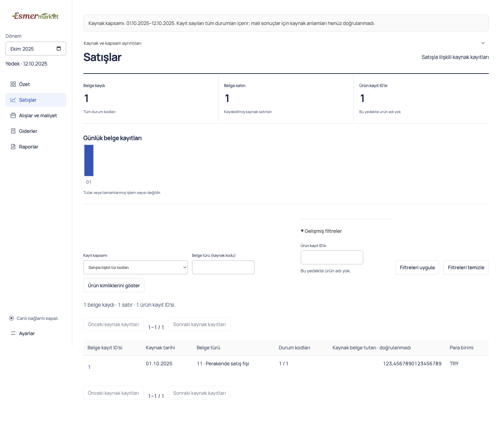
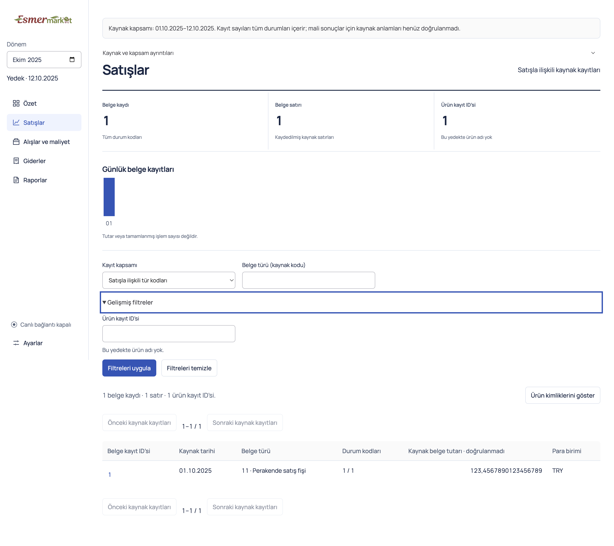

# Source filter layout evidence

The source workspace now presents scope and document type together, advanced product filtering below them, and Apply/Clear together. The document/product view switch sits beside the result counts. The former mixed flex row bottom-aligned short fields against expanded details and split the actions across rows.

This is the user's filtering-section refinement, related to [issue #27](https://github.com/AlesSystems/esmer-market-analytics/issues/27), [plan Tasks 5.2 and 6.2](../../docs/superpowers/plans/esmer-market-implementation-plan.md), and [the page contract](../../docs/contracts/page-control-desks.md). It contributes local usability evidence for A03/A07 without closing their Windows or owner-acceptance gates.

## Build and fixture

- Branch `codex/source-filter-layout`, based on `bfc0108` from `origin/main`.
- Contract commit `bdfecd8`; keyboard/scaling coverage `f974cd5`; implementation `4cd9436`.
- Packaged unsigned macOS application, macOS 27.0 arm64, Node 24.15.0, Electron 44.3.0. The package contains the implementation bytes recorded in `4cd9436`.
- Synthetic `rawSnapshot()` with one sales document and one purchasing document. Lineage `fixture:filter-layout`, extraction `filter-layout-v1`, October 2025. No private backup or production source was opened.
- No schema, IPC, financial calculation, source projection, dependency, credential, or deployment change. Existing `SourceQuery`, draft strings and query handlers remain unchanged.

## Work contracts

The execution graph was recorded before delegation in ignored `work/filter-layout/graph.json`. Writes and packaging were serialized. Each node waits for its predecessor.

| ID | Type | Dependency | Objective and acceptance |
| --- | --- | --- | --- |
| FILTER-01 | Analysis | None | Identify the CSS mechanism and preserve source semantics. |
| FILTER-02 | Test | FILTER-01 | Reproduce in the packaged synthetic app with a screenshot and failing geometry check. |
| FILTER-03 | Implementation | FILTER-02 | Restrict edits to SourceWorkspace and its shared/sales styles; align fields and group actions. |
| FILTER-04 | Test | FILTER-03 | Verify packaged interactions, widths, zoom, screenshots, and project checks. |
| FILTER-05 | Review | FILTER-04 | Independent review has no unresolved actionable findings. |
| FILTER-06 | Documentation | FILTER-05 | Record evidence and open the requested ready PR. |

Risk is low. Inputs are the supplied screenshot, foundation documents, incumbent styles, and existing synthetic desktop fixtures. The lead owned tests and acceptance; one worker owned UI edits; a separate reviewer checked the final diff. Review used one model family.

## Reproduction and verification

The first harness attempt timed out because an exact label selector included native option text. The selector was corrected before recording an application failure. On the unchanged baseline package, the layout assertion then failed with this output.

```text
Error: advanced filters follow both main fields
Expected: >= 790.7265625
Received:    645.4296875
1 failed
```

The focused packaged batch passed ten existing tests. The new test initially assumed the disclosure was closed when switching workspaces; its setup now normalizes that state. Native resize and zoom wait for the actual CSS viewport. Zoom evidence uses Electron capturePage because emulated full-page screenshots crop enlarged content.

Final `ESMER_FILTER_CAPTURE=work/filter-layout/after npm exec -- playwright test tests/desktop/source-filter-layout.test.ts` output was:

```text
1 passed (2.7s)
```

The test checks both destinations at 1440, 1120 and 680 pixels, plus a 390-pixel stress size below the supported minimum, and native 1.3 zoom at 680 pixels. Opening advanced filters preserves field positions and widths; fields precede disclosure; actions follow the hint; there is no page overflow. Keyboard Enter opens the native disclosure and retains focus. The product hint has an accessible description. Invalid IDs disable Apply; a valid maximum-length signed ID shows no matches; Clear restores rows; document/product switching still works.

| Procedure | Actual result |
| --- | --- |
| `npm run test:unit` | 50 passed. |
| `npm run test:integration` | 312 passed; 14 environment-dependent checks skipped. |
| `npm run test:desktop -- tests/desktop/source-filter-layout.test.ts tests/desktop/source-workspace.test.ts tests/desktop/live-tracking.test.ts tests/desktop/sales-control-desk.test.ts tests/desktop/purchasing-control-desk.test.ts tests/desktop/v1-simplicity.test.ts` | Fresh build/package succeeded; 10 existing tests passed. The repaired new check passed separately against that package, for 11 distinct desktop checks. |
| `npm run typecheck`, `npm run lint`, `git diff --check` | Passed after the final test changes. |
| Impeccable layout detector before/after | No findings. Rendered wide/narrow sales and purchasing captures inspected; native zoom capture confirmed. |
| Independent final review and comment audit | No actionable findings; zero comments or suppressions to remove. |

Local raw receipts remain in ignored `work/filter-layout/`. The Poteto Fix Root Causes principle selected structural groups over offsets. Laziness Protocol kept the change to scoped JSX/CSS. Model the Domain preserved the existing typed query. Prove It Works required the packaged interaction and geometry checks.

## Synthetic screenshots

| Before | After |
| --- | --- |
|  |  |

[Narrow purchasing](screenshots/purchasing-narrow.png) and [native enlarged-text sales](screenshots/sales-zoom.png) show the same grouping. The latter captures the visible native viewport; remaining controls are reachable by scrolling.

Windows packaging, installation, scaling, performance and owner acceptance remain unperformed. Continue on this branch with `npm ci`, `npm run package:win`, and `npm run test:desktop -- tests/desktop/source-filter-layout.test.ts tests/desktop/source-workspace.test.ts tests/desktop/live-tracking.test.ts`. Review the supported Windows display/scaling settings and record A07 evidence before closing that gate. No production connection or rollout is authorized by this refinement.
