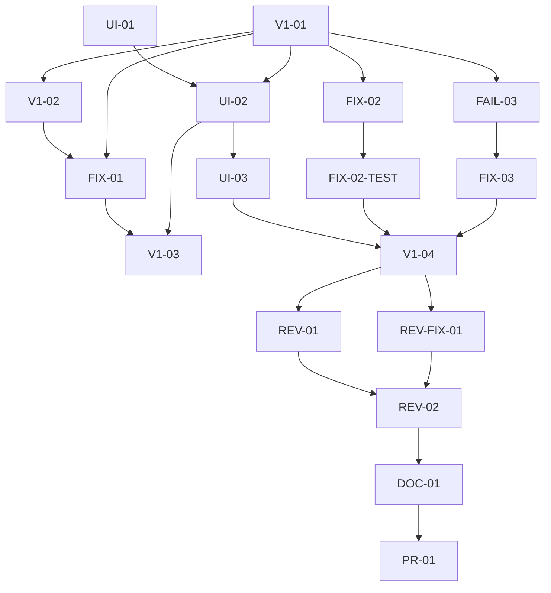

# v1 verification and UI simplicity

## Workflow

- [x] Read the Principles section of the poteto-mode skill.
- [x] Phase A: Frame.
- [x] Phase B: Design the workflow.
- [x] Phase C: Run the loop.
- [x] Ground the v1 contract and map existing verification.
- [x] Capture the packaged macOS baseline and inspect each workspace.
- [x] Simplify redundant UI, preserving source meaning and required tasks.
- [x] Expose and repair any reproducible v1 defects with focused tests.
- [x] Run unit, integration, packaged desktop, typecheck, lint, and build.
- [x] Review the complete diff independently and resolve actionable findings.
- [x] Phase D: Keep the audit trail.
- [x] Phase E: Verify and hand back.
- [x] Create a PR with evidence and unresolved acceptance gates.

## Scope and done predicate

Verify the current v1 application using synthetic data on macOS. All existing
workspaces, local persistence, imports, report versions, recovery, IPC boundaries,
and synthetic SQL tracking are in scope. No production access or renewed private
source inspection is authorized. Windows checks are explicitly excluded.

Done means every applicable repository check passes, identified defects have
focused regression evidence, the packaged UI has a bounded before/after review,
an independent review has no unresolved blocking findings, and a PR records the
results and open gates. Passing macOS checks does not complete Windows or owner
acceptance gates.

Use existing data models and UI components. Remove duplicate copy and decorative
complexity while preserving Turkish labels, uncertainty, record provenance,
financial safeguards, navigation, and accessibility. The user selected removal of decorative 3D elements; native tasks remain.

## Work contracts

| ID | Type | Objective | Dependencies | Allowed area and artifact | Acceptance and verification | Risk | State |
| --- | --- | --- | --- | --- | --- | --- | --- |
| V1-01 | analysis | Map v1 requirements, current implementation, and gates | none | Read-only application, foundation docs, issue comments; system-audit.md | Cite current paths and identify uncovered or unresolved requirements | medium | completed |
| UI-01 | analysis | Inspect every workspace and record subtraction decisions | none | Read-only UI and packaged app; baseline screenshots and ui-audit.md | Real packaged captures, clear retained tasks and proposed cuts | low | completed |
| V1-02 | test | Run baseline unit and integration checks | V1-01 | Logs outside Git | Record actual failures separately from toolchain failures | medium | completed |
| UI-02 | implementation | Apply the selected UI simplification | V1-01, UI-01 | src/ui, affected desktop tests; focused coherent commits | Required tasks and states remain accessible; focused checks pass | medium | completed |
| FIX-01 | implementation | Repair reproduced system defects, if any | V1-01, V1-02 | Only areas supported by observed defects | Focused behavioral test fails before and passes after each fix | medium | completed |
| FIX-02 | implementation | Repair observed current-asset release allowlist gaps | V1-01 | tools/release-inventory.ts, focused integration tests | Exact shipped assets pass; unknown files and secret sentinels still fail | medium | completed |
| FIX-02-TEST | test | Verify the release-validator repair independently of Windows runtime | FIX-02 | Synthetic unpacked fixtures, focused logs | Focused red/green and typecheck/lint pass; no broader platform acceptance claimed | medium | completed |
| V1-03 | test | Verify integrated application | UI-02, FIX-01 | Existing test/build scripts, evidence | Unit, integration, packaged desktop, typecheck, lint, build pass on macOS | medium | failed |
| UI-03 | test | Confirm simplified UI once | UI-02 | Packaged captures, mechanical detector | Inspect all affected pages and sizes in one round; at most one repair confirmation | low | completed |
| FAIL-03 | analysis | Diagnose full-suite launch failures | V1-01 | full-suite.log and existing desktop harness | Confirm four failures are Windows-only default paths; preserve the failed receipt | low | completed |
| FIX-03 | implementation | Resolve the local packaged executable in failing checks | FAIL-03 | Three affected desktop tests | macOS uses local package; explicit executable overrides and Windows-only skips retained | low | completed |
| V1-04 | test | Accept integrated verification after harness repair | FIX-03, FIX-02-TEST, UI-03 | Existing full-suite receipt and focused re-test | All applicable checks have passing evidence; record original four failures and eight exclusions | medium | completed |
| REV-01 | review | Review patch, requirements, and evidence independently | V1-04 | Read-only diff; review artifact | Resolve blocking findings; distinguish platform and source evidence gaps | medium | completed |
| REV-FIX-01 | implementation | Consolidate the duplicated packaged executable policy | V1-04 | Four changed desktop files and one test helper | Same platform paths and overrides; six packaged checks pass | low | completed |
| REV-02 | review | Confirm the narrow review repair | REV-01, REV-FIX-01 | Read-only resolver delta | Both axes accept the changed helper/callers without new findings | low | completed |
| DOC-01 | documentation | Record acceptance and decision evidence | REV-02 | workstreams/v1-verification | Commands, environment, fixture identities, expected/actual, paths and limitations | low | completed |
| PR-01 | integration | Commit and publish reviewable PR | DOC-01 | Current branch codex/live-mock-tracking | Verified remote, coherent Conventional Commits, PR attached | medium | completed |

## Scheduling and throughput

The parent coordinates UI writes and Git integration; workers may commit their assigned coherent changes. One read-only delegate audits system requirements and another audits UI structure. They write only their own audit files. A worker owns disjoint ledger components and tests; a second worker owns the reproduced report-comparison fix. Run packaged application checks serially because they share build
output and fixtures. Start review only after implementation and verification.
Independent reviews use the same available model family, not a cross-family panel.

The highest uncertainty is current v1 coverage and runtime behavior. Resolve that
before cuts. Existing harnesses are the verification artifact; no new framework
or later-phase feature is needed. Scale effort to observed failures.

## Failure and repair receipts

V1-03 failed on four test-launch defaults pointing to a Windows executable on macOS. Its other results were 50 unit, 324 integration, and 72 packaged desktop passes, including actual five-minute SQL polling; eight Windows/private opt-ins were skipped. FAIL-03 diagnosed these as harness-path failures before FIX-03. V1-04 will reuse those successful results and re-run the four affected checks after the repair; no application behavior changed for FIX-03.

REV-FIX-01 responds to the Standards reviewer’s nonblocking duplicated-resolver finding. It consolidates only the four already changed desktop files. Wider baseline test migration is outside this patch.

## Published handoff

[PR #63](https://github.com/AlesSystems/esmer-market-analytics/pull/63) targets `main` from `codex/live-mock-tracking` and is attached to the chat. Application checks, documentation links and screenshot hashes pass. The original failed suite receipt remains recorded. V1-03 retains its failed state; V1-04 is the successful repair acceptance. All required downstream nodes are complete. Windows/private-source exclusions and owner/production gates remain open.
